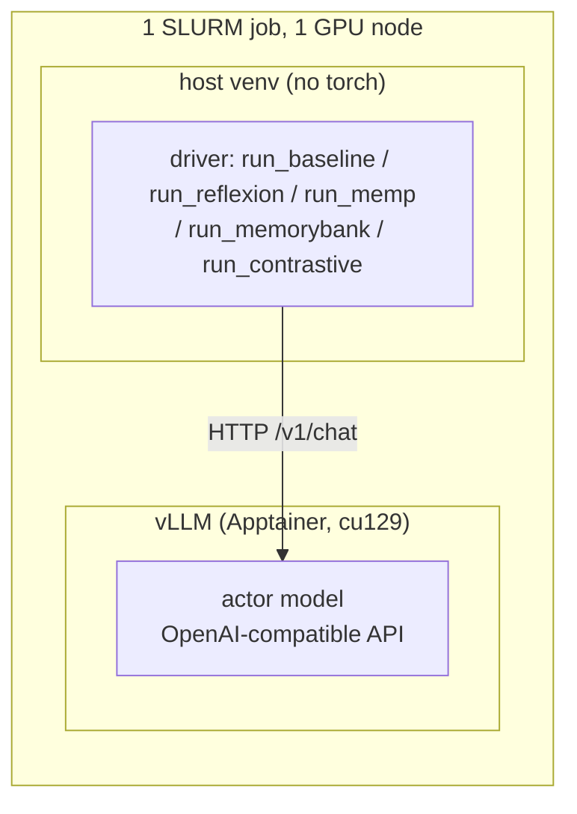

# Do memory-augmented LLM agents reason better?

Bachelor thesis. Three published memory architectures — **Reflexion** (episodic),
**MemP** (procedural) and **MemoryBank** (declarative) — re-implemented on one shared
harness and measured against a memoryless baseline on two reasoning benchmarks, across
three actor models spanning 0.6B to 120B parameters. Plus a fourth, **Contrastive** —
built here rather than ported — which banks *what to do* from the actor's successes and
*what not to do* from its failures, and tests the negative half against the gold-path
procedure the other methods use in its place.

The question is not "does memory help on average" but **what the active ingredient
actually is**. Every method is run with its own paper-faithful configuration *and* with a
matched control that keeps everything except the thing the method claims is load-bearing —
a trial-matched no-memory arm for Reflexion, random-instead-of-retrieved memory for the
two cross-task methods, and a rule-grounding ablation on the memory content itself.

> **Status (2026-09-16):** **SPaRC is complete** across all 3 ported methods × 3 models
> (~546 GPU-h) and written up. **StepGame is complete** on the two measurable actors —
> gpt-oss-120b was dropped by a pre-registered ceiling gate, not by omission. **Contrastive
> is complete on both benchmarks**, pre-registered before submission; two repair re-makes
> are still in flight. **LogicGame is dropped** — the published set ships no answer key.
> See [Status](#status).

---

## Headline findings

Three results replicate across all three ported memory architectures on SPaRC, and they
are the spine of the thesis. StepGame then tests them on a second task shape, and
[agrees on the mechanism while disagreeing on the effect size](#stepgame-a-second-task-shape).

**1. Memory needs a competent actor.** On SPaRC the sign of the effect is a property of
the model, not of the method. Every method helps gpt-oss-120b and does nothing measurable
on Qwen3-0.6B, while on Qwen3-32B **no arm of any method ever beats its own SPaRC
baseline** — and several are significantly *worse*, every MemP configuration among them.
"Memory improves agents" is not a claim that survives a change of actor. It does not
survive a change of *task* either: the same Qwen3-32B gains **+162** on StepGame.

**2. Relevance does not matter.** Retrieved memory is statistically indistinguishable
from *randomly chosen* memory in every one of the paired contrasts — for both MemP and
MemoryBank, at every granularity, on both benchmarks — and random scored numerically
higher in several. This is not a broken retriever: on SPaRC the retrieved arm injects
cases matching the test puzzle's exact rule set 65.2% of the time against random's 2.4%.
Relevance was achieved; it simply did not convert.

**2b. Neither does the *sign* of the memory.** The fourth method banks *what to do* from
the actor's successes and *what not to do* from its failures. Swapping the gold-derived
procedure for a warning drawn from the actual failure — same bank, same retriever, same
*k*, same positive half, token budget matched to 2% — moves accuracy by nothing on
either benchmark (SPaRC p=0.556, StepGame p=0.382, and p=0.480 after both renderer
defects of [§6.6](docs/contrastive.md) were repaired). See
[docs/contrastive.md §6.1](docs/contrastive.md).

**3. Content correctness does not matter either.** The rules-preamble ablation made the
distilled memories dramatically better grounded (correct rule framing 13→51%, 36→88%,
22→62%; the outright rule error 6.9%→0.5–1.2%) and changed accuracy by nothing significant in
any of six paired tests — with the single best arm coming from the *less* rule-correct
bank.

What survives as the active ingredient is not the retriever, not the prose, and not the
memory type, but **the presence of a correct worked example in context** — which puts the
measured effect closer to few-shot prompting than to memory. Supporting this: MemP's and
MemoryBank's banks were found to hold byte-identical trajectories (500/500), so the two
"different memory types" agree to 48 of 53 lines; a *randomly chosen* correct trajectory
recovers two-thirds of the full gain; and StepGame's `fixed` arm — **the same three
entries pasted into every item, no retrieval at all** — still collects +134 of the +162.

The mechanism, where there is one, is **navigational rather than normative**: on SPaRC a
worked example collapses dead-ends (227→152–186) while wrong-solutions *rise* (203→222–256).
A past solution teaches the model to keep making progress, not to obey the rules.

**Both poles of that axis are now measured on one actor.** The contrastive method's
DON'Ts are the mirror image of a worked trajectory — wrong-solutions **−51** (203→152,
more than double the best previous rule-compliance effect) bought with **+46** dead-ends,
against the trajectory's −71 dead-ends bought with +37 wrong-solutions. Neither converts
alone, because each pays for its gain in the other pool. What looked like a property of a
weak actor — Qwen3-32B becoming rule-careful and stall-prone under memory — turns out to
be a property of **normative memory content**, reproducible on the strongest actor by
choosing what the memory says.

### SPaRC at a glance

500 test puzzles, one attempt each, seed 0, `temp 0.6`. Bold = *p* < 0.05 on an exact
McNemar against that actor's own memoryless baseline (paired, same puzzles).

| Actor | Baseline | Reflexion @T10 | MemP (best arm) | MemoryBank (best arm) | Contrastive (method arm) |
|---|---|---|---|---|---|
| Qwen3-0.6B | 14 (2.8%) | 58 vs 50 control, p=0.24 | 19 (+5, p=0.42) | 19 (+5, p=0.38) | — (pre-registered as uninterpretable) |
| Qwen3-32B | 55 (11.0%) | 128 vs 133 control, p=0.56 | 40 (**−15, p=0.036**) | 48 (−7, n.s.) | — |
| gpt-oss-120b | 70 (14.0%) | 179 vs 159 control, **p=0.023** | 105 (**+35, p<0.0001**) | 98 (**+28, p=0.0011**) | 74 (+4, n.s.; control 80) |

Contrastive's column is the `avoid` arm against the memoryless baseline, which is *not*
the test the method is for — its question is `avoid` vs `hindsight` (74 vs 80, p=0.556),
and its predicted effect was in the failure-mode table, not this one. See
[docs/contrastive.md §6](docs/contrastive.md).

Reflexion's column is a *retry* method, so its raw curve rises whether or not memory does
anything — only unsolved puzzles are re-attempted and successes are carried forward. The
comparison shown is therefore against a trial-matched control arm, not against the
baseline. On gpt-oss its entire benefit arrives in the **first** reflection (+4.4pp at T2)
and does not widen over the next eight trials (+4.0pp at T10); trials 3–10 cost ~8 GPU-h
per arm to reproduce what plain resampling does for free.

### StepGame: a second task shape

1000 test items, one attempt each, same seed and sampling. **gpt-oss-120b is absent by
design** — it scores 0.994 and is prompt-invariant on clean StepGame, so there is no
headroom in which to measure memory ([docs/stepgame.md §6 risk 1](docs/stepgame.md); an
adversarial probe confirmed the 99.4% is genuine, §5.1).

| Actor | Baseline | MemP retr. | MemP random | MemP fixed | MemoryBank retr. | Reflexion @T10 (mem vs ctl) |
|---|---|---|---|---|---|---|
| Qwen3-0.6B | 246 (24.6%) | 310 (**+64**) | 287 (**+41**) | 267 (+21) | 308 (**+62**) | 553 vs 576, −2.3pp |
| Qwen3-32B | 733 (73.3%) | 895 (**+162**) | 901 (**+168**) | 867 (**+134**) | 900 (**+167**) | 940 vs 963, **−2.3pp** |

**The headline is the flatness.** For Qwen3-32B, ten memory arms span 0.867–0.901 — a
3.4pp range, *inside* the ~4pp replicate noise floor — against a 0.733 baseline. Retrieval
relevance is null again (MemP retrieved vs random p=0.617; MemoryBank p=0.852), the two
methods are indistinguishable from each other (p=0.712), and contrastive polarity changes
nothing. The only manipulation that moves anything is `fixed`, and it moves *down* (0.867,
p=0.013 vs retrieved) — so **quantity helps slightly and relevance not at all**.

Two things cut against reading the +162 as "memory works here":

- **Reflexion, the one method whose memory carries no gold-derived procedure, is the only
  one that hurts** — its memory arm loses to its own trial-matched control on both actors.
  Consistent with the worked-example reading above: what helps is the demonstration,
  not the recollection.
- **A protocol confound, stated up front.** The campaign runs on `upstream-header` (Li et
  al.'s instruction paragraph, exemplars stripped), which is 13.8 points below our own
  prompt for Qwen3-32B, and about half that gap is *frame inversion* — and 52% of the
  distilled bank entries state exactly the reference-frame convention the prompt omits.
  A material share of every `+150`-class number is **memory re-supplying withheld task
  specification**. Quote the `ours` baseline (0.828) alongside. The contrasts *between*
  arms — where the headline tests live — all share the protocol and are unaffected. See
  the box in [docs/stepgame.md §3.2](docs/stepgame.md).

Full tables — per-difficulty, per-failure-mode, token cost per solve, and every ablation —
are in the per-method docs. §0 of each is regenerated from the result files by a script
rather than maintained by hand.

| Method | Doc | Report generator |
|---|---|---|
| Reflexion (episodic) | [docs/reflexion_results.md](docs/reflexion_results.md) | [scripts/reflexion_report.py](scripts/reflexion_report.py) |
| MemP (procedural) | [docs/memp.md](docs/memp.md) | [scripts/memp_report.py](scripts/memp_report.py) |
| MemoryBank (declarative) | [docs/memorybank.md](docs/memorybank.md) | [scripts/memorybank_report.py](scripts/memorybank_report.py) |
| Contrastive (ours) | [docs/contrastive.md](docs/contrastive.md) | [scripts/contrastive_report.py](scripts/contrastive_report.py) |
| **All methods on StepGame** | [docs/stepgame.md](docs/stepgame.md) | [scripts/stepgame_report.py](scripts/stepgame_report.py) |

The four method docs hold SPaRC; StepGame's numbers for *all* methods live together in
`docs/stepgame.md` §0, because the benchmark's tables differ in shape (no `steps` table,
a by-hops table in its place, no dead-end failure mode).

---

## Status

| Benchmark | Data + harness | Baseline | Reflexion | MemP | MemoryBank | Contrastive |
|---|---|---|---|---|---|---|
| **SPaRC** (interactive grid MDP) | done | done ×3 models | done ×3 | done ×3 + ablations | done ×3 + preamble ablation | done (gpt-oss, 5 arms + repairs) |
| **StepGame** (single-turn text QA) | done, gated | done ×3 + calibration + probe | done ×2 | done ×2 + `fixed` | done ×2 | done (Qwen3-32B, 5 arms + repairs) |
| **LogicGame** | **dropped 2026-09-11** | — | — | — | — | — |

**StepGame actors are Qwen3-0.6B and Qwen3-32B.** The baseline stage was a *gate*, not a
formality: it fired, and gpt-oss-120b was dropped on ceiling grounds before ~20 jobs were
spent on it. Qwen3-0.6B is at the chance floor at depth under this protocol (0.110 at
h≥4, p=0.55), so its depth breakdown is not interpretable — aggregate and h≤3 only.
[docs/stepgame.md §7](docs/stepgame.md) has the milestone table.

**LogicGame is dropped, not pending.** `en_all_304.jsonl` ships no `reference` field;
only the 10 dev items have answers and grading is Codabench-only (5 submissions/day,
six aggregate numbers back). That cannot feed Reflexion's retry set or a paired McNemar,
and the only way in was ~30 h of hand-written per-category verifiers for a 132-item
subset — highest entry cost of the three benchmarks, lowest power. The freed slot went to
depth on SPaRC and StepGame, and to the fourth method. Reopen only if per-item results or
the references are released.

**Open items**, in the order they could still change a conclusion:

1. **Contrastive's `balanced` arm must be re-run** (jobs `15965049`/`15965050`, written to
   `*_v2.json`). `balanced_retrieve` re-sorted picked entries by entry id while
   `retrieve()` returns similarity order, so on the 144 SPaRC items where both arms drew
   the same three entries the arm silently manipulated *presentation order* as well as
   polarity. Fixed in code and pinned by `smoke_contrastive.py`; until the re-run lands
   the polarity question is open. [docs/contrastive.md §6.3](docs/contrastive.md).
2. **Contrastive's SPaRC control at its best** (job `15964887`) — the repaired `hindsight`
   renderer. StepGame's four cells all landed and the null survived the correction
   (0.382 → 0.480); SPaRC's 2×2 is one cell short.
3. **MemP's cross-model transfer arms on SPaRC** were only run at *script* granularity,
   which the campaign then showed to be the inert component. Transfer at *trajectory*
   granularity is the one unrun ported-method contrast that could still move a result.
4. **A `PROMPT_PROTOCOL=ours` re-run of one StepGame arm** would separate "memory repairs
   the prompt" from "memory improves reasoning". It is a one-flag change and every
   artefact is protocol-tagged, so the two can never be paired by accident.
5. **StepGame `noise` variant** — the candidate home for gpt-oss-120b, which clean
   StepGame cannot measure. Pairing clean to noise by file position is invalid
   (`correct.py` removes different items from each); verify before promising it.

---

## How it works

The guiding constraint for the whole project: **every memory method plugs into one shared,
method-agnostic harness**, and only a small, clearly isolated set of pieces is specific to
each method. That is what makes the cross-method comparisons config-matched rather than
four separate experiments — the baseline is not a separate run from Reflexion, it *is*
Reflexion's trial 1, and both of its arms share that one execution.

The model is **served**; the experiment **drives** it over HTTP, so the driver never
depends on CUDA or vLLM:



`scripts/serve_and_run.sbatch` is the single entrypoint for everything. It starts vLLM
from the shared `ag_gipp` Apptainer image, waits for `/health`, smoke-checks it, then runs
a driver selected by the `DRIVER` env knob. A trap frees the GPU on any exit. Adding a
method means adding a `DRIVER` case — not touching the server; Contrastive was added
that way. Adding a *benchmark* means satisfying `Benchmark` and picking a suite runner —
StepGame was added that way, and `regress_sparc.py` proves the completed SPaRC campaign
was not disturbed by it.

**The seams every method reuses**, unchanged:

| Seam | File | Role |
|---|---|---|
| `Memory` (ABC) | [memory/base.py](src/memory_agents/memory/base.py) | `read`/`write`/`save`/`load` — the keyed store each method implements |
| `MemoryAgent` | [agents/memory_agent.py](src/memory_agents/agents/memory_agent.py) | baseline actor + a persistent memory block folded into the system prompt; empty block ⇒ byte-identical to baseline |
| `run_sparc_suite_memory_pass`<br>`run_single_turn_suite` | [harness/run.py](src/memory_agents/harness/run.py) | the concurrent pass over an explicit item set, with a `block_for(id)` callback rendering each item's injected memory — one per benchmark shape |
| `Benchmark` | [benchmarks.py](src/memory_agents/benchmarks.py) | what SPaRC (multi-step MDP) and StepGame (single-turn QA) both satisfy |

Episodes are sequential *inside*, concurrent *across*: a fixed pool of envs handed out
through an `asyncio.Queue`, where the queue **is** the concurrency limiter. Long campaigns
checkpoint atomically after every trial or chunk into a single resumable state file — a
10-trial Reflexion arm is tens of GPU-hours and does not fit one 12 h SLURM job, so `RESUME=<file>`
continuing exactly where it stopped is load-bearing, not a convenience. The knobs that
define a run (split, sampling, base seed, memory cap) are **frozen** in that state and
cannot be overridden from the CLI, so trials 6–10 cannot silently run at a different
temperature than the curve they extend.

Read [docs/architecture.md](docs/architecture.md) for the full design, including why the
control arm exists, why per-trial seeds must differ within an arm and match across arms,
and the JSON-safety rules a new method inherits.

### The fourth method: Contrastive

Every ported method learns from one sign. Reflexion learns from *failure*, but only
about the same task — a reflection is replayed into a retry of the puzzle that produced
it. MemP and MemoryBank learn across tasks, but only from *success*: a train puzzle the
actor failed is distilled from the **dataset's gold path** instead, so the failure
itself is thrown away and nothing in either bank comes from a mistake.

Contrastive keeps the mistake. One bank, and the outcome decides what an entry holds:

| the actor | the entry carries | written by |
|---|---|---|
| **solved** it | `strategy` — what to do | MemP's own distill prompt, **verbatim** |
| **failed** it | `avoid` — what not to do | the one new model call this method makes |

The motivation is a measured side-effect of the arm that won the SPaRC campaign: MemP's
verbatim trajectory suppresses dead-ends (227→156) while pushing wrong-solutions *up*
(203→240), because a worked trace teaches navigation and says nothing about rules. A
failed attempt is the one artifact in which a rule violation is directly observable —
and on SPaRC the env hands back a per-rule verdict on it in code, which grounds the
DON'T in a rule that was *actually* broken.

What makes it a decomposition rather than a fourth separate experiment:

- **No new build pass.** `episode_record()` already keeps `episode_context` for
  failures; the ~8 h memoryless train pass was already done.
- **There is already a number on the other side.** MemP's v2 script bank is 500
  entries = 71 from the actor's own successes + **429 from the gold path**, and scored
  90/500. This bank is the same 500 = *the same 71, same prompt* + **429 from the
  failures**. The `hindsight` arm renders the gold-derived text through this method's
  own renderer, so the headline test moves exactly one factor — and it is matched on
  tokens to within 2%.
- **The polarity is the risk, and it is handled.** A bank's mix of DOs and DON'Ts *is*
  the actor's train accuracy: 71/429 on SPaRC with gpt-oss, and it **inverts** to
  323/177 on StepGame with Qwen3-32B — which is why the two benchmarks are a genuine
  pair for this method. The `balanced` arm guarantees at least one DO per block, and
  every eval file records what was actually injected.

It reuses all four seams unchanged, plus MemP's build pass, MemP's embeddings and MemP's
retriever verbatim — the same argument [docs/memorybank.md §1](docs/memorybank.md) makes
for sharing a retriever: the cross-method contrast is only interpretable if the methods
differ in what the memory *says* and in nothing else.

[ExpeL](https://arxiv.org/abs/2308.10144) and AutoGuide, the closest prior work, both
report the combination working; neither runs the half-arms against it.

---

## Layout

```
src/memory_agents/
  benchmarks.py        the SPaRC / StepGame seam
  prompts.py           SPaRC rules + I/O contract
  prompts_stepgame.py  StepGame prompts (protocol `ours`)
  prompts_stepgame_upstream.py  Li et al.'s prompt, fetched not vendored
  agents/              BaselineAgent, MemoryAgent
  envs/                sparc.py, stepgame.py, stepgame_solver.py (exact oracle)
  memory/              base.py (ABC) + reflexion.py, memp.py, memorybank.py,
                       contrastive.py
  harness/run.py       concurrent suite runners, checkpointing, JSON safety
  llm/client.py        async OpenAI-compatible client
scripts/
  serve_and_run.sbatch the single SLURM entrypoint (all drivers, all benchmarks)
  run_{baseline,reflexion,memp,memorybank,contrastive}.py   the five drivers
  run_{stepgame,memorybank,contrastive}_campaign.sh         staged job submission
  {reflexion,memp,memorybank,contrastive,stepgame}_report.py  regenerate §0 of each doc
  compare_all_arms.py  every model's Reflexion arm pair in one table
  audit_bank.py        is a bank's prose actually rule-correct? (the §3.5 proxy)
  probe_stepgame.py    the adversarial probe behind "gpt-oss's 99.4% is real"
  fetch_stepgame.py / build_stepgame_splits.py  StepGame data layer
  smoke_stepgame.py / smoke_contrastive.py / regress_sparc.py / dryrun_stepgame.py
  verify_stepgame_solver.py
docs/                  architecture.md + one results doc per method + stepgame.md
data/stepgame/splits/  the four frozen splits (committed — every arm must score
                       identical items for the paired tests to be paired)
```

`results/` and `data/stepgame/raw/` are gitignored: results are large and regenerable,
and the StepGame corpus is fetched rather than vendored because upstream publishes no
LICENSE. The numbers live in `docs/`.

---

## Setup

```bash
python -m venv .venv && source .venv/bin/activate
pip install -e . -r requirements.txt
```

`vllm` is deliberately **not** a dependency here — it is only needed on the serving node,
where `serve_and_run.sbatch` runs it from the shared `ag_gipp` Apptainer image so the
CUDA build matches the GPU node. `requirements.txt` holds only the SPaRC gym env, which
pip cannot get from PyPI.

StepGame data, once, no GPU:

```bash
python scripts/fetch_stepgame.py          # 164 MB from a pinned commit
python scripts/verify_stepgame_solver.py  # corpus gate: 454,625/454,625
python scripts/build_stepgame_splits.py   # the four frozen splits
```

We use the **rectified** corpus (Li, Hogg & Cohn, AAAI-24), not the original: 14 of 214
crowdsourced templates express a different relation than their label, and the corruption
compounds with hop count (7.6% at *k*=1 → 54.3% at *k*=10). On the original data any
"accuracy falls with *k*" result is partly measuring label rot.

---

## Running

### SPaRC

```bash
# baseline, whole test split
sbatch --export=ALL,LIMIT=0 scripts/serve_and_run.sbatch

# Reflexion: one root job (= trial 1, shared by both arms), then one job per arm
sbatch -J refl-root --export=ALL,DRIVER=reflexion,PHASE=root,LIMIT=0 scripts/serve_and_run.sbatch
sbatch -J refl-mem  --export=ALL,DRIVER=reflexion,PHASE=arm,ARM=memory,TRIALS=10,ROOT=<root.json>    scripts/serve_and_run.sbatch
sbatch -J refl-ctl  --export=ALL,DRIVER=reflexion,PHASE=arm,ARM=control,TRIALS=10,ROOT=<root.json>   scripts/serve_and_run.sbatch

# resume any long arm where it stopped
sbatch -J refl-mem --export=ALL,DRIVER=reflexion,PHASE=arm,TRIALS=10,RESUME=<state.json> scripts/serve_and_run.sbatch

# then, on the login node (no GPU)
python scripts/run_reflexion.py --phase compare --memory <m.json> --control <c.json>
```

MemP is `build → distill → embed → eval` (plus `upgrade`, which re-derives a bank at the
trajectory or proceduralization granularity without re-running the build), and MemoryBank
is `distill → eval`, reusing MemP's build pass and embeddings verbatim (~25 GPU-h saved).
The embed phase serves a *different* model, so it cannot share a job with the chat phases
— but it depends only on the dataset, so it runs in parallel with build/distill.
`serve_and_run.sbatch` carries worked submit lines for every chain.

Contrastive is `distill → eval → compare`, reusing MemP's build pass and embeddings —
`scripts/run_contrastive_campaign.sh` submits the whole thing, including `EXCLUDE=` for
draining nodes:

```bash
sbatch -J co-dist --export=ALL,DRIVER=contrastive,PHASE=distill,BUILD=<memp_build_train_*.json> scripts/serve_and_run.sbatch

# hindsight is the CONTROL, not an optional extra -- run it every time
for G in avoid hindsight positive-only; do
  sbatch -J co-$G --export=ALL,DRIVER=contrastive,PHASE=eval,ARM=retrieved,CO_GRANULARITY=$G,BANK=<bank.json>,EMBEDDINGS=<emb.npz> scripts/serve_and_run.sbatch
done
# the arm that makes a null readable: on SPaRC a bank is ~86% DON'Ts
sbatch -J co-bal --export=ALL,DRIVER=contrastive,PHASE=eval,CO_ARM=balanced,CO_GRANULARITY=avoid,BANK=<bank.json>,EMBEDDINGS=<emb.npz> scripts/serve_and_run.sbatch

python scripts/run_contrastive.py --phase compare --baseline <root.json> \
    --retrieved <avoid.json> --hindsight <hindsight.json> --positive <pos.json> --random <rnd.json>
```

### StepGame

`BENCHMARK=stepgame` on any driver, but use the staged campaign script — the baseline
stage is a **gate**, and reading it before committing the rest is what saved ~20 jobs:

```bash
bash scripts/run_stepgame_campaign.sh baseline   # THE GATE: 3 jobs
bash scripts/run_stepgame_campaign.sh gate       # read it (no GPU)
bash scripts/run_stepgame_campaign.sh calibrate  # 6 jobs: our prompt vs Li et al.'s
#   ... refl-root, refl-arms, memp-build, memp-distill, memp-embed,
#       memp-upgrade (no GPU), memp-eval, mb-distill, mb-eval, compare (no GPU)
DRYRUN=1 bash scripts/run_stepgame_campaign.sh memp-eval   # print submit lines only
```

`upgrade` and both `compare` phases take no model and no GPU, and `serve_and_run.sbatch`
has no `upgrade` branch — submitting one allocates GPUs and then dies on `unknown PHASE`.
Run them on the login node. `STEPGAME_TEST` selects the `*_byhops_*` split for the
difficulty analysis and `KEY_VARIANT=lexical` the retrieval-key ablation — it must match
between the embed job and the evals reading its `.npz`, and the driver refuses the pair if
it does not. `PROMPT_PROTOCOL` defaults to `upstream-header` in the campaign script (for
headroom) and to `ours` in the code; every artefact is tagged with the protocol it ran
under.

### Gates (no GPU)

```bash
python scripts/smoke_stepgame.py         # data + prompt invariants, incl. the no-leak rule  (~2 s)
python scripts/smoke_contrastive.py      # what each contrastive arm does and does not show  (~1 s)
python scripts/regress_sparc.py          # SPaRC prompts byte-identical to pre-refactor     (~20 s)
python scripts/dryrun_stepgame.py        # every phase of every arm vs a mock model         (~90 s)
python scripts/verify_stepgame_solver.py # the whole 454k-item corpus                       (~5 min)
```

The first three are what you run after touching anything. `regress_sparc.py` exists so the
StepGame generalization of the harness can be shown not to have disturbed the completed
SPaRC campaign; the corpus gate only needs re-running when the fetch pin or the solver
changes.

---

## Notes on reading the results

- **Single seed, single attempt per puzzle** on the cross-task arms — no variance estimate
  across repeats. A handful of results sit close enough to their thresholds that a repeat
  could move them; the docs name which.
- **Detection floors.** Paired tests over 500 SPaRC puzzles at these accuracies detect
  ~15+ puzzle differences; StepGame's replicate analysis puts its minimum detectable
  difference at ~3.9pp. The nulls are "no detectable difference at this scale", not
  "identical" — and a gap *below* the floor has not been shown to be zero either.
- **StepGame's effect sizes carry a protocol confound** (`upstream-header` withholds the
  reference-frame convention that >50% of bank entries supply). Between-arm contrasts are
  unaffected; vs-baseline numbers are not. See [docs/stepgame.md §3.2](docs/stepgame.md).
- **StepGame's chance floor is ~11%, not 0** — unlike SPaRC, where a random path never
  solves. Read against the floor and lean on the paired tests rather than raw deltas.
- **Every retrieved-vs-random contrast in this repo differs in presentation order as well
  as in entry selection** — `random_retrieve` sorts by entry id, `retrieve` by similarity.
  It is second-order there (the two draws share almost no entries) and it cuts *toward*
  the reported null; it is left unchanged on purpose so future runs stay comparable with
  the completed campaign. [docs/contrastive.md §6.3](docs/contrastive.md).
- **MemoryBank's forgetting mechanism is not evaluated** (it is inert under a frozen
  bank — an argument that is reasoned, not measured), so that campaign tests the
  retrieval-and-recall design, not the paper in full.
- **Qwen3-0.6B's SPaRC arms are confounded by a format-failure spike**: a ~1.7k-token
  injected block takes its unparseable-episode count from 7 to 71–91 of 500. Its flat
  accuracy reflects a damaged I/O contract, not inert memory. On StepGame the same actor
  is at the chance floor at depth instead.
- **Multiple comparisons**: Holm correction over the whole family of ~17 tests, as in
  [docs/memp.md §4](docs/memp.md), not per method.

Each results doc ends with its own explicit threats-to-validity section.

---

## References

Methods, as cited in the per-method docs:

- **Reflexion** — Shinn et al., 2023
- **MemP** — Fang et al., Findings of ACL 2026
- **MemoryBank** — Zhong et al., AAAI 2024

Contrastive is not a port. Its closest relatives, which it cites rather than claims
priority over, are **ExpeL** (Zhao et al., AAAI 2024) and **AutoGuide** (NeurIPS 2024);
what is new here is the controlled decomposition of the two halves, not the combination
itself. See [docs/contrastive.md §1](docs/contrastive.md).

Benchmarks:

- **SPaRC** — via [Spatial-Gym](https://github.com/lkaesberg/Spatial-Gym)
- **StepGame** — Shi, Zhang & Lipani, AAAI-22; rectified corpus from Li, Hogg & Cohn, AAAI-24

Compute: NHR-Nord@Göttingen / GWDG SCC, `ag_gipp`, A100 80GB. MIT licensed — see
[LICENSE](LICENSE).
