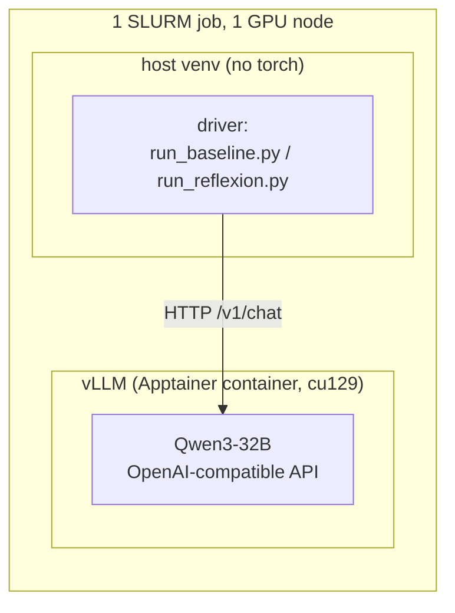
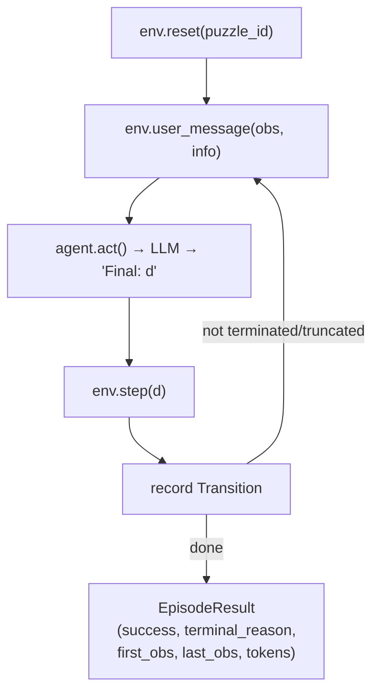
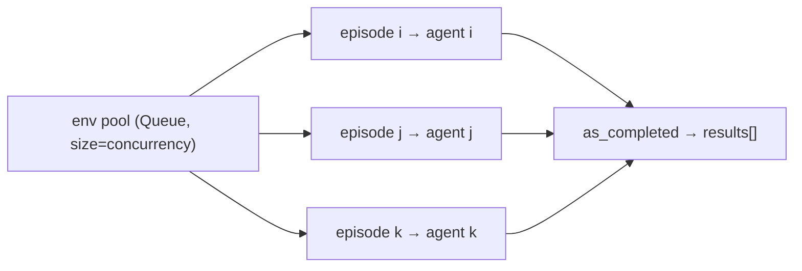
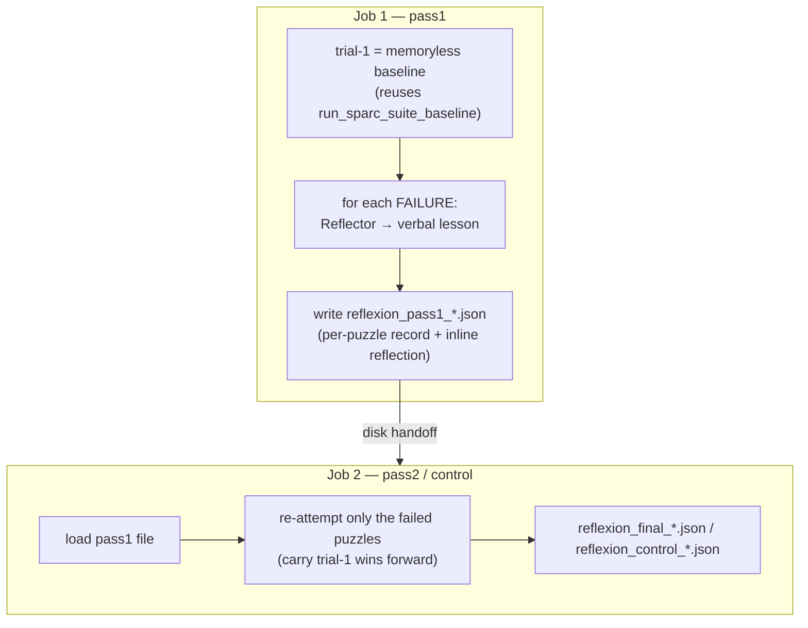
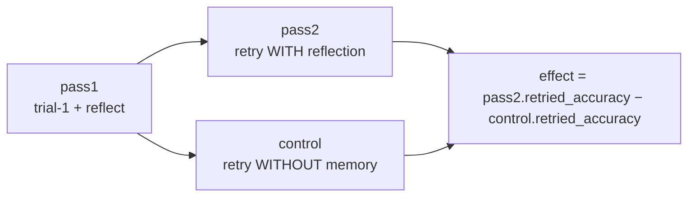
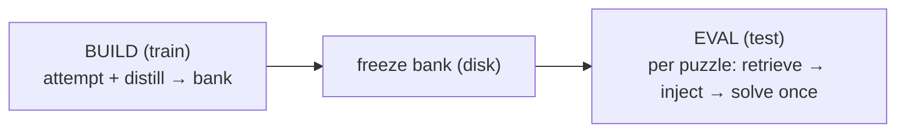

# Architecture

High-level design of the two things running on SPaRC so far: the **memoryless baseline**
and the **Reflexion** memory method built on top of it. The guiding principle for the
whole project is that memory methods (Reflexion, and later MemoryBank / MemP) plug into a
shared, method-agnostic harness — only a small, clearly isolated set of pieces is specific
to each method.

---

## 1. Serving & execution model (shared by everything)

The model is **served**, and the experiment **drives** it over HTTP. The two are split so
the driver never depends on CUDA/vLLM.



- **`scripts/serve_and_run.sbatch`** is the single entrypoint. It starts vLLM from the
  shared `ag_gipp` Apptainer image, waits for `/health`, runs a smoke check, then runs a
  **driver** selected by the `DRIVER` env knob (`baseline` | `reflexion`). A trap frees the
  GPU on any exit. The serve block is method-agnostic; adding a method = adding a `DRIVER`
  case, not touching the server.
- **`memory_agents/llm/client.py` (`LLMClient`)** — an `AsyncOpenAI` wrapper. Async is the
  point: one episode is sequential, so throughput comes from running **many episodes
  concurrently** against the same server. Carries the sampling config (`temperature`,
  `top_p`, `top_k`, `seed`, `max_tokens`).
- **`memory_agents/config.py`** resolves the endpoint (env vars or a discovery file the
  serve job writes).

Sampling note: the thinking model (Qwen3) cannot use greedy decoding (it loops), so
everything runs at the official thinking-mode params `temp 0.6 / top_p 0.95 / top_k 20`.

---

## 2. The baseline (memoryless)

### Core idea
SPaRC is a per-step MDP. The environment **re-sends the full grid state every step**
(visited nodes, current head, per-rule pass/fail, legal actions), so the agent needs no
memory of its own moves — it just picks the next move from the current grid.

> **Key nuance:** the actor is *state-aware but reasoning-blind*. It always sees where the
> path is; the only thing it does **not** carry across steps is its own prior reasoning.
> That single gap is exactly what a memory method fills.

### Components

| Piece | File | Role |
|---|---|---|
| `SparcEnv` | `envs/sparc.py` | Thin wrapper over Spatial-Gym; loads a puzzle by id, steps an action, renders the grid, parses the model's `Final: <d>` reply. `max_steps=100`. |
| `BaselineAgent` | `agents/base.py` | Owns one message list. `act()` sends the current grid, retries on unparseable replies (≤5), then `_trim()` wipes history back to just the system prompt. |
| `sparc_system_prompt` | `prompts.py` | The full SPaRC rules + I/O contract (ends every reply with `Final: <digit>`). |
| `Transition` / `EpisodeResult` | `envs/base.py` | Per-step and per-episode records: action, `agent_location`, `rule_status`, tokens; plus `first_obs`, `last_obs`, `terminal_reason`. |
| `run_sparc_suite_baseline` | `harness/run.py` | Runs the whole split concurrently. |

### One episode (sequential loop)



`terminal_reason` collapses the env signals into one label: **solved** /
**wrong-solution** (submitted an invalid path) / **dead-end** (no legal move left) /
**format-failure** (never produced a parseable move).

### Concurrency
Episodes are sequential *inside*, concurrent *across*. A fixed pool of `SparcEnv`s is
handed out through an `asyncio.Queue`; the queue **is** the concurrency limiter — only
`concurrency` episodes can hold an env (and thus have an in-flight LLM call) at once. Each
episode gets its own agent (one message list per agent).



### Output
`run_baseline.py` writes `results/json/baseline_*.json` (summary + per-puzzle records);
`summarize_results.py` renders a human-readable `results/txt/*.txt` report.

---

## 3. Reflexion (first memory method)

### Core idea
Reflexion adds memory by **retrying**: attempt each puzzle once with no memory, turn each
failure into a short verbal **reflection**, then re-attempt the failed puzzles with that
reflection in context. Per the paper, reflection is **per-puzzle** (a lesson about puzzle X
is used only when re-attempting X) and the actor stays otherwise identical to the baseline,
so any gain is attributable to the reflection alone.

It runs as **two SLURM jobs linked by a file on disk**, so reflections can be inspected or
hand-edited between them.



### Method-agnostic seams (reused by MemoryBank / MemP later)

| Seam | File | What it does |
|---|---|---|
| `Memory` (ABC) | `memory/base.py` | `read` / `write` / `to_dict` / `from_dict` / `save` / `load`. The keyed store every method implements. |
| `MemoryAgent` | `agents/memory_agent.py` | `BaselineAgent` + a persistent **memory block** folded into the system prompt at reset. Survives `_trim`, so it rides along every step. Empty block ⇒ identical to baseline. |
| `run_sparc_suite_memory_pass` | `harness/run.py` | The retry pass. Runs only the puzzles present in `memory`; `block_of` renders items → the injected block. Method-agnostic. |

### Reflexion-specific pieces (what a new method swaps out)

| Piece | File | What it does |
|---|---|---|
| `ReflexionMemory` | `memory/reflexion.py` | Per-puzzle store of reflections, capped at the last 3 (the paper's window). |
| `Reflector` | `memory/reflexion.py` | The self-reflection LLM call: one failed `EpisodeResult` → one lesson. |
| reflection prompt | `prompts.py` | Paper-faithful: *"diagnose a reason for failure and devise a new, concise, high-level plan"*, with few-shot examples, the **whole** move trajectory, and the **final grid** (`last_obs`). |

### How a reflection re-enters the actor
The reflection is just extra system context — the actor is unchanged:

```
system = <full SPaRC rules>  +  "Reflections from your previous attempt: - <lesson>"
```

Because `_trim` keeps only the system message, the lesson persists for every step of the
retry without touching the loop.

### The three phases (`run_reflexion.py --phase …`)



- **pass1** — the baseline trial + a reflection for every failure → the memory artifact.
- **pass2** — re-attempt the failed set with each puzzle's reflection injected; carry the
  trial-1 wins forward untouched.
- **control** — the **same** failed set, **same** retry seed, but an **empty** memory block.

### Why the control arm exists (the key methodological point)
Only *failures* are retried and wins are carried forward, so trial-2 accuracy can only go
**up** and `lift ≥ 0` by construction. And because the actor samples at temp 0.6, a plain
resample flips some failures **with no memory at all**. So whole-split "lift" mixes two
effects. The honest measure is on the **retried subset** (where trial-1 accuracy is 0 by
construction):

> **Reflexion's real effect = pass2 `retried_accuracy` − control `retried_accuracy`.**

Both arms run at `--retry-seed`, which **must differ** from the trial-1 seed — with the same
prompt and seed vLLM reproduces trial-1's exact reply, giving a *replay* instead of a second
attempt.

### Robustness & accounting (from the refactor)
- **Crash-safe:** a transient vLLM error records an `errored_episode` (`terminal_reason
  = "error"`) and surfaces an `errors` count, instead of taking a multi-hour run down.
- **Honest token cost:** `retry_*` / `aborted_*` tokens (spent on replies that yielded no
  move) are tracked and reported via `retry_tokens()`, so a method that provokes more
  format-failures cannot look artificially cheap. Reflection-generation tokens are counted
  separately as part of Reflexion's cost.

---

## 4. What is baseline vs. Reflexion at a glance

| | Baseline | Reflexion |
|---|---|---|
| Attempts per puzzle | 1 | up to 2 (retry on failure) |
| Memory | none | per-puzzle verbal reflection |
| Actor | `BaselineAgent` | `MemoryAgent` (same actor + injected block) |
| Driver | `run_baseline.py` | `run_reflexion.py` (pass1 / pass2 / control) |
| Jobs | 1 | 2 (disk handoff) |
| Reuses | — | the entire baseline as its trial-1 |

The baseline is not a separate experiment from Reflexion — it **is** Reflexion's trial-1.
That is what keeps the comparison config-matched.

---

## 5. Coming next: cross-task memory (MemoryBank & MemP)

Reflexion is **per-task** (reflect on a puzzle, retry that same puzzle). MemoryBank and MemP
are **cross-task**: build a memory on the **train** split, freeze it, and apply it to unseen
**test** puzzles. Same two-job / disk-handoff skeleton — job 1 = *build on train*, job 2 =
*eval on test*. Train/test are disjoint, so it is a clean generalization test.



**Reused unchanged:** the `Memory` ABC, `MemoryAgent`, and the `DRIVER`/two-job sbatch. The
build pass is the same shape as Reflexion's `pass1` (attempt + distill), just over `train`
and writing a retrieval bank instead of a per-puzzle dict.

**Three new pieces (shared by both):**
1. **Retrieval** — the eval pass generalises to a `block_for(puzzle) → str` callback
   (retrieve top-k for *this* puzzle) and runs the whole test split, instead of a fixed
   per-puzzle dict over a subset.
2. **Embeddings + a tiny vector store** — embed a puzzle "signature" (grid size, difficulty,
   rule types present); cosine top-k over a numpy array (no FAISS needed).
3. **A `RetrievalMemory` subclass** of the ABC adding `retrieve(query, k)` and
   embedding-aware `save`/`load`.

**The two methods differ only in what is stored / how it is retrieved:**

| | MemoryBank | MemP |
|---|---|---|
| Memory type | episodic — "what happened on similar puzzles" | procedural — "how to solve this class of puzzle" |
| Built from | per-puzzle experience (success strategy / failure note) + embedding | reusable procedures distilled from train trajectories, merged/deduped |
| Retrieval | embedding similarity of the puzzle signature | rule-type/feature overlap (or embedding) → applicable procedures |
| Update | Ebbinghaus forgetting curve (strength decays, recall reinforces); rank by similarity × strength | procedures refined/deprecated by usefulness; **frozen at test** for a clean measurement |

**Experimental comparison (simpler than Reflexion):** each test puzzle is solved **once**
with retrieved memory — no retry-of-failures, so **no `lift ≥ 0` artifact and no control arm
needed**. Compare directly to the memoryless baseline (9.6%) at the same seed. Memory can
*hurt* (irrelevant retrievals), so it is a genuine two-sided test; the key ablation is
**retrieved vs. random memory**, to show relevance is what does the work.

**Open decisions (defer to build time):** embedding model + exact puzzle signature; unit of
memory (per-puzzle vs. merged procedures) and top-k; MemP frozen vs. online-updated (start
frozen). None touch the serve stack, the actor, or the episode loop.
