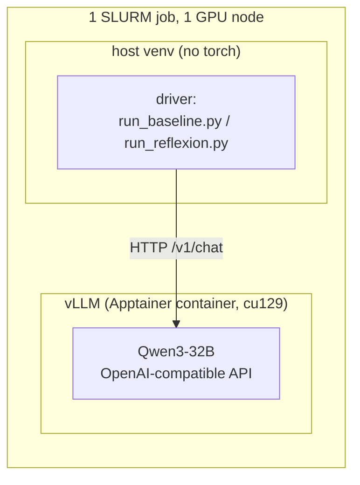
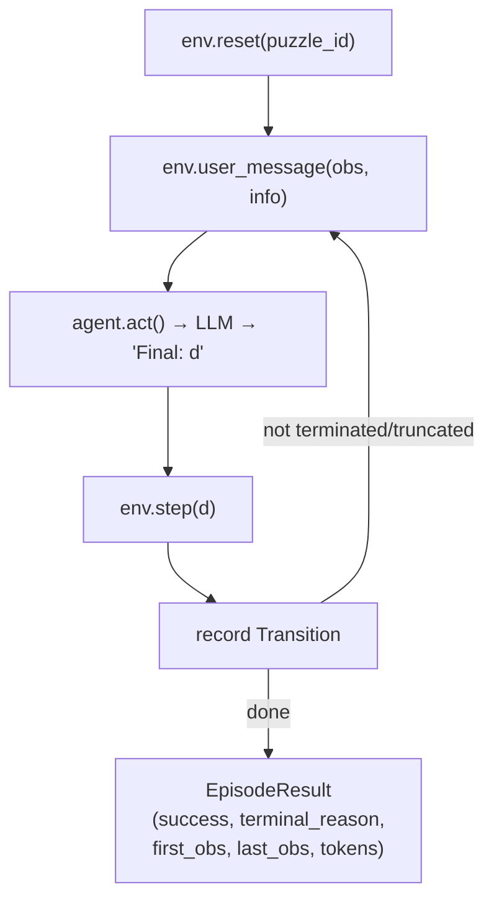
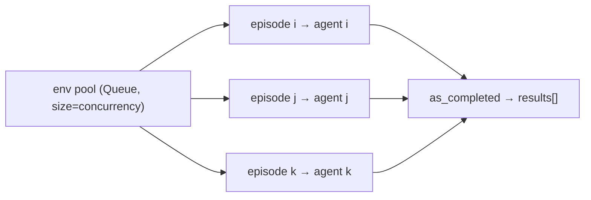
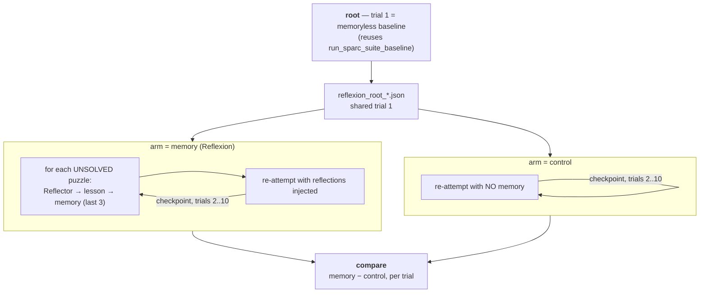
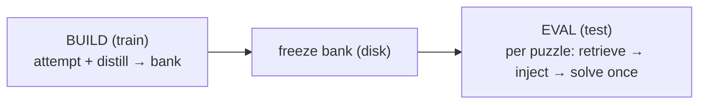

# Architecture

High-level design of the two things running on SPaRC so far: the **memoryless baseline**
and the **Reflexion** memory method built on top of it. The guiding principle for the
whole project is that memory methods (Reflexion, and later MemoryBank / MemP) plug into a
shared, method-agnostic harness — only a small, clearly isolated set of pieces is specific
to each method.

---

## 1. Serving & execution model (shared by everything)

The model is **served**, and the experiment **drives** it over HTTP. The two are split so
the driver never depends on CUDA/vLLM.



- **`scripts/serve_and_run.sbatch`** is the single entrypoint. It starts vLLM from the
  shared `ag_gipp` Apptainer image, waits for `/health`, runs a smoke check, then runs a
  **driver** selected by the `DRIVER` env knob (`baseline` | `reflexion`). A trap frees the
  GPU on any exit. The serve block is method-agnostic; adding a method = adding a `DRIVER`
  case, not touching the server.
- **`memory_agents/llm/client.py` (`LLMClient`)** — an `AsyncOpenAI` wrapper. Async is the
  point: one episode is sequential, so throughput comes from running **many episodes
  concurrently** against the same server. Carries the sampling config (`temperature`,
  `top_p`, `top_k`, `seed`, `max_tokens`).
- **`memory_agents/config.py`** resolves the endpoint (env vars or a discovery file the
  serve job writes).

Sampling note: the thinking model (Qwen3) cannot use greedy decoding (it loops), so
everything runs at the official thinking-mode params `temp 0.6 / top_p 0.95 / top_k 20`.

---

## 2. The baseline (memoryless)

### Core idea
SPaRC is a per-step MDP. The environment **re-sends the full grid state every step**
(visited nodes, current head, per-rule pass/fail, legal actions), so the agent needs no
memory of its own moves — it just picks the next move from the current grid.

> **Key nuance:** the actor is *state-aware but reasoning-blind*. It always sees where the
> path is; the only thing it does **not** carry across steps is its own prior reasoning.
> That single gap is exactly what a memory method fills.

### Components

| Piece | File | Role |
|---|---|---|
| `SparcEnv` | `envs/sparc.py` | Thin wrapper over Spatial-Gym; loads a puzzle by id, steps an action, renders the grid, parses the model's `Final: <d>` reply. `max_steps=100`. |
| `BaselineAgent` | `agents/base.py` | Owns one message list. `act()` sends the current grid, retries on unparseable replies (≤5), then `_trim()` wipes history back to just the system prompt. |
| `sparc_system_prompt` | `prompts.py` | The full SPaRC rules + I/O contract (ends every reply with `Final: <digit>`). |
| `Transition` / `EpisodeResult` | `envs/base.py` | Per-step and per-episode records: action, `agent_location`, `rule_status`, tokens; plus `first_obs`, `last_obs`, `terminal_reason`. |
| `run_sparc_suite_baseline` | `harness/run.py` | Runs the whole split concurrently. |

### One episode (sequential loop)



`terminal_reason` collapses the env signals into one label: **solved** /
**wrong-solution** (submitted an invalid path) / **dead-end** (no legal move left) /
**format-failure** (never produced a parseable move).

### Concurrency
Episodes are sequential *inside*, concurrent *across*. A fixed pool of `SparcEnv`s is
handed out through an `asyncio.Queue`; the queue **is** the concurrency limiter — only
`concurrency` episodes can hold an env (and thus have an in-flight LLM call) at once. Each
episode gets its own agent (one message list per agent).



### Output
`run_baseline.py` writes `results/json/baseline_*.json` (summary + per-puzzle records);
`summarize_results.py` renders a human-readable `results/txt/*.txt` report.

---

## 3. Reflexion (first memory method)

### Core idea
Reflexion adds memory by **retrying**, over many trials. This is the paper's Algorithm 1:
attempt a puzzle; while it is unsolved and trials remain, turn the failed trajectory into a
short verbal **reflection**, append it to that puzzle's episodic memory, and re-attempt the
**same** puzzle with that memory in context. Reflection is **per-puzzle** (a lesson about
puzzle X is only ever shown when re-attempting X), the memory is a **sliding window of the
last 3** reflections (the paper's Ω, "usually set to 1–3"), solved puzzles are never
re-attempted (the reference implementation's `skip` flag), and the actor is otherwise
identical to the baseline — so any gain is attributable to the reflection alone.

We run **10 trials**, matching the paper's decision-making experiments.



Trial 1 is run **once** and shared: both arms start from the *identical* trial-1 episodes,
not from two independent samples, which removes trial-1 variance from the comparison.

### Method-agnostic seams (reused by MemoryBank / MemP later)

| Seam | File | What it does |
|---|---|---|
| `Memory` (ABC) | `memory/base.py` | `read` / `write` / `to_dict` / `from_dict` / `save` / `load`. The keyed store every method implements. |
| `MemoryAgent` | `agents/memory_agent.py` | `BaselineAgent` + a persistent **memory block** folded into the system prompt at reset. Survives `_trim`, so it rides along every step. Empty block ⇒ identical to baseline. |
| `run_sparc_suite_memory_pass` | `harness/run.py` | The retry pass over an **explicit puzzle set**, with `block_for(pid)` rendering that puzzle's injected block. Method-agnostic. |
| `EpisodeResult.reflection_context` | `envs/base.py` | Serialises just enough of an episode (grids, move order, final rule verdict) to write its reflection in a **later process** — what makes trials span SLURM jobs. |

The puzzle set is passed to the retry pass rather than derived from the memory store,
because the two must be able to disagree: both arms have to re-attempt the *same* set, yet
the control arm has no memory at all and even the memory arm can hold an empty entry (a
reflection call that came back empty). Deriving the set from the store would shrink the
control arm to nothing.

### Reflexion-specific pieces (what a new method swaps out)

| Piece | File | What it does |
|---|---|---|
| `ReflexionMemory` | `memory/reflexion.py` | Per-puzzle store of reflections, capped at the last 3 (the paper's Ω). |
| `Reflector` | `memory/reflexion.py` | The self-reflection LLM call: one failed `EpisodeResult` + that puzzle's existing memory → one new lesson. |
| reflection prompt | `prompts.py` | Paper-faithful: *"diagnose a reason for failure and devise a new, concise, high-level plan"*, with few-shot examples, the **whole** move trajectory, the **final grid** (`last_obs`), and the **plans already tried** in earlier trials — the reference implementation conditions on prior plans too, without which trial 4 happily re-proposes what trial 3 watched fail. |

### How a reflection re-enters the actor
The reflection is just extra system context — the actor is unchanged:

```
system = <full SPaRC rules>  +  "Reflections from your previous attempt: - <lesson>"
```

Because `_trim` keeps only the system message, the lesson persists for every step of the
retry without touching the loop.

### The three phases (`run_reflexion.py --phase …`)

| Phase | What it does | Needs a GPU |
|---|---|---|
| `root` | Trial 1 only: the memoryless baseline over the split → `reflexion_root_*.json`. | yes |
| `arm` | Trials 2..N for **one** arm (`--arm memory` or `--arm control`), checkpointing after each trial → `reflexion_memory_*.json` / `reflexion_control_*.json`. | yes |
| `compare` | Prints both curves side by side and the per-trial difference. | no |

```bash
python scripts/run_reflexion.py --phase root  --split test --limit 0
python scripts/run_reflexion.py --phase arm --arm memory  --root <root.json> --trials 10
python scripts/run_reflexion.py --phase arm --arm control --root <root.json> --trials 10
python scripts/run_reflexion.py --phase compare --memory <m.json> --control <c.json>
```

### Resumability (why the state file exists)
A trial over the 500-puzzle test split costs ~2 h, so 10 trials do **not** fit the 12 h
SLURM limit. Each arm is one JSON state file — config, the trial curve so far, every
puzzle's attempt history and `last_episode`, and the memory store — rewritten **atomically
after every trial**. Resubmitting with `RESUME=<file>` continues exactly where it stopped:

```bash
sbatch ... --export=ALL,DRIVER=reflexion,PHASE=arm,TRIALS=10,RESUME=results/json/reflexion_memory_*.json ...
```

Two consequences worth stating: reflection for trial *t* is written **before** trial *t*
runs (from the stored `last_episode`), so a resumed job can always rebuild what it needs
from the file alone; and the knobs that define a run — split, sampling, base seed, memory
cap — are **frozen** in the state and cannot be overridden from the CLI, so trials 6–10
cannot silently run at a different temperature than the curve they extend.

### Why the control arm exists, and why it mirrors the trial count
Only *unsolved* puzzles are re-attempted and solved ones are carried forward, so cumulative
accuracy **can only rise** with the trial index — a 10-trial curve slopes upward whether or
not memory does anything. And because the actor samples at temp 0.6, a plain resample
converts some failures **with no memory at all**; ten resamples convert more. So the curve
alone measures nothing. The control arm — same puzzles, same number of trials, same
per-trial seeds, empty memory block — is what turns it into a claim:

> **Reflexion's effect = memory arm − control arm, at the same trial index.**

**Seeds.** Trial *t* decodes at `base_seed + t − 1`, in both arms. Distinct per trial is
load-bearing: in the control arm every trial sends a byte-identical prompt, so a fixed seed
would make vLLM replay trial 1 ten times and the control would measure nothing rather than
the resampling effect it exists to measure. Identical across arms is equally load-bearing:
it is what leaves the injected block as the only difference between them.

**Cost.** ~2 h/trial → ~20 h per arm for 10 trials over the full split, plus reflection
calls on the memory arm (the control makes none). The unsolved set shrinks slowly at this
accuracy, so trials do not get much cheaper. Use `--limit` for a smaller study.

### Robustness & accounting (from the refactor)
- **Crash-safe:** a transient vLLM error records an `errored_episode` (`terminal_reason
  = "error"`) and surfaces an `errors` count, instead of taking a multi-hour run down.
  A crashed episode has no trajectory, so it is **excluded from reflection** (there is no
  failure to diagnose) but still re-attempted on the next trial — a crash is not an attempt.
- **Everything that reaches disk must be plain Python.** Spatial-Gym returns numpy types
  (`agent_location` is an `ndarray`, `rule_status` holds numpy bools) and `json.dumps`
  encodes none of them. `harness/run.py` runs env values through `make_json_safe` when it
  builds each `Transition`, so the conversion happens once, at the boundary. This is not a
  theoretical concern: it cost a completed 2 h trial, which died in `save_state` *after*
  the GPU work was done. Two follow-on rules any new method inherits — call
  `make_json_safe` **per value**, never once over a whole structure (its cycle guard
  returns `None` for any object seen twice, so a reused env buffer would blank every entry
  after the first); and note `save_state` degrades to `default=str` with a loud warning
  rather than raising, because losing hours of compute to an encoder error is worse than
  one lossily-written field.
- **Honest token cost:** `retry_*` / `aborted_*` tokens (spent on replies that yielded no
  move) are tracked and reported via `retry_tokens()`, so a method that provokes more
  format-failures cannot look artificially cheap. Reflection-generation tokens are counted
  separately as part of Reflexion's cost.

---

## 4. What is baseline vs. Reflexion at a glance

| | Baseline | Reflexion (memory arm) | Control arm |
|---|---|---|---|
| Attempts per puzzle | 1 | up to `--trials` (10), stopping at the first success | same as the memory arm |
| Memory | none | per-puzzle verbal reflections, last 3 | none |
| Reflection calls | — | one per unsolved puzzle per trial | **none** |
| Actor | `BaselineAgent` | `MemoryAgent` (same actor + injected block) | `MemoryAgent`, empty block ⇒ identical to baseline |
| Driver | `run_baseline.py` | `run_reflexion.py --phase arm --arm memory` | `--phase arm --arm control` |
| Jobs | 1 | 1 root + N (checkpoint/resume) | resumes from the same root |
| Reuses | — | the entire baseline as its trial 1 | the *same* trial 1 as the memory arm |

The baseline is not a separate experiment from Reflexion — it **is** Reflexion's trial 1,
and both arms share that one run. That is what keeps the comparison config-matched.

---

## 5. Coming next: cross-task memory (MemoryBank & MemP)

Reflexion is **per-task** (reflect on a puzzle, retry that same puzzle). MemoryBank and MemP
are **cross-task**: build a memory on the **train** split, freeze it, and apply it to unseen
**test** puzzles. Same two-job / disk-handoff skeleton — job 1 = *build on train*, job 2 =
*eval on test*. Train/test are disjoint, so it is a clean generalization test.



**Reused unchanged:** the `Memory` ABC, `MemoryAgent`, and the `DRIVER`/two-job sbatch. The
build pass is the same shape as Reflexion's `root` phase (attempt + distill), just over `train`
and writing a retrieval bank instead of a per-puzzle dict.

**Three new pieces (shared by both):**
1. **Retrieval** — the eval pass generalises to a `block_for(puzzle) → str` callback
   (retrieve top-k for *this* puzzle) and runs the whole test split, instead of a fixed
   per-puzzle dict over a subset.
2. **Embeddings + a tiny vector store** — embed a puzzle "signature" (grid size, difficulty,
   rule types present); cosine top-k over a numpy array (no FAISS needed).
3. **A `RetrievalMemory` subclass** of the ABC adding `retrieve(query, k)` and
   embedding-aware `save`/`load`.

**The two methods differ only in what is stored / how it is retrieved:**

| | MemoryBank | MemP |
|---|---|---|
| Memory type | episodic — "what happened on similar puzzles" | procedural — "how to solve this class of puzzle" |
| Built from | per-puzzle experience (success strategy / failure note) + embedding | reusable procedures distilled from train trajectories, merged/deduped |
| Retrieval | embedding similarity of the puzzle signature | rule-type/feature overlap (or embedding) → applicable procedures |
| Update | Ebbinghaus forgetting curve (strength decays, recall reinforces); rank by similarity × strength | procedures refined/deprecated by usefulness; **frozen at test** for a clean measurement |

**Experimental comparison (simpler than Reflexion):** each test puzzle is solved **once**
with retrieved memory — no retry-of-failures, so **no `lift ≥ 0` artifact and no control arm
needed**. Compare directly to the memoryless baseline (9.6%) at the same seed. Memory can
*hurt* (irrelevant retrievals), so it is a genuine two-sided test; the key ablation is
**retrieved vs. random memory**, to show relevance is what does the work.

**Open decisions (defer to build time):** embedding model + exact puzzle signature; unit of
memory (per-puzzle vs. merged procedures) and top-k; MemP frozen vs. online-updated (start
frozen). None touch the serve stack, the actor, or the episode loop.
