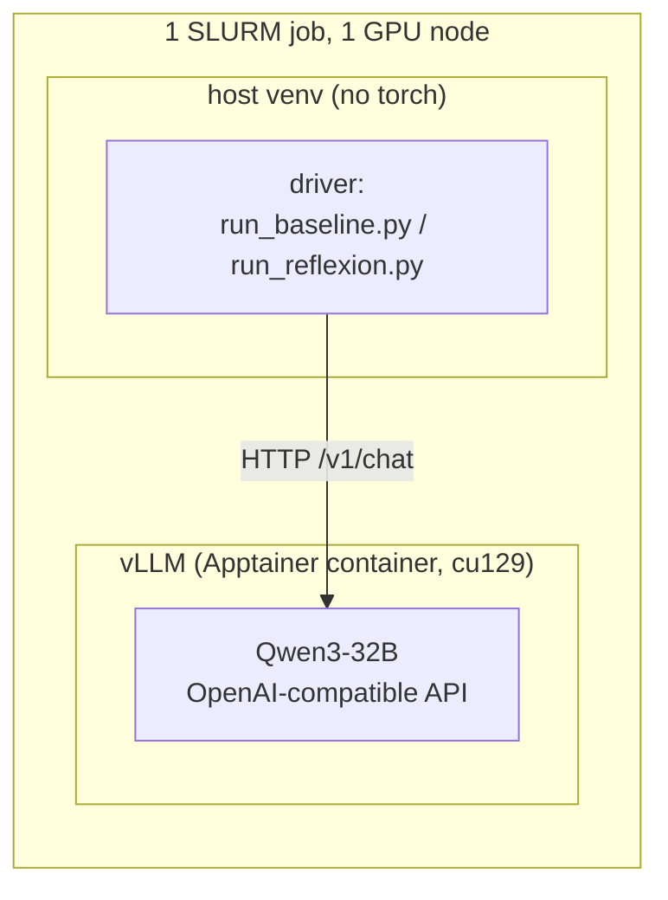
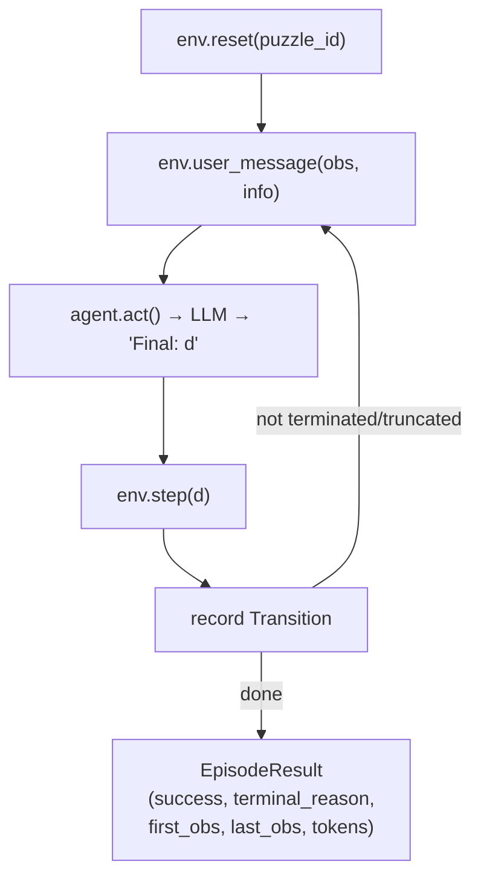
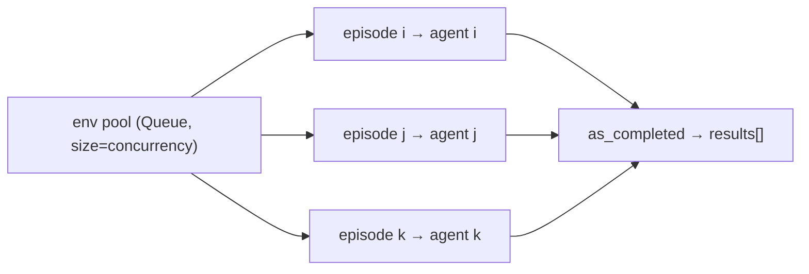
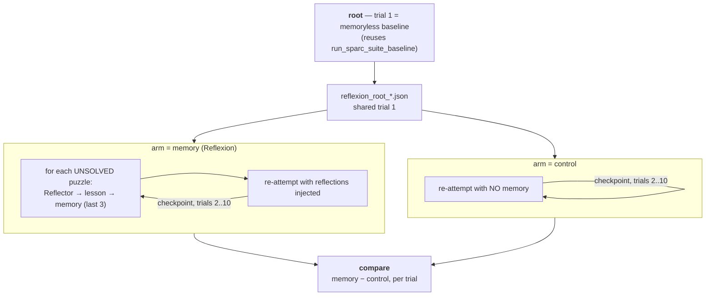
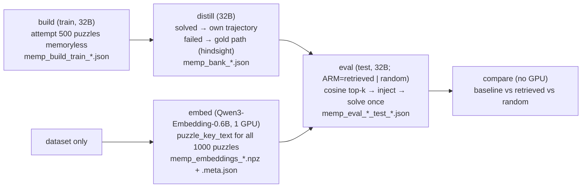
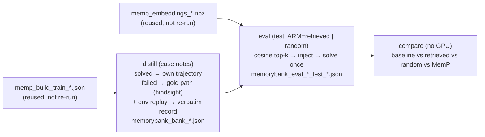

# Architecture

High-level design of what runs on SPaRC: the **memoryless baseline** (§2) and the three
memory methods built on top of it — **Reflexion** (episodic, §3), **MemP** (procedural,
§5.1) and **MemoryBank** (declarative, §5.2). The guiding principle for the whole project
is that every memory method plugs into a shared, method-agnostic harness — only a small,
clearly isolated set of pieces is specific to each one.

Per-method results live in `docs/reflexion_results.md`, `docs/memp.md` and
`docs/memorybank.md`.

---

## 1. Serving & execution model (shared by everything)

The model is **served**, and the experiment **drives** it over HTTP. The two are split so
the driver never depends on CUDA/vLLM.



- **`scripts/serve_and_run.sbatch`** is the single entrypoint. It starts vLLM from the
  shared `ag_gipp` Apptainer image, waits for `/health`, runs a smoke check, then runs a
  **driver** selected by the `DRIVER` env knob (`baseline` | `reflexion`). A trap frees the
  GPU on any exit. The serve block is method-agnostic; adding a method = adding a `DRIVER`
  case, not touching the server.
- **`memory_agents/llm/client.py` (`LLMClient`)** — an `AsyncOpenAI` wrapper. Async is the
  point: one episode is sequential, so throughput comes from running **many episodes
  concurrently** against the same server. Carries the sampling config (`temperature`,
  `top_p`, `top_k`, `seed`, `max_tokens`).
- **`memory_agents/config.py`** resolves the endpoint (env vars or a discovery file the
  serve job writes).

Sampling note: the thinking model (Qwen3) cannot use greedy decoding (it loops), so
everything runs at the official thinking-mode params `temp 0.6 / top_p 0.95 / top_k 20`.

---

## 2. The baseline (memoryless)

### Core idea
SPaRC is a per-step MDP. The environment **re-sends the full grid state every step**
(visited nodes, current head, per-rule pass/fail, legal actions), so the agent needs no
memory of its own moves — it just picks the next move from the current grid.

> **Key nuance:** the actor is *state-aware but reasoning-blind*. It always sees where the
> path is; the only thing it does **not** carry across steps is its own prior reasoning.
> That single gap is exactly what a memory method fills.

### Components

| Piece | File | Role |
|---|---|---|
| `SparcEnv` | `envs/sparc.py` | Thin wrapper over Spatial-Gym; loads a puzzle by id, steps an action, renders the grid, parses the model's `Final: <d>` reply. `max_steps=100`. |
| `BaselineAgent` | `agents/base.py` | Owns one message list. `act()` sends the current grid, retries on unparseable replies (≤5), then `_trim()` wipes history back to just the system prompt. |
| `sparc_system_prompt` | `prompts.py` | The full SPaRC rules + I/O contract (ends every reply with `Final: <digit>`). |
| `Transition` / `EpisodeResult` | `envs/base.py` | Per-step and per-episode records: action, `agent_location`, `rule_status`, tokens; plus `first_obs`, `last_obs`, `terminal_reason`. |
| `run_sparc_suite_baseline` | `harness/run.py` | Runs the whole split concurrently. |

### One episode (sequential loop)



`terminal_reason` collapses the env signals into one label: **solved** /
**wrong-solution** (submitted an invalid path) / **dead-end** (no legal move left) /
**format-failure** (never produced a parseable move).

### Concurrency
Episodes are sequential *inside*, concurrent *across*. A fixed pool of `SparcEnv`s is
handed out through an `asyncio.Queue`; the queue **is** the concurrency limiter — only
`concurrency` episodes can hold an env (and thus have an in-flight LLM call) at once. Each
episode gets its own agent (one message list per agent).



### Output
`run_baseline.py` writes `results/json/baseline_*.json` (summary + per-puzzle records);
`summarize_results.py` renders a human-readable `results/txt/*.txt` report.

---

## 3. Reflexion (first memory method)

### Core idea
Reflexion adds memory by **retrying**, over many trials. This is the paper's Algorithm 1:
attempt a puzzle; while it is unsolved and trials remain, turn the failed trajectory into a
short verbal **reflection**, append it to that puzzle's episodic memory, and re-attempt the
**same** puzzle with that memory in context. Reflection is **per-puzzle** (a lesson about
puzzle X is only ever shown when re-attempting X), the memory is a **sliding window of the
last 3** reflections (the paper's Ω, "usually set to 1–3"), solved puzzles are never
re-attempted (the reference implementation's `skip` flag), and the actor is otherwise
identical to the baseline — so any gain is attributable to the reflection alone.

We run **10 trials**, matching the paper's decision-making experiments.



Trial 1 is run **once** and shared: both arms start from the *identical* trial-1 episodes,
not from two independent samples, which removes trial-1 variance from the comparison.

### Method-agnostic seams (reused by MemP / MemoryBank)

| Seam | File | What it does |
|---|---|---|
| `Memory` (ABC) | `memory/base.py` | `read` / `write` / `to_dict` / `from_dict` / `save` / `load`. The keyed store every method implements. |
| `MemoryAgent` | `agents/memory_agent.py` | `BaselineAgent` + a persistent **memory block** folded into the system prompt at reset. Survives `_trim`, so it rides along every step. Empty block ⇒ identical to baseline. |
| `run_sparc_suite_memory_pass` | `harness/run.py` | The retry pass over an **explicit puzzle set**, with `block_for(pid)` rendering that puzzle's injected block. Method-agnostic. |
| `EpisodeResult.reflection_context` | `envs/base.py` | Serialises just enough of an episode (grids, move order, final rule verdict) to write its reflection in a **later process** — what makes trials span SLURM jobs. |

The puzzle set is passed to the retry pass rather than derived from the memory store,
because the two must be able to disagree: both arms have to re-attempt the *same* set, yet
the control arm has no memory at all and even the memory arm can hold an empty entry (a
reflection call that came back empty). Deriving the set from the store would shrink the
control arm to nothing.

### Reflexion-specific pieces (what a new method swaps out)

| Piece | File | What it does |
|---|---|---|
| `ReflexionMemory` | `memory/reflexion.py` | Per-puzzle store of reflections, capped at the last 3 (the paper's Ω). |
| `Reflector` | `memory/reflexion.py` | The self-reflection LLM call: one failed `EpisodeResult` + that puzzle's existing memory → one new lesson. |
| reflection prompt | `prompts.py` | Paper-faithful: *"diagnose a reason for failure and devise a new, concise, high-level plan"*, with few-shot examples, the **whole** move trajectory, the **final grid** (`last_obs`), and the **plans already tried** in earlier trials — the reference implementation conditions on prior plans too, without which trial 4 happily re-proposes what trial 3 watched fail. |

### How a reflection re-enters the actor
The reflection is just extra system context — the actor is unchanged:

```
system = <full SPaRC rules>  +  "Reflections from your previous attempt: - <lesson>"
```

Because `_trim` keeps only the system message, the lesson persists for every step of the
retry without touching the loop.

### The three phases (`run_reflexion.py --phase …`)

| Phase | What it does | Needs a GPU |
|---|---|---|
| `root` | Trial 1 only: the memoryless baseline over the split → `reflexion_root_*.json`. | yes |
| `arm` | Trials 2..N for **one** arm (`--arm memory` or `--arm control`), checkpointing after each trial → `reflexion_memory_*.json` / `reflexion_control_*.json`. | yes |
| `compare` | Prints both curves side by side and the per-trial difference. | no |

```bash
python scripts/run_reflexion.py --phase root  --split test --limit 0
python scripts/run_reflexion.py --phase arm --arm memory  --root <root.json> --trials 10
python scripts/run_reflexion.py --phase arm --arm control --root <root.json> --trials 10
python scripts/run_reflexion.py --phase compare --memory <m.json> --control <c.json>
```

### Resumability (why the state file exists)
A trial over the 500-puzzle test split costs ~2 h, so 10 trials do **not** fit the 12 h
SLURM limit. Each arm is one JSON state file — config, the trial curve so far, every
puzzle's attempt history and `last_episode`, and the memory store — rewritten **atomically
after every trial**. Resubmitting with `RESUME=<file>` continues exactly where it stopped:

```bash
sbatch ... --export=ALL,DRIVER=reflexion,PHASE=arm,TRIALS=10,RESUME=results/json/reflexion_memory_*.json ...
```

Two consequences worth stating: reflection for trial *t* is written **before** trial *t*
runs (from the stored `last_episode`), so a resumed job can always rebuild what it needs
from the file alone; and the knobs that define a run — split, sampling, base seed, memory
cap — are **frozen** in the state and cannot be overridden from the CLI, so trials 6–10
cannot silently run at a different temperature than the curve they extend.

### Why the control arm exists, and why it mirrors the trial count
Only *unsolved* puzzles are re-attempted and solved ones are carried forward, so cumulative
accuracy **can only rise** with the trial index — a 10-trial curve slopes upward whether or
not memory does anything. And because the actor samples at temp 0.6, a plain resample
converts some failures **with no memory at all**; ten resamples convert more. So the curve
alone measures nothing. The control arm — same puzzles, same number of trials, same
per-trial seeds, empty memory block — is what turns it into a claim:

> **Reflexion's effect = memory arm − control arm, at the same trial index.**

**Seeds.** Trial *t* decodes at `base_seed + t − 1`, in both arms. Distinct per trial is
load-bearing: in the control arm every trial sends a byte-identical prompt, so a fixed seed
would make vLLM replay trial 1 ten times and the control would measure nothing rather than
the resampling effect it exists to measure. Identical across arms is equally load-bearing:
it is what leaves the injected block as the only difference between them.

**Cost.** ~2 h/trial → ~20 h per arm for 10 trials over the full split, plus reflection
calls on the memory arm (the control makes none). The unsolved set shrinks slowly at this
accuracy, so trials do not get much cheaper. Use `--limit` for a smaller study.

### Robustness & accounting (from the refactor)
- **Crash-safe:** a transient vLLM error records an `errored_episode` (`terminal_reason
  = "error"`) and surfaces an `errors` count, instead of taking a multi-hour run down.
  A crashed episode has no trajectory, so it is **excluded from reflection** (there is no
  failure to diagnose) but still re-attempted on the next trial — a crash is not an attempt.
- **Everything that reaches disk must be plain Python.** Spatial-Gym returns numpy types
  (`agent_location` is an `ndarray`, `rule_status` holds numpy bools) and `json.dumps`
  encodes none of them. `harness/run.py` runs env values through `make_json_safe` when it
  builds each `Transition`, so the conversion happens once, at the boundary. This is not a
  theoretical concern: it cost a completed 2 h trial, which died in `save_state` *after*
  the GPU work was done. Two follow-on rules any new method inherits — call
  `make_json_safe` **per value**, never once over a whole structure (its cycle guard
  returns `None` for any object seen twice, so a reused env buffer would blank every entry
  after the first); and note `save_state` degrades to `default=str` with a loud warning
  rather than raising, because losing hours of compute to an encoder error is worse than
  one lossily-written field.
- **Honest token cost:** `retry_*` / `aborted_*` tokens (spent on replies that yielded no
  move) are tracked and reported via `retry_tokens()`, so a method that provokes more
  format-failures cannot look artificially cheap. Reflection-generation tokens are counted
  separately as part of Reflexion's cost.

---

## 4. What is baseline vs. Reflexion at a glance

| | Baseline | Reflexion (memory arm) | Control arm |
|---|---|---|---|
| Attempts per puzzle | 1 | up to `--trials` (10), stopping at the first success | same as the memory arm |
| Memory | none | per-puzzle verbal reflections, last 3 | none |
| Reflection calls | — | one per unsolved puzzle per trial | **none** |
| Actor | `BaselineAgent` | `MemoryAgent` (same actor + injected block) | `MemoryAgent`, empty block ⇒ identical to baseline |
| Driver | `run_baseline.py` | `run_reflexion.py --phase arm --arm memory` | `--phase arm --arm control` |
| Jobs | 1 | 1 root + N (checkpoint/resume) | resumes from the same root |
| Reuses | — | the entire baseline as its trial 1 | the *same* trial 1 as the memory arm |

The baseline is not a separate experiment from Reflexion — it **is** Reflexion's trial 1,
and both arms share that one run. That is what keeps the comparison config-matched.

---

## 5. Cross-task memory: MemP (procedural) & MemoryBank (declarative)

Reflexion is **per-task** (reflect on a puzzle, retry that same puzzle). MemoryBank and MemP
are **cross-task**: build a memory on the **train** split, freeze it, and apply it to unseen
**test** puzzles. Train/test are disjoint (verified: zero id overlap), so it is a clean
generalization test.

**Reused unchanged:** the `Memory` ABC, `MemoryAgent`, `run_sparc_suite_memory_pass` (its
`block_for(pid) → str` callback was designed for exactly this), and the `DRIVER` sbatch.

**Experimental comparison (simpler than Reflexion):** each test puzzle is solved **once**
with retrieved memory — no retry-of-failures, so **no `lift ≥ 0` artifact and no control arm
needed**. Compare directly to the memoryless baseline at the same seed and sampling params.
Memory can *hurt* (irrelevant retrievals), so it is a genuine two-sided test; the key ablation
is **retrieved vs. random memory**, to show relevance is what does the work. `run_memp.py
--phase compare` reports both contrasts with exact McNemar tests (paired binary outcomes over
the same 500 puzzles; only discordant pairs are informative).

### 5.1 MemP (Fang et al., 2026 — procedural memory)

MemP distills past trajectories into **procedures** ("how to solve this class of puzzle")
and retrieves them for new tasks by embedding similarity. Five phases, because build and
eval are ~8 h of GPU each and the embedding model is a *different server* than the chat
model (vLLM serves one model per process):



The load-bearing decoupling: **the embed phase depends only on the dataset, not the bank.**
`puzzle_key_text(record)` (envs/sparc.py, key-fn `puzzle-key-v1`) renders a canonical text
from `text_visualization` — grid dims, start/end, one line per rule cell, a rule census — and
a bank entry's vector is simply the embedding of its source puzzle's key text. So all 500
train keys and 500 test queries are embedded in one tiny 1-GPU job that can run in parallel
with build/distill, and eval needs only the chat model plus the `.npz`. The same renderer is
used for keys and queries; that symmetry is what makes the cosine similarity meaningful, so
the format is frozen once a bank exists (bump the version and re-embed instead of editing).

Resolved design decisions (were "open" in the first draft of this section):

| Decision | Choice |
|---|---|
| Build source | agent's own successful train trajectories; **failed/crashed puzzles are distilled from the dataset's gold solution path instead** (hindsight). SPaRC's ~10% memoryless success would otherwise yield a tiny bank skewed to difficulty 1–2; the gold fallback covers all 500 train puzzles. Provenance (`agent`/`gold`) is recorded per entry and reported per run. |
| Unit of memory | one entry per train puzzle: a distilled **script** (rule-combination-scoped strategy, ≤120 words, no coordinates — the LLM writes this) plus a compact **exemplar** (the solved action sequence + grid census — assembled in code, so it cannot be hallucinated). This is the paper's winning "Proceduralization" (script + concrete trace) at SPaRC-feasible size. |
| Embedding model | `Qwen/Qwen3-Embedding-0.6B` via vLLM `/v1/embeddings` (`--runner pooling`, verified against vllm-25.1.sif). Vectors are float32 numpy in a sidecar `.npz`; cosine top-k is a dot product over ≤500 rows — no FAISS. |
| top-k | 3 (`TOP_K_MEMORIES`), ~1–1.2k injected tokens. Frozen into the eval config, so a k-sweep is a submit-line change. |
| Update at test | **frozen.** The paper's online update strategies are a possible follow-up, but a frozen bank keeps the measurement clean and the eval trivially concurrency-safe (retrieval is precomputed for all 500 test puzzles before the first episode runs). |

`path_to_actions` (envs/sparc.py) converts a gold path's `{x,y}` node list into env action
ints and refuses non-unit steps; the distill phase replays a few gold paths through a real
env on every run (`--verify-gold`) so the delta→action table can never silently drift from
the env's convention. The injected block is appended **after** the system prompt like
Reflexion's (`format_procedures`, prefix-cache invariant), renders identically in both arms
(similarities are logged in results, never shown to the actor), and the gold-distill prompt
reads dataset fields only — so a crashed build episode distills exactly like a failed one.

Build and eval checkpoint every `CHUNK` (100) puzzles with the same atomic-write + frozen-
config-on-resume discipline as Reflexion; distill checkpoints the bank as it grows and
retries empty replies once at `seed+1`. The bank's distillation token cost lands in its
`stats` block and `--phase compare` reports it as MemP's amortized construction cost.

### 5.2 MemoryBank (Zhong et al., 2024 — declarative memory)

Implemented; see `docs/memorybank.md` for the campaign and results.

The paper stores each past **interaction** twice — the conversation kept verbatim (its
"in-depth memory storage") and an LLM-written **event summary** of it — and recalls the
relevant ones by dense retrieval. Ported here as **one past puzzle = one past interaction**,
so a bank entry carries both layers for one train puzzle:

| Field | Paper's layer | Written by | Content |
|---|---|---|---|
| `trajectory` | in-depth storage | **code** (env replay of the entry's own winning line) | start grid, every move with the resulting path head, final grid with the path drawn |
| `case_note` | hierarchical event summary | LLM (`CaseDistiller`) | 2–3 sentences recounting *that* puzzle and how it was solved |
| `exemplar` | — | code | compact action list + grid census, for the `case` granularity |

Written by code wherever it can be: the record is a replayed transcript, so — unlike an
LLM-written summary — it cannot misstate what happened. MemP §3.6 measured that this is the
component carrying the signal, which is why it is MemoryBank's default rather than an option.

**Dropped from the paper, deliberately.** The Ebbinghaus forgetting curve and memory-strength
updating need a *repeat-recall* event to mean anything (the paper's `S` only grows when a piece
is retrieved again in a later turn); a single parallel build pass never re-queries earlier
entries and the bank is frozen at test time, so nothing would ever reinforce and decay would
reduce to insertion order. The paper never ablates the mechanism quantitatively either (Table 2
has no forgetting on/off comparison). The user portrait has no analogue — SPaRC has no user —
and a global summary would inject byte-identical text for every puzzle, which is MemP's `fixed`
arm, already measured and inert. The thesis proposal defines this arm operationally as *"a
declarative agent that retrieves similar solved cases via dense embedding search"*, which is
exactly what is built.

| | MemoryBank (declarative) | MemP (procedural, 5.1) |
|---|---|---|
| Memory type | episodic **case** — "here's a similar puzzle I've seen before, and what worked" | procedural **script** — "how to solve this class of puzzle" |
| Content | a concrete case note tied to one instance, plus that instance's verbatim record; never phrased as a rule or numbered strategy | an abstracted "Applies to: \<rule class\>" script with numbered general steps, coordinates/moves explicitly banned from the prose |
| Built from | the *same* `memp_build_train_*.json` — solved → own trajectory, failed/crashed → gold path (hindsight) | solved → own trajectory, failed/crashed → gold path (hindsight) |
| Retrieval | embedding similarity of `puzzle_key_text` (same key-fn, same `.npz`) | embedding similarity of `puzzle_key_text` |
| Update at test | frozen (no decay) | frozen |

Sharing the retriever is the experiment, not a shortcut: sub-question 2 of the proposal asks
*which memory type is most effective* — that comparison is only meaningful if the two
cross-task methods differ in **content type** (concrete case vs. abstracted procedure) and
nothing else. So MemoryBank reuses MemP's entire retrieval skeleton — `MempMemory`'s
`attach_vectors`/`retrieve`/`random_retrieve`/tie-break (`MemoryBankMemory` subclasses it and
overrides only `SCHEMA`), the embed phase, `run_sparc_suite_memory_pass`, and the McNemar
`compare` stack — and reuses MemP's `build` output and embeddings `.npz` outright, since both
key on the identical `puzzle_key_text`/`puzzle-key-v1`. §3.4 of `docs/memp.md` also measured
that no retrieval policy on SPaRC ever significantly beat any other, so this axis carries no
signal to lose.



Resolved design decisions:

| Decision | Choice |
|---|---|
| Build source | **reuses `memp_build_train_*.json` directly** — the memoryless train attempts are method-agnostic content, so there is no reason to re-run ~8 h of GPU time for a second cross-task method. |
| Unit of memory | one entry per train puzzle: the paper's two layers (`case_note` + `trajectory`) plus the compact `exemplar`. The note is LLM-written and instructed to *recount this specific instance*, explicitly forbidden from generalizing into advice, rules, or a numbered procedure; the record and exemplar are assembled in code, so neither can be hallucinated. |
| Distill prompt shape | contrasts directly with MemP's: *"You are recalling a specific past experience, not writing a strategy guide. Recount what this puzzle looked like and how it was solved, concretely, in 2–3 sentences. Do not phrase this as a rule, a numbered procedure, or advice for other puzzles — you are remembering one instance, not instructing."* No "Applies to:" line, no few-shot procedural example. |
| Rules preamble | an **ablation, not a default**: `--rules-preamble on\|off` builds two banks per model, one with `distill_rules_preamble` prepended (parity with the v2 MemP banks) and one with the plain, more paper-faithful prompt. MemP §3.5 showed the rulebook is what stopped procedures misstating the square/star rule (50.7% → 99.8% correctly framed); whether a *case note* needs it is genuinely open, so it is measured with `scripts/audit_bank.py` and evaluated rather than guessed. Frozen into the bank and named in its filename. |
| Injected block wording | own framing sentence, deliberately un-procedural: *"Declarative memory: specific past cases similar to this puzzle, from puzzles you solved before. Use them only as loose analogies for the kind of layout and rule combination involved — not as instructions to follow."* Appended after the system prompt exactly like MemP's `format_procedures` (prefix-cache invariant), just a sibling render function (`format_cases`) over a different entry shape. |
| Granularity | `case-record` (note + verbatim record, the paper's two layers) is the default; `case` (note + compact exemplar, the analogue of MemP's `script`) is an eval knob kept for that contrast. |
| Embedding | **reuses `memp_embeddings_*.npz` and its `.meta.json` outright** — same key-fn, so `attach_vectors` needs no changes and the embed phase never re-runs. |
| top-k | 3, matching MemP, so the retrieved-vs-random and cross-method comparisons are apples-to-apples. |
| Update at test | frozen — see above. |

`MemoryBankMemory` is a straight subclass of `MempMemory`: it inherits
`attach_vectors`/`retrieve`/`random_retrieve`/`fixed_retrieve`/`filtered` unchanged (cosine
top-k over the shared `.npz`, same id tie-break for reproducibility) and overrides only
`SCHEMA = "memorybank-bank-v1"`, so a bank of the wrong method fails loudly at load instead of
half-working. A thin `CaseDistiller` (parallel to `Distiller`) supplies
`distill_from_trajectory` / `distill_from_gold`. `run_memorybank.py` imports `run_memp.py`'s
plumbing rather than mirroring it (`save_state`, `make_client`, `episode_record`,
`accuracy_block`, `gold_exemplar`/`agent_exemplar`, `load_embeddings`, `mcnemar_exact`, the
`compare` helpers) and has three phases — `distill → eval → compare` — with `embed` borrowed
from MemP. The verbatim record is attached inside `distill` by a pure-CPU env replay
(`replay_path`), not in a separate `upgrade` phase, because for MemoryBank it is not an
optional granularity but half of what the paper stores; the eval refuses to run at
`case-record` if any entry lacks one.
