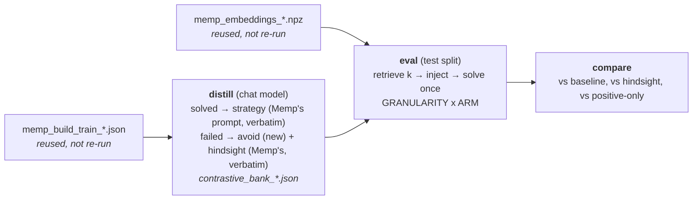

# Contrastive memory — design and pre-registration

A fourth memory method, built here rather than ported. One bank, two kinds of entry,
and which kind a train task yields is decided by the outcome rather than by a knob:

| the actor | the entry carries | written by |
|---|---|---|
| **solved** it | `strategy` — what to do | Memp's own distill prompt, **verbatim** |
| **failed** it | `avoid` — what not to do | the one new model call this method makes |

Every ported method learns from one sign. Reflexion learns from failure, but only
about the *same* task — a reflection is replayed into a retry of the puzzle that
produced it. Memp and MemoryBank learn across tasks, but only from success: a train
puzzle the actor failed is distilled from the **dataset's gold path** instead, so the
failure itself is discarded and nothing in either bank is derived from a mistake.
This method keeps the mistake.

> **Status: RUN.** SPaRC on gpt-oss-120b (5 arms + a 2×2 repair) and Qwen3-32B
> (5 arms); StepGame on Qwen3-32B (5 arms + repair) and Qwen3-0.6B (5 arms). ~34 jobs.
> §5's predictions were written before submission and are frozen; §6 scores them. §0 is
> regenerated by `scripts/contrastive_report.py`, never edited by hand.
>
> **Headline (§6.1): the null holds, and now between two strong arms.** Learning from
> the failure is indistinguishable from learning from the gold path — SPaRC 95 vs 98
> (p = 0.80), StepGame 888 vs 896 (p = 0.48) — with both arms individually significant
> against baseline. Since `avoid` needs no gold annotations, the two being
> interchangeable is the result worth having.
>
> **The mechanism prediction landed (§6.2).** DON'Ts cut SPaRC wrong-solutions
> 203 → 152 on gpt-oss and 210 → 143 on Qwen3-32B, more than double the campaign's best
> previous rule-compliance effect, and pay for it in dead-ends.
>
> **Two methodological findings that reach beyond this method.** 39 tokens of
> misleading header cost as much as omitting a worked example from all 500 entries
> (§6.6); and two jobs injecting a **byte-identical** prompt flipped 33 of 144 items,
> so anything under ~15 puzzles in this campaign is unresolved rather than null
> (§6.3). The second is now in all four methods' threats sections.
>
> **Not run:** Qwen3-0.6B on SPaRC — pre-registered as uninterpretable for this method
> (§6.8).

---

## 0. All runs at a glance

Every contrastive arm run on either benchmark, generated from the result files by
`scripts/contrastive_report.py` (`BENCH=sparc|stepgame --only <view>`); **the numbers
below are not maintained by hand** — re-run it after adding an arm. All arms: one
attempt per item, seed 0, `temperature 0.6`, *k* = 3, retrieval and block format
identical across arms. Baselines are each actor's Reflexion trial 1.

Rows are grouped by arm: the four **`avoid`** rows are the method (main, relevance
ablation, polarity ablation, and the repaired configuration), then its **`hindsight`**
control, then **`positive-only`**, which withholds the failed entries entirely.

`hindsight` is the control the method's headline question needs — the same bank with a
gold-derived procedure where the method puts a DON'T. **`[@ best]`** marks that pairing
re-made after the two renderer defects of section 6.6 were fixed (a missing worked
exemplar, and a header describing a two-sign block on an arm whose items are all DO),
over banks whose every `strategy`/`avoid`/`hindsight` text is byte-identical to the
first run. The two single-factor arms that separated those defects are not campaign
results and are tabulated in section 6.6 instead.

Each row is reported against the memoryless baseline only; the method-vs-control
contrasts, with their p-values, are made in section 6.1. The two *italic* rows at the
foot of every table are one arm each of **Memp** and **MemoryBank**, for scale. They
render through their own method's block, so a gap to them is a method comparison rather
than a controlled contrast — full tables in [memp.md](memp.md) and
[memorybank.md](memorybank.md). Memp appears at **script** granularity on SPaRC, the
like-for-like choice since every arm here is prose only; on StepGame it appears at
**trajectory** granularity because that campaign deliberately ran no script arm.

---

### 0.1 SPaRC — 500 test puzzles per actor

#### Success rate

`vs baseline` is the paired difference against that actor's memoryless run over the same items. **Bold = *p* < 0.05** on an exact McNemar; the p itself is quoted in section 6 where it is argued. The two *italic* rows are one arm each of the ported methods, for scale — they use their own renderer, so a gap to them is a method comparison, not a controlled contrast. Memp is shown at **script** granularity, the like-for-like one since every arm here is prose only.

| Actor | Arm | Solved /500 | Accuracy | vs baseline |
|---|---|---|---|---|
| Qwen3-32B | baseline (memoryless) | 55 | 11.0% | — |
|  | avoid, retrieved | 48 | 9.6% | -7 |
|  | avoid, random | 42 | 8.4% | -13 |
|  | avoid, BALANCED | 44 | 8.8% | -11 |
|  | hindsight, retrieved | 43 | 8.6% | -12 |
|  | positive-only, retrieved | 39 | 7.8% | **-16** |
|  | *Memp — script v2, retrieved* | 40 | 8.0% | **-15** |
|  | *MemoryBank — case-record, retrieved* | 48 | 9.6% | -7 |
| gpt-oss-120b | baseline (memoryless) | 70 | 14.0% | — |
|  | avoid, retrieved | 74 | 14.8% | +4 |
|  | avoid, random | 74 | 14.8% | +4 |
|  | avoid, BALANCED | 83 | 16.6% | +13 |
|  | avoid + exemplar  [@ best] | 95 | 19.0% | **+25** |
|  | hindsight, retrieved | 80 | 16.0% | +10 |
|  | hindsight + both  [@ best] | 98 | 19.6% | **+28** |
|  | positive-only, retrieved | 79 | 15.8% | +9 |
|  | *Memp — script v2, retrieved* | 90 | 18.0% | **+20** |
|  | *MemoryBank — case-record, retrieved* | 98 | 19.6% | **+28** |

#### Success by difficulty

Accuracy within each SPaRC difficulty band (n = 86 / 118 / 121 / 86 / 89).

| Actor | Arm | d1 | d2 | d3 | d4 | d5 |
|---|---|---|---|---|---|---|
| Qwen3-32B | baseline (memoryless) | 33% | 14% | 7% | 3% | 0% |
|  | avoid, retrieved | 23% | 15% | 6% | 3% | 0% |
|  | avoid, random | 20% | 13% | 6% | 3% | 0% |
|  | avoid, BALANCED | 27% | 10% | 6% | 2% | 0% |
|  | hindsight, retrieved | 23% | 11% | 5% | 3% | 1% |
|  | positive-only, retrieved | 26% | 9% | 4% | 1% | 0% |
|  | *Memp — script v2, retrieved* | 26% | 11% | 3% | 1% | 0% |
|  | *MemoryBank — case-record, retrieved* | 27% | 12% | 7% | 3% | 0% |
| gpt-oss-120b | baseline (memoryless) | 38% | 18% | 10% | 3% | 1% |
|  | avoid, retrieved | 48% | 19% | 8% | 0% | 0% |
|  | avoid, random | 41% | 19% | 12% | 1% | 1% |
|  | avoid, BALANCED | 55% | 19% | 10% | 2% | 0% |
|  | avoid + exemplar  [@ best] | 51% | 25% | 15% | 2% | 2% |
|  | hindsight, retrieved | 48% | 22% | 9% | 1% | 1% |
|  | hindsight + both  [@ best] | 48% | 31% | 13% | 3% | 1% |
|  | positive-only, retrieved | 47% | 19% | 12% | 1% | 1% |
|  | *Memp — script v2, retrieved* | 51% | 27% | 7% | 3% | 2% |
|  | *MemoryBank — case-record, retrieved* | 58% | 24% | 12% | 6% | 1% |

#### Failure modes

Terminal reason for all 500 episodes, and **the table the pre-registered prediction in section 5 is about**. `wrong-solution` = a path was submitted and broke a rule; `dead-end` = the path was painted into a corner; `format-failure` = no parseable move.

| Actor | Arm | solved | wrong-solution | dead-end | format-failure | error |
|---|---|---|---|---|---|---|
| Qwen3-32B | baseline (memoryless) | 55 | 210 | 235 | 0 | 0 |
|  | avoid, retrieved | 48 | 185 | 267 | 0 | 0 |
|  | avoid, random | 42 | 178 | 280 | 0 | 0 |
|  | avoid, BALANCED | 44 | 143 | 313 | 0 | 0 |
|  | hindsight, retrieved | 43 | 179 | 278 | 0 | 0 |
|  | positive-only, retrieved | 39 | 212 | 249 | 0 | 0 |
|  | *Memp — script v2, retrieved* | 40 | 160 | 300 | 0 | 0 |
|  | *MemoryBank — case-record, retrieved* | 48 | 201 | 251 | 0 | 0 |
| gpt-oss-120b | baseline (memoryless) | 70 | 203 | 227 | 0 | 0 |
|  | avoid, retrieved | 74 | 152 | 273 | 1 | 0 |
|  | avoid, random | 74 | 151 | 275 | 0 | 0 |
|  | avoid, BALANCED | 83 | 183 | 234 | 0 | 0 |
|  | avoid + exemplar  [@ best] | 95 | 171 | 234 | 0 | 0 |
|  | hindsight, retrieved | 80 | 177 | 243 | 0 | 0 |
|  | hindsight + both  [@ best] | 98 | 177 | 225 | 0 | 0 |
|  | positive-only, retrieved | 79 | 173 | 248 | 0 | 0 |
|  | *Memp — script v2, retrieved* | 90 | 180 | 229 | 1 | 0 |
|  | *MemoryBank — case-record, retrieved* | 98 | 223 | 178 | 1 | 0 |

#### Injected polarity

Share of items whose injected block contained at least one **DO** — what the actor SAW, not where the text came from. Only the `avoid` arms appear: they are the ones carrying DON'Ts, and a bank's mix of the two signs is the **actor's train accuracy**, not a knob. gpt-oss solves 71 of 500 SPaRC train puzzles, so a plain cosine top-3 leaves most items with no worked example at all; on StepGame the ratio inverts. An arm low in this column cannot be read as a verdict on negative advice — that is what `balanced` exists for (section 2). `hindsight` and `positive-only` sit at 100% and 28.8% trivially, by construction.

| Actor | Arm | items with ≥1 DO |
|---|---|---|
| Qwen3-32B | avoid, retrieved | 16.2% |
|  | avoid, random | 24.0% |
|  | avoid, BALANCED | 100.0% |
| gpt-oss-120b | avoid, retrieved | 28.8% |
|  | avoid, random | 36.8% |
|  | avoid, BALANCED | 100.0% |
|  | avoid + exemplar  [@ best] | 28.8% |

#### Token cost and efficiency

Prompt + completion + retry over every episode. `retry` is included per the accounting rule in `docs/memp.md` section 2 — an arm that provokes more format failures must not look cheap. **tok/solve** is the efficiency figure: an arm that solves more can still cost more per solved item.

| Actor | Arm | Total | ktok/puzzle | Solved | ktok/solve | vs baseline |
|---|---|---|---|---|---|---|
| Qwen3-32B | baseline (memoryless) | 37.5M | 75.0 | 55 | 682.0 | — |
|  | avoid, retrieved | 45.5M | 90.9 | 48 | 947.0 | +39% |
|  | avoid, random | 45.1M | 90.2 | 42 | 1074.3 | +58% |
|  | avoid, BALANCED | 45.5M | 91.0 | 44 | 1033.7 | +52% |
|  | hindsight, retrieved | 45.4M | 90.8 | 43 | 1055.5 | +55% |
|  | positive-only, retrieved | 40.3M | 80.7 | 39 | 1034.4 | +52% |
|  | *Memp — script v2, retrieved* | 46.5M | 93.0 | 40 | 1162.7 | +70% |
|  | *MemoryBank — case-record, retrieved* | 58.9M | 117.8 | 48 | 1227.5 | +80% |
| gpt-oss-120b | baseline (memoryless) | 27.7M | 55.5 | 70 | 396.3 | — |
|  | avoid, retrieved | 38.5M | 77.1 | 74 | 520.9 | +31% |
|  | avoid, random | 36.4M | 72.7 | 74 | 491.5 | +24% |
|  | avoid, BALANCED | 39.7M | 79.3 | 83 | 477.7 | +21% |
|  | avoid + exemplar  [@ best] | 48.3M | 96.6 | 95 | 508.6 | +28% |
|  | hindsight, retrieved | 39.2M | 78.4 | 80 | 490.1 | +24% |
|  | hindsight + both  [@ best] | 43.9M | 87.7 | 98 | 447.7 | +13% |
|  | positive-only, retrieved | 34.6M | 69.2 | 79 | 438.2 | +11% |
|  | *Memp — script v2, retrieved* | 46.3M | 92.6 | 90 | 514.4 | +30% |
|  | *MemoryBank — case-record, retrieved* | 73.5M | 147.0 | 98 | 749.9 | +89% |

#### Token breakdown: prompt vs completion

The same tokens as the previous table, split by kind. **Prompt tok/step** is the clearest measure of what a memory block actually costs, since the block is re-sent on every step of the episode. `retry` is prompt+completion spent on replies that yielded no parseable answer.

| Actor | Arm | Prompt | Completion | Retry | Prompt share | Prompt tok/step |
|---|---|---|---|---|---|---|
| Qwen3-32B | baseline (memoryless) | 15.2M | 22.3M | 0.06M | 40% | 2026 |
|  | avoid, retrieved | 20.5M | 24.9M | 0.07M | 45% | 2652 |
|  | avoid, random | 20.4M | 24.7M | 0.00M | 45% | 2644 |
|  | avoid, BALANCED | 20.5M | 24.9M | 0.07M | 45% | 2647 |
|  | hindsight, retrieved | 20.5M | 24.8M | 0.09M | 45% | 2679 |
|  | positive-only, retrieved | 16.4M | 23.8M | 0.10M | 41% | 2147 |
|  | *Memp — script v2, retrieved* | 23.1M | 23.4M | 0.06M | 50% | 2989 |
|  | *MemoryBank — case-record, retrieved* | 37.7M | 21.1M | 0.05M | 64% | 5078 |
| gpt-oss-120b | baseline (memoryless) | 16.7M | 10.7M | 0.29M | 60% | 2090 |
|  | avoid, retrieved | 22.7M | 14.8M | 0.96M | 59% | 2760 |
|  | avoid, random | 22.6M | 13.4M | 0.46M | 62% | 2748 |
|  | avoid, BALANCED | 23.7M | 15.3M | 0.68M | 60% | 2797 |
|  | avoid + exemplar  [@ best] | 27.0M | 19.5M | 1.79M | 56% | 3082 |
|  | hindsight, retrieved | 24.3M | 14.3M | 0.58M | 62% | 2814 |
|  | hindsight + both  [@ best] | 26.9M | 16.1M | 0.90M | 61% | 3170 |
|  | positive-only, retrieved | 19.0M | 15.0M | 0.61M | 55% | 2263 |
|  | *Memp — script v2, retrieved* | 27.0M | 18.0M | 1.25M | 58% | 3143 |
|  | *MemoryBank — case-record, retrieved* | 46.9M | 23.8M | 2.72M | 64% | 5253 |

#### Steps in the environment

Env steps per episode (`max_steps=100`), split by outcome: a solved episode's step count is essentially the path length, while a failed one shows how long the agent kept moving before dying.

| Actor | Arm | Mean (all) | Mean (solved) | Mean (failed) |
|---|---|---|---|---|
| Qwen3-32B | baseline (memoryless) | 15.0 | 12.2 | 15.3 |
|  | avoid, retrieved | 15.4 | 13.2 | 15.7 |
|  | avoid, random | 15.4 | 12.5 | 15.7 |
|  | avoid, BALANCED | 15.5 | 12.0 | 15.8 |
|  | hindsight, retrieved | 15.3 | 13.7 | 15.5 |
|  | positive-only, retrieved | 15.3 | 11.4 | 15.6 |
|  | *Memp — script v2, retrieved* | 15.4 | 11.7 | 15.8 |
|  | *MemoryBank — case-record, retrieved* | 14.9 | 11.8 | 15.2 |
| gpt-oss-120b | baseline (memoryless) | 16.0 | 12.8 | 16.5 |
|  | avoid, retrieved | 16.5 | 13.7 | 17.0 |
|  | avoid, random | 16.4 | 13.5 | 16.9 |
|  | avoid, BALANCED | 17.0 | 14.7 | 17.4 |
|  | avoid + exemplar  [@ best] | 17.6 | 14.9 | 18.2 |
|  | hindsight, retrieved | 17.3 | 14.7 | 17.7 |
|  | hindsight + both  [@ best] | 17.0 | 14.0 | 17.7 |
|  | positive-only, retrieved | 16.8 | 12.7 | 17.5 |
|  | *Memp — script v2, retrieved* | 17.2 | 15.0 | 17.7 |
|  | *MemoryBank — case-record, retrieved* | 17.9 | 14.1 | 18.8 |

---

### 0.2 StepGame — 1000 test items, `upstream-header`

> **These effect sizes carry a protocol confound.** The campaign runs on
> `upstream-header`, which is 13.8 points below `ours` for Qwen3-32B, and about half
> that gap is frame inversion that a distilled bank demonstrably repairs
> (`docs/stepgame.md` risk 1b). Part of every `+150`-class number here is memory
> re-supplying task specification the prompt withheld, not memory improving reasoning.
> The **contrasts between arms** are unaffected — they all share the protocol — which
> is why the headline test lives there and not in the vs-baseline column.

#### Success rate

`vs baseline` is the paired difference against that actor's memoryless run over the same items. **Bold = *p* < 0.05** on an exact McNemar; the p itself is quoted in section 6 where it is argued. The two *italic* rows are one arm each of the ported methods, for scale — they use their own renderer, so a gap to them is a method comparison, not a controlled contrast. Memp is shown at **trajectory** granularity: the StepGame campaign ran no script arm, so unlike section 0.1 its Memp row is not prose-only.

| Actor | Arm | Solved /1000 | Accuracy | vs baseline |
|---|---|---|---|---|
| Qwen3-32B | baseline (memoryless) | 733 | 73.3% | — |
|  | avoid, retrieved | 879 | 87.9% | **+146** |
|  | avoid, random | 883 | 88.3% | **+150** |
|  | avoid, BALANCED | 875 | 87.5% | **+142** |
|  | avoid + exemplar  [@ best] | 888 | 88.8% | **+155** |
|  | hindsight, retrieved | 889 | 88.9% | **+156** |
|  | hindsight + both  [@ best] | 896 | 89.6% | **+163** |
|  | positive-only, retrieved | 871 | 87.1% | **+138** |
|  | *Memp — trajectory, retrieved* | 895 | 89.5% | **+162** |
|  | *MemoryBank — case-record, retrieved* | 900 | 90.0% | **+167** |

#### Success by story length *k*

`k` is the number of sentences, which is what every published StepGame number reports. It is **not** the reasoning depth — see the hop table below and `docs/stepgame.md` section 2.2.

| Actor | Arm | k1 | k2 | k3 | k4 | k5 | k6 | k7 | k8 | k9 | k10 |
|---|---|---|---|---|---|---|---|---|---|---|---|
| Qwen3-32B | baseline (memoryless) | 96% | 78% | 81% | 80% | 71% | 69% | 71% | 64% | 59% | 64% |
|  | avoid, retrieved | 100% | 91% | 93% | 86% | 86% | 86% | 89% | 86% | 80% | 82% |
|  | avoid, random | 100% | 93% | 96% | 86% | 87% | 87% | 83% | 84% | 87% | 80% |
|  | avoid, BALANCED | 100% | 92% | 94% | 87% | 81% | 89% | 87% | 84% | 81% | 80% |
|  | avoid + exemplar  [@ best] | 100% | 91% | 93% | 86% | 87% | 87% | 93% | 85% | 85% | 81% |
|  | hindsight, retrieved | 100% | 92% | 94% | 85% | 89% | 89% | 84% | 90% | 87% | 79% |
|  | hindsight + both  [@ best] | 99% | 95% | 93% | 84% | 90% | 91% | 89% | 87% | 85% | 83% |
|  | positive-only, retrieved | 100% | 94% | 94% | 87% | 85% | 87% | 88% | 81% | 77% | 78% |
|  | *Memp — trajectory, retrieved* | 98% | 95% | 91% | 89% | 90% | 88% | 91% | 87% | 84% | 82% |
|  | *MemoryBank — case-record, retrieved* | 99% | 93% | 92% | 90% | 91% | 92% | 93% | 85% | 83% | 82% |

#### Success by true hop count

The reasoning depth, as re-derived by the exact solver. The informative band is **h≥4**; h9/h10 rest on a handful of items each and should not be read individually.

| Actor | Arm | h1 | h2 | h3 | h4 | h5 | h6 | h7 | h8 | h9 | h10 | **h≥4** | all |
|---|---|---|---|---|---|---|---|---|---|---|---|---|---|
| Qwen3-32B | baseline (memoryless) | 94% | 63% | 66% | 58% | 56% | 47% | 48% | 29% | 20% | 25% | **51.7%** | 73.3% |
|  | avoid, retrieved | 97% | 77% | 91% | 87% | 75% | 82% | 65% | 79% | 100% | 75% | **80.5%** | 87.9% |
|  | avoid, random | 98% | 78% | 87% | 85% | 80% | 76% | 87% | 79% | 60% | 100% | **81.8%** | 88.3% |
|  | avoid, BALANCED | 98% | 79% | 87% | 84% | 75% | 82% | 65% | 79% | 60% | 75% | **78.4%** | 87.5% |
|  | avoid + exemplar  [@ best] | 98% | 81% | 89% | 79% | 89% | 76% | 78% | 86% | 100% | 50% | **81.4%** | 88.8% |
|  | hindsight, retrieved | 99% | 78% | 90% | 84% | 85% | 74% | 83% | 93% | 100% | 50% | **82.6%** | 88.9% |
|  | hindsight + both  [@ best] | 98% | 80% | 90% | 86% | 82% | 84% | 78% | 86% | 60% | 100% | **83.5%** | 89.6% |
|  | positive-only, retrieved | 98% | 78% | 90% | 78% | 75% | 74% | 70% | 79% | 100% | 50% | **75.8%** | 87.1% |
|  | *Memp — trajectory, retrieved* | 98% | 85% | 90% | 88% | 70% | 76% | 87% | 71% | 80% | 75% | **80.1%** | 89.5% |
|  | *MemoryBank — case-record, retrieved* | 97% | 85% | 90% | 84% | 77% | 82% | 96% | 93% | 80% | 50% | **82.6%** | 90.0% |

#### Failure modes

Terminal reason for all 1000 items. Single-turn, so the only failure modes are a wrong label and an unparseable reply.

| Actor | Arm | solved | wrong-answer | format-failure | error |
|---|---|---|---|---|---|
| Qwen3-32B | baseline (memoryless) | 733 | 267 | 0 | 0 |
|  | avoid, retrieved | 879 | 121 | 0 | 0 |
|  | avoid, random | 883 | 117 | 0 | 0 |
|  | avoid, BALANCED | 875 | 125 | 0 | 0 |
|  | avoid + exemplar  [@ best] | 888 | 112 | 0 | 0 |
|  | hindsight, retrieved | 889 | 111 | 0 | 0 |
|  | hindsight + both  [@ best] | 896 | 104 | 0 | 0 |
|  | positive-only, retrieved | 871 | 129 | 0 | 0 |
|  | *Memp — trajectory, retrieved* | 895 | 105 | 0 | 0 |
|  | *MemoryBank — case-record, retrieved* | 900 | 100 | 0 | 0 |

#### Injected polarity

Share of items whose injected block contained at least one **DO** — what the actor SAW, not where the text came from. Only the `avoid` arms appear: they are the ones carrying DON'Ts, and a bank's mix of the two signs is the **actor's train accuracy**, not a knob. gpt-oss solves 71 of 500 SPaRC train puzzles, so a plain cosine top-3 leaves most items with no worked example at all; on StepGame the ratio inverts. An arm low in this column cannot be read as a verdict on negative advice — that is what `balanced` exists for (section 2). `hindsight` and `positive-only` sit at 100% and 28.8% trivially, by construction.

| Actor | Arm | items with ≥1 DO |
|---|---|---|
| Qwen3-32B | avoid, retrieved | 94.7% |
|  | avoid, random | 96.4% |
|  | avoid, BALANCED | 100.0% |
|  | avoid + exemplar  [@ best] | 94.7% |

#### Token cost and efficiency

Prompt + completion + retry over every episode. `retry` is included per the accounting rule in `docs/memp.md` section 2 — an arm that provokes more format failures must not look cheap. **tok/solve** is the efficiency figure: an arm that solves more can still cost more per solved item.

| Actor | Arm | Total | ktok/item | Solved | ktok/solve | vs baseline |
|---|---|---|---|---|---|---|
| Qwen3-32B | baseline (memoryless) | 2.3M | 2.3 | 733 | 3.2 | — |
|  | avoid, retrieved | 3.4M | 3.4 | 879 | 3.8 | +20% |
|  | avoid, random | 3.3M | 3.3 | 883 | 3.7 | +18% |
|  | avoid, BALANCED | 3.4M | 3.4 | 875 | 3.9 | +23% |
|  | avoid + exemplar  [@ best] | 3.4M | 3.4 | 888 | 3.9 | +22% |
|  | hindsight, retrieved | 3.3M | 3.3 | 889 | 3.7 | +18% |
|  | hindsight + both  [@ best] | 3.2M | 3.2 | 896 | 3.6 | +14% |
|  | positive-only, retrieved | 3.1M | 3.1 | 871 | 3.6 | +14% |
|  | *Memp — trajectory, retrieved* | 3.2M | 3.2 | 895 | 3.6 | +12% |
|  | *MemoryBank — case-record, retrieved* | 3.6M | 3.6 | 900 | 4.0 | +26% |

#### Token breakdown: prompt vs completion

The same tokens as the previous table, split by kind. `retry` is prompt+completion spent on replies that yielded no parseable answer.

| Actor | Arm | Prompt | Completion | Retry | Prompt share |
|---|---|---|---|---|---|
| Qwen3-32B | baseline (memoryless) | 0.3M | 2.0M | 0.06M | 13% |
|  | avoid, retrieved | 1.1M | 2.2M | 0.03M | 33% |
|  | avoid, random | 1.1M | 2.2M | 0.01M | 33% |
|  | avoid, BALANCED | 1.1M | 2.3M | 0.03M | 32% |
|  | avoid + exemplar  [@ best] | 1.2M | 2.2M | 0.04M | 34% |
|  | hindsight, retrieved | 1.1M | 2.2M | 0.04M | 33% |
|  | hindsight + both  [@ best] | 1.2M | 2.1M | 0.00M | 36% |
|  | positive-only, retrieved | 0.9M | 2.2M | 0.03M | 29% |
|  | *Memp — trajectory, retrieved* | 1.3M | 1.9M | 0.00M | 42% |
|  | *MemoryBank — case-record, retrieved* | 1.7M | 1.9M | 0.03M | 47% |

---

## 1. Why, and what is actually new

### The motivation is a measured side-effect, not "two signs are better than one"

`docs/memp.md` §3.9, gpt-oss-120b, Δ against the 70/500 memoryless baseline:

| Injected memory | Δ wrong-solution | Δ dead-end | Δ solved |
|---|---|---|---|
| rule-correct script from the gold path | **−23** | +2 | +20 |
| verbatim winning trajectory | **+37** | −71 | +32 |

The arm that won the campaign **makes rule compliance worse**. A worked trace teaches
the model to keep making progress and says nothing about which rules bound the
puzzle, so dead-ends collapse and invalid submissions climb. The campaign's own
summary: the mechanism is *"navigational rather than normative"*.

A failed attempt is the one artifact in which a rule violation is directly
observable — and on SPaRC the environment hands back a per-rule verdict on it, in
code:

```json
"all_dots_collected": {"passed": false, "detail": {"total": 3, "collected": 1}},
"poly_ylop_area":     {"passed": false, "detail": {"violations": [0], ...}}
```

That verdict is fed to the avoid-distiller as grounding, so a DON'T names a rule that
was *actually* broken rather than one the model inferred from a grid. It is the
failure-side analogue of the property `docs/memp.md` §3.9 found decisive: not a claim
about what the rule says, but the env's judgement on what happened.

**H1.** Replacing the gold-derived procedure on a non-solved train puzzle with a
DON'T distilled from the actual failure reduces wrong-solutions, because a warning
about a rule that was observably broken transmits a constraint that a procedure
describing a correct path does not.

**H0.** The two are interchangeable: what the actor uses is *any* rule-scoped
paragraph about a similar puzzle, and its sign and provenance are inert — which is
what `docs/memp.md` §3.4 (relevance) and §3.9 (correctness) already found about every
other property of this kind of memory.

### What is not claimed

The literature contains close relatives; the thesis cites them rather than claiming
priority.

| Work | What it does | How this differs |
|---|---|---|
| **Reflexion** (Shinn et al., 2023) | failure-derived memory | already an arm here; replayed into the **same** task, never cross-task |
| **Memp** `Vanilla` update (Fang et al., 2026) | consolidates all group trajectories, failures included | implemented in this repo, never run; still distils toward a *procedure*, and the paper never ablates the sign |
| **Memp** `Adjustment` | repairs a procedure that led to a failure | implemented here, never run |
| **ExpeL** (Zhao et al., AAAI 2024) | cross-task insight pool from comparing success/failure pairs | pairs are cross-item and LLM-summarised; no ablation of the two halves |
| **AutoGuide** (NeurIPS 2024) | state-conditioned guidelines from contrasting successful and unsuccessful trajectories | generated prose; no matched-bank control |

The claim is therefore **not** "first to combine". It is:

> the first **controlled decomposition** of the positive and negative signals — the
> same 500 entries, the same retriever, the same *k*, the same block format, the same
> positive half, the same actor and seed, differing only in whether a non-solved
> train task contributes a warning drawn from its failure or a procedure drawn from
> its gold path.

ExpeL and AutoGuide report the combination working; neither runs the half-arms
against it. That is the gap.

### Why this lands cleanly on *this* campaign

`docs/memp.md`'s v2 script bank is 500 entries = 71 distilled from the actor's own
successes + **429 distilled from the gold path**, and it scored 90/500 on gpt-oss
(p = 0.0225). This method's bank is the same 500 = *the same 71, written by the same
prompt* + **429 distilled from the failures**. One factor moves. There is already a
number on the other side of it.

---

## 2. The data this is built on

`scripts/run_memp.py`'s `episode_record()` keeps `episode_context` for failures as
well as successes, so **the ~8 h memoryless train pass does not need to be re-run**.
Measured over the build files on disk:

| Build file | n | solved → DO | failed → DON'T | failures with usable context |
|---|---|---|---|---|
| `memp_build_train_gptoss120b.json` | 500 | 71 | 429 | 429 (236 wrong-sol, 193 dead-end) |
| `memp_build_train_qwen32b.json` | 500 | 41 | 459 | 459 (221 wrong-sol, 238 dead-end) |
| `memp_build_train_qwen06b.json` | 500 | 9 | 491 | 491 (191, 294, 6 format-fail) |
| `memp_build_stepgame_train_qwen32b_upstream-header.json` | 500 | 323 | 177 | 177 |
| `memp_build_stepgame_train_qwen06b_upstream-header.json` | 500 | 82 | 418 | 418 |

### The polarity problem — read this before the arms

**A bank's mix of DOs and DON'Ts is the actor's train accuracy.** It is not a knob,
and on SPaRC these actors are weak, so the bank is overwhelmingly negative. What a
plain cosine top-3 can therefore inject:

| Actor | DO | DON'T | positive share | expected DOs per block at k=3 |
|---|---|---|---|---|
| gpt-oss-120b | 71 | 429 | **14.2%** | **~0.4** |
| Qwen3-32B | 41 | 459 | 8.2% | ~0.25 |
| Qwen3-0.6B | 9 | 491 | 1.8% | ~0.05 |
| StepGame, Qwen3-32B | 323 | 177 | 64.6% | ~1.9 |

On SPaRC **most items will see no worked positive example at all** — and a correct
worked example in context is the one ingredient this campaign has established as
active (`docs/memp.md` §3.10: a *randomly chosen* correct trajectory recovers +22 of
+32). A null on `avoid` under plain retrieval would therefore be unreadable: it could
not distinguish *"negative advice does not help"* from *"negative advice crowded out
the thing that does"*.

**The control is not subject to this at all**, and that asymmetry is the contrast, not
a flaw in it: under `hindsight` every entry — including all 429 from failed train
tasks — is rendered as a DO, so 100% of items see a worked positive framing against
`avoid`'s 28.8%. The headline test is therefore "all-positive against mostly-negative",
which is what the method *is*; but it means `avoid` vs `hindsight` compares two things
at once, and **`balanced` vs `hindsight` is the sharper contrast** — it holds "every
item sees a DO" fixed at 100% on both sides and moves only what the remaining entries
say.

That is what **`--arm balanced`** is for: cosine top-*k*, but with at least
`--min-positive` DO entries guaranteed. It is not a tuning knob, it is the arm that
makes a null interpretable, and it is run alongside `retrieved` rather than instead of
it. `scripts/smoke_contrastive.py` pins the behaviour on a deliberately lopsided bank,
and every eval file records `injected_positive_share` and `items_with_a_positive`,
both of which the report prints in their own table.

---

## 3. The arms

The bank is **always 500 entries** and the positive half is **always the same text**.
`docs/memp.md` §3.6's agent-only ablation is uninterpretable because it changed
provenance *and* bank size (500→71) at once, and says so in its own
threats-to-validity; that is not repeated here.

> **The reported configuration, fixed 2026-09-21: `avoid` with the worked exemplar
> attached** (`--exemplars on`). §6.6 showed that omitting it cost ~20 puzzles on
> gpt-oss for no scientific gain — it was left out so the DO/DON'T sign contrast would
> not be confounded with a worked example, but since *both* arms carry one the contrast
> is unaffected, and the arms without it were simply weaker versions of themselves.
> Every retrieval ablation is being re-run at this configuration (`run_contrastive_campaign.sh
> standard`) so the relevance and polarity contrasts test the arm the thesis reports.
>
> **`hindsight` stays.** It is the control, and it is not interchangeable with
> MemoryBank despite matching its score on SPaRC/gpt-oss (98 each): the two disagree on
> **58 of 500 items** (29 each way), and their totals differ in the other three
> settings (−5, −4, −17). MemoryBank has its own bank, its own distilled text and its
> own renderer, so `avoid` against it is a cross-method comparison with many moving
> parts; `avoid` against `hindsight` holds bank, entry count, retriever, *k* and the
> positive half fixed and moves one thing. Dropping it would leave the method with no
> control, which is the whole contribution. It is already run at its best config, so
> keeping it costs nothing.

### Content: what a non-solved train task contributes

| `--granularity` | A `failed` entry renders | Role |
|---|---|---|
| `avoid` | its DON'T, distilled from the actual failure | **the method** |
| `hindsight` | a procedure distilled from the gold path — Memp's policy, our renderer | **the control** |
| `positive-only` | nothing (one placeholder line) | what the 429 contribute at all |
| `avoid-only` | its DON'T, and the DOs are withheld too | the pure-negative arm |

### Retrieval: how entries are chosen

| `--arm` | Policy |
|---|---|
| `retrieved` | cosine top-*k*, Memp's, verbatim |
| `balanced` | top-*k* with ≥ `--min-positive` DOs — see §2 |
| `random` | the seeded-random relevance ablation |
| `random-balanced` | matched to `balanced`, so the ablation moves relevance and not polarity |

### The headline test is `avoid` vs `hindsight`, and it is token-matched

Measured over the real gpt-oss v2 bank (k=3, mean injected block):

| Arm | mean block | vs `avoid` |
|---|---|---|
| `avoid` | **~834 tok** | — |
| `hindsight` | **~819 tok** | **−1.8%** |
| `avoid-only` | ~719 tok | −14% |
| `positive-only` | **~180 tok** | **−78%** |

`avoid` vs `hindsight` is matched on bank size, entry count, retriever, *k*, polarity,
positive half **and token budget to within 2%**. It moves exactly one factor.

`positive-only` is *not* token-matched — 85.8% of its entries render a placeholder —
so a win for `avoid` over it is confounded with block length and must be reported as
such. It answers "do the 429 contribute anything", not "does the sign matter".

---

## 4. The pipeline



| Phase | Runs on | Reads → writes |
|---|---|---|
| `distill` | chat model (~1–2 h) | `memp_build_train_*.json` → `contrastive_bank_<tag>.json` |
| `eval` | chat model | bank + Memp vectors → `contrastive_eval_<gran>_<arm>_<tag>.json` |
| `compare` | login node, no GPU | result files → `results/txt/contrastive_vs_baseline_<tag>.txt` |

**All three texts are written in one `distill` pass.** If the control text came from a
second job, `avoid` and `hindsight` could silently be built from different banks and
the single-factor claim would be false.

Submitted through `scripts/run_contrastive_campaign.sh`, which mirrors
`run_stepgame_campaign.sh`'s conventions (one `BENCH` knob for both benchmarks,
`MODELS=` to restrict, `DRYRUN=1` to print instead of submit, and
`DEP_DISTILL_<TAG>=<jobid>` to chain evals off an in-flight bank):

```bash
BENCH=sparc    bash scripts/run_contrastive_campaign.sh distill        # 1 job
BENCH=sparc DEP_DISTILL_GPTOSS120B=<id> bash scripts/run_contrastive_campaign.sh eval   # 5
BENCH=stepgame bash scripts/run_contrastive_campaign.sh distill        # 1 job
BENCH=stepgame DEP_DISTILL_QWEN32B=<id> bash scripts/run_contrastive_campaign.sh eval   # 5
               bash scripts/run_contrastive_campaign.sh status         # what exists
               bash scripts/run_contrastive_campaign.sh compare        # NO GPU
```

The defaults pick one actor per benchmark on purpose: SPaRC → **gpt-oss-120b**, the
only actor on which any memory method helps; StepGame → **Qwen3-32B**, since gpt-oss
was dropped on ceiling grounds and Qwen3-32B is also the one bank whose polarity runs
the right way (64.6% positive). `MODELS="qwen32b qwen06b"` adds the others.

The equivalent raw submit lines:

```bash
BANK=results/json/contrastive_bank_gptoss120b.json
EMB=results/json/memp_embeddings_qwen3emb06b.npz

# 1. the bank
sbatch -J co-dist --export=ALL,DRIVER=contrastive,PHASE=distill,\
BUILD=results/json/memp_build_train_gptoss120b.json,OUT=$BANK \
    scripts/serve_and_run.sbatch

# 2. the core evals. COMMON keeps the --export list in one place: a granularity
#    typo'd on one of several submit lines shows up only as two arms agreeing.
COMMON="DRIVER=contrastive,PHASE=eval,LIMIT=0,BANK=$BANK,EMBEDDINGS=$EMB"
for G in avoid hindsight positive-only; do
    sbatch -J "co-$G" --export="ALL,$COMMON,ARM=retrieved,CO_GRANULARITY=$G" \
        scripts/serve_and_run.sbatch
done
# the arm that makes a null readable (section 2), and its matched ablation
sbatch -J co-bal --export="ALL,$COMMON,ARM=balanced,CO_GRANULARITY=avoid" \
    scripts/serve_and_run.sbatch
sbatch -J co-rnd --export="ALL,$COMMON,ARM=random,CO_GRANULARITY=avoid" \
    scripts/serve_and_run.sbatch

# 3. compare (login node, no GPU)
python scripts/run_contrastive.py --phase compare \
    --baseline results/json/reflexion_root_gptoss120b_test.json \
    --retrieved <avoid.json> --hindsight <hindsight.json> \
    --positive <positive-only.json> --random <rnd.json> \
    --memp results/json/memp_eval_retrieved_test_gptoss120b_v2.json
```

---

## 5. What is held constant, and the pre-registered predictions

Identical to Memp's protocol (`docs/memp.md` §2) and MemoryBank's (§3):

- **500 test puzzles, one attempt each.** No retry, so no `lift ≥ 0` artifact and no
  trial-matched control; memory can also *hurt*, which makes it two-sided.
- **Sampling:** seed 0, `temperature 0.6`, `top_p 0.95`, `top_k 20`,
  `max_tokens 12288`.
- **Baseline:** each model's Reflexion trial 1 — the memoryless pass over the same
  500 puzzles at the same seed and the same code.
- **Injection point:** appended *after* the full system prompt, exactly as the other
  three methods' blocks are, preserving the shared KV prefix.
- **Block format:** all four content arms share one renderer. Similarity scores are
  logged and never shown to the model.
- **Retrieval:** Memp's, verbatim — same `puzzle_key_text`, same `.npz`, same cosine
  top-*k*, same `(-similarity, id)` tie-break, same per-puzzle random seeding, so a
  resumed job injects byte-identical blocks.
- **k = 3**, matching both cross-task methods.
- **The positive half is Memp's own distillation, unchanged**, and so is `hindsight`.
  The `avoid` prompt is the only thing this method introduces.

### Predictions, written 2026-09-14 before any arm was submitted

gpt-oss-120b, k=3. Reference points: baseline 70/500 (wrong-sol 203, dead-end 227);
Memp script v2 — which is `hindsight` under a different renderer — 90/500 (180, 229).

| Arm | Predicted solved | Predicted wrong-sol | Reasoning |
|---|---|---|---|
| `hindsight`, retrieved | 85–95 | 175–195 | should reproduce Memp's v2 script arm within noise. **If it does not, the renderer differs from Memp's in a way that matters and everything below is suspect** — this is the arm that validates the apparatus, not a result |
| `positive-only`, retrieved | 72–82 | 195–215 | 71 real entries and 429 placeholders; close to baseline |
| `avoid`, retrieved | **80–95** | **165–190** | H1: a warning naming an observably broken rule transmits the constraint at least as well as a procedure describing a correct path |
| `avoid`, balanced | 85–100 | 170–195 | same, with the worked example the plain arm starves the block of |
| `avoid` vs `hindsight` | **the headline test** | | H1 predicts wrong-sol lower by ≥12 with solved not lower |

**The outcome that confirms H0** is `avoid` landing inside `hindsight`'s interval with
p > 0.2. That is the modal expectation (§6.6) and it is still a chapter: it would
extend the campaign's spine from *"relevance does not matter and content correctness
does not matter"* to *"the sign does not matter either — what the actor uses is any
rule-scoped paragraph about a similar task, however it was obtained."* Given that
`hindsight` requires gold annotations and `avoid` does not, a demonstrated tie is also
a practical result: the gold path can be dropped for free.

**Interesting regardless of direction:** `avoid-only`'s wrong-solution count. Below
203 means a warning transmits a constraint with no positive example present at all.
Above 240 means negative demonstrations are *imitated* — a real, citable finding, and
the reason that arm is run rather than assumed.

---

## 6. Results

Both benchmarks agree, and they agree on the null.

### 6.1 The headline test: learning from the failure ≈ learning from the gold path

| Benchmark | configuration | `avoid` | `hindsight` | discordant | p |
|---|---|---|---|---|---|
| SPaRC, gpt-oss-120b | as first run | 74/500 | 80/500 | 33 / 39 | 0.556 |
| SPaRC, gpt-oss-120b | **both arms repaired** | **95/500** | **98/500** | 31 / 34 | **0.804** |
| StepGame, Qwen3-32B | as first run | 879/1000 | 889/1000 | 48 / 58 | 0.382 |
| StepGame, Qwen3-32B | **both arms repaired** | **888/1000** | **896/1000** | 45 / 53 | **0.480** |

**H0 is confirmed, and the repaired comparison is the stronger version of it.** The
first run compared two arms that were both handicapped (§6.6); repaired, both are
individually significant against baseline — `avoid + exemplar` +25 (p = 0.0015),
`hindsight + both` +28 (p = 0.0002) — and the gap between them is 3 puzzles at
p = 0.80. Replacing a gold-derived procedure with a DON'T distilled from the actor's
own failure changes accuracy by nothing detectable, on either task, whether both arms
are weak or both are strong.

The practical corollary is what this buys: the two are interchangeable, and `avoid`
needs **no gold annotations at all**. On a task without them, the failure is a free
substitute for the labels.

Two caveats travel with it. The difference is 3 puzzles against a measured noise floor
of ~13 (§6.3), so this is "indistinguishable at this sample size", not "identical". And
the two arms differ in more than the sign of the text: `hindsight` shows a worked
positive framing on 100% of items against `avoid`'s 28.8% on SPaRC (§0), which is
inherent to the contrast rather than a confound — but it makes `balanced` vs
`hindsight`, which holds that at 100% on both sides, the sharper comparison.

### 6.2 But the mechanism prediction landed — the largest rule-compliance effect yet

The pre-registered prediction (§5) was about the failure-mode table, not the accuracy
column, and that half was right. SPaRC, Δ against the memoryless baseline:

| Arm | wrong-solution | Δ | dead-end | Δ | solved |
|---|---|---|---|---|---|
| baseline | 203 | — | 227 | — | 70 |
| `hindsight` | 177 | −26 | 243 | +16 | 80 |
| `positive-only` | 173 | −30 | 248 | +21 | 79 |
| **`avoid`** | **152** | **−51** | **273** | **+46** | 74 |
| `avoid`, random | 151 | −52 | 275 | +48 | 74 |
| `avoid`, BALANCED | 157 | −46 | 259 | +32 | 84 |
| *(ref)* Memp rule-correct script | 180 | −23 | 229 | +2 | 90 |

**−51 wrong-solutions is more than double the best previous rule-compliance effect in
this campaign** (the rule-correct script's −23, `docs/memp.md` §3.9), and it was
predicted in advance — §5 forecast 165–190 and the arm landed at 152, better than the
interval. A warning that names a rule the environment actually reported as broken does
transmit that constraint.

**It does not convert, because it costs navigation.** Dead-ends rise by 46, and
dead-ends are the larger pool, so the net is +4 (p = 0.71). This is the sharpest
instance yet of the campaign's *navigational vs normative* axis, now with both poles
measured on one actor:

- a verbatim winning trajectory is **navigational**: dead-ends −71, wrong-solutions +37
- a DON'T is **normative**: wrong-solutions −51, dead-ends +46

They are near-exact mirrors. And the DON'T reproduces on gpt-oss precisely the trade
`docs/memp.md` §3.9 documented for Qwen3-32B — *"memory makes it markedly more
rule-careful (wrong −50) and markedly more prone to stalling (dead +65), for a net
−15"*. What looked like a property of a weak actor turns out to be a property of
**normative memory content**, reproducible on the strongest actor by choosing what the
memory says. That is a cleaner statement of the campaign's spine than anything in the
three ported methods.

### 6.3 Polarity, and a noise floor that changes how to read everything above

§2 predicted that an unconstrained top-*k* over a 14.2%-positive bank would starve the
block of worked examples. The `balanced` arm was built to test that, and it moves
`avoid` from 74 to 83 (+9, p = 0.30) on gpt-oss — below this design's detection floor.

Getting there took two corrections, and the second is the important one.

**First correction (real, and it changed nothing).** `balanced_retrieve` re-sorted the
picked entries by entry id while `retrieve()` returns them in similarity order, so on
the 144 items whose plain top-3 already held a DO the two arms injected the *identical
three entries in a different order*. That was a genuine defect and it is fixed. But the
re-run says it did not matter: **83 against the confounded run's 84, 28/29 discordant,
p = 1.0000.** An earlier draft of this section attributed most of the arm's margin to
that artifact; that attribution was wrong.

**Second correction: the runs are not reproducible, and that is the finding.** With the
ordering fixed, those 144 items receive a **byte-identical prompt** in the `retrieved`
and `balanced` arms — same bank, same entries, same order, same seed 0, same
`temperature 0.6 / top_p 0.95 / top_k 20`, same model, same code. They should produce
identical episodes. Measured:

| | |
|---|---|
| items with a byte-identical injected block | **144** |
| of those, episodes of a **different length** | **94 (65%)** |
| items solved by exactly one of the two runs | **33** |
| as a share of the 72 solved by either | **46%** |
| the paired test on that pure non-determinism | 23/10, **p = 0.0351** |

Two jobs, the same prompt, and a "significant" difference out of nothing. The cause is
that vLLM's seed does not pin generation across jobs: continuous batching means the
other requests in flight change the reduction order, so logits and therefore samples
differ — and the *other* 356 items' blocks do differ between these arms, which is
enough to perturb the 144.

**What this means for every number in this document, and in the other three.** The
campaign's standing threat has been *"single seed, single attempt, so no variance
estimate exists"*. There is now an estimate, and it is large: a same-prompt re-run moves
~13 of 500 puzzles and can reach *p* < 0.05 unaided. Concretely:

- Differences below ~15 puzzles should be read as **unresolved**, not as effects. That
  covers `balanced` vs `retrieved` (+9), `avoid` vs `hindsight` (−6 as run, −3 at best),
  and the two single-factor repairs of §6.6 (+9, +11) individually.
- Differences of ~25–30 survive it comfortably: `hindsight + both` (+28, p = 0.0002),
  `avoid + exemplar` (+25, p = 0.0015), and Memp's and MemoryBank's headline arms.
- The asymmetry of the null measurement itself (23 against 10) is unexplained. It is
  either a 1-in-29 draw, or the batching perturbation is not symmetric between arms.
  Either way it argues for repeated seeds on anything that matters, which no arm in
  this campaign has.

> This is not specific to the contrastive method. Every single-attempt arm in
> `docs/memp.md` and `docs/memorybank.md` rests on one generation per item at one seed,
> and this is the first direct measurement of what that is worth. It belongs in their
> threats sections, and it is the strongest available argument for spending the next
> GPU-hours on **repeated seeds** rather than on new arms.

What survives about polarity is the descriptive fact, not a quantified gain: a
14.2%-positive bank leaves 71% of gpt-oss's items with no worked example in context,
and `balanced` lifts that to 100%. Whether the ~9 puzzles that follow are real is not
resolvable at this sample size.

### 6.4 Relevance is inert for the fourth time

| Benchmark | `avoid` retrieved | `avoid` random | discordant | p |
|---|---|---|---|---|
| SPaRC | 74 | 74 | 32 / 32 | **1.000** |
| StepGame | 879 | 883 | 57 / 61 | **0.783** |

Identical to the puzzle on SPaRC, and the failure modes match to within one episode
(152/273 against 151/275). A fourth memory architecture, a fourth null. Whatever
retrieval is doing in this family of methods, it is not selecting relevant content.

### 6.5 New: most of a Memp bank is inert

`positive-only` keeps the 71 entries from the actor's own successes and replaces all
429 gold-derived procedures with a one-line placeholder. It loses **one puzzle**:

| Benchmark | `hindsight` (429 real) | `positive-only` (429 placeholders) | p |
|---|---|---|---|
| SPaRC | 80 | 79 | **1.000** |
| StepGame | 889 | 871 | 0.098 |

So 429 of 500 entries in a Memp-style bank contribute between nothing and 18 items.
This is a stronger form of `docs/memp.md` §3.6's agent-only result and, unlike that
one, it is **not confounded with bank size** — the bank stays at 500 and retrieval is
unchanged. Caveat: `positive-only` is not token-matched (197 vs 798 injected tokens on
SPaRC), so it is cheaper as well as no worse, and part of the tie may be the shorter
block rather than the missing content.

### 6.6 The apparatus check: two renderer defects, and they compose

§5 named `hindsight` as the arm that validates the renderer — it should reproduce
Memp's v2 script arm, and *"if it does not, everything below is suspect."* It came in
at 80/500 against Memp's 90, and an earlier draft called that "within noise". That was
wrong: the detection floor is ~15 puzzles (§6.3), so p = 0.289 meant **unresolved**,
not zero. It was two renderer defects, both mine.

Three candidates were tested. Two were eliminated from data already on disk — *text
quality* (`scripts/audit_bank.py`, same 429 source puzzles: 100.0% region-correct
against Memp v2's 99.7%, 886 vs 907 mean chars, and this method's agent-side texts are
*better*, 9.6% vs 19.2% visit-wrong) and *delivery rate / bank composition* (on the 356
items `positive-only` starves, Memp's three real strategies scored 25 against 27,
p = 0.85; Memp's full 500-entry bank scores 90 too). The 2×2 on the remaining two, over
banks whose every text is byte-identical to wave 1:

| configuration | solved | vs as-run | wrong-sol | dead-end |
|---|---|---|---|---|
| as first run (no exemplar, mixed header) | 80 | — | 177 | 243 |
| + exemplar | 89 | +9 | 187 | **224** |
| + matched header | 91 | +11 | **166** | 243 |
| **+ both** | **98** | **+28 (p = 0.0002)** | 177 | 225 |
| *Memp script v2 — the target* | *90* | | *180* | *229* |

**They compose, and each works through a different failure pool.** The exemplar is
navigational (dead-ends −19, wrong-solutions +10) — the signature every concrete worked
example in this campaign has. The matched header is purely normative (wrong-solutions
−11, dead-ends unchanged): the two-sign header was instructing the actor about failures
its block never contained, and removing that instruction bought rule compliance and
nothing else. Together they land at 98, above the apparatus target, and the combined
+28 is the only one of the three that clears the noise floor of §6.3.

The uncomfortable part for the thesis: **39 tokens of misleading instruction cost as
much as omitting a verified worked example from all 500 entries**. All four methods
share the same injection seam, so prompt hygiene in the block is a first-order variable
in this campaign, not a detail — that belongs in `docs/architecture.md`, not only here.

### 6.7 Cost

SPaRC, tokens per solve against the memoryless baseline: `avoid` +31%,
`hindsight` +24%, `avoid`/balanced +17%, `positive-only` +11%. The bank was cheap —
3.2M tokens on gpt-oss, 1.3M on Qwen3-32B — and the whole campaign came in at **~22
GPU-h against the ~35 budgeted**: distill 0:31 and 0:26, evals 2:12–2:30 (SPaRC) and
1:05–1:20 (StepGame). Every job completed on the first attempt; no bank entry came
back empty and no distill call failed.

### 6.8 Qwen3-32B: the method replicates the campaign's first finding

Every contrastive arm on Qwen3-32B/SPaRC lands **below** its memoryless baseline of 55,
exactly as every arm of every other method does on this actor:

| arm | solved | vs base | wrong-sol | dead-end |
|---|---|---|---|---|
| baseline | 55 | — | 210 | 235 |
| `avoid`, retrieved | 48 | −7 | 185 | 267 |
| `avoid`, random | 42 | −13 | 178 | 280 |
| `avoid`, balanced | 44 | −11 | **143** | **313** |
| `hindsight`, retrieved | 43 | −12 | 179 | 278 |
| `positive-only` | 39 | **−16, p = 0.033** | 212 | 249 |
| *Memp script v2* | 40 | **−15, p = 0.036** | 160 | 300 |
| *MemoryBank case-record* | 48 | −7 | 201 | 251 |

A fourth method, the same sign. README finding 1 — *the sign of the effect is a
property of the model, not of the method* — now holds across four architectures and
nine arms on this actor.

And the mechanism is the same one §6.2 describes, at its most extreme anywhere in the
campaign: `avoid`/balanced drives wrong-solutions to **143**, −67 against baseline and
the lowest figure any arm has produced on any actor, while dead-ends rise to **313**,
the highest. Qwen3-32B under normative memory becomes maximally rule-careful and
maximally prone to stalling. That is not a property of a weak actor — it is what
normative content does, and gpt-oss shows the same trade at smaller magnitude.

Qwen3-0.6B on SPaRC is **not run**: §6.5 pre-registers it as uninterpretable for this
method (a ~1.7k block already takes its unparseable-episode count from 7 to 71–91 of
500, and its bank would be 1.8% positive — 9 DO against 491 DON'T).

### 6.8 What the thesis should take from this

1. **The sign of the memory does not matter.** Adding it to relevance (§6.4) and
   content correctness (`docs/memp.md` §3.9) makes three properties of memory content
   that have now been manipulated and measured to no effect.
2. **But what the memory is *about* does.** Normative content moves rule compliance
   and costs navigation; navigational content does the reverse. Neither converts alone,
   because each pays for its gain in the other pool. That is a mechanism, not a null.
3. **The composition question is now the live one.** `balanced` is a first pass at it —
   force one worked example alongside the warnings and the arm gains 10 puzzles and
   recovers a third of the dead-end cost. Nothing in the campaign has yet put a
   *verbatim trajectory* next to a DON'T, which is the obvious next arm and needs no
   new code: the trajectory bank and the contrastive bank already exist.

---

## 7. Threats to validity, decided in advance

1. **Polarity (§2) is the largest threat and the one most likely to produce an
   uninterpretable null.** Handled by the `balanced` arm and by logging
   `injected_positive_share` / `items_with_a_positive` into every eval file. No effect
   size is quoted without them.
2. **Negative demonstrations may be imitated.** Measured by `avoid-only` rather than
   assumed away. The renderer labels every entry `DO` or `DO NOT` and
   `scripts/smoke_contrastive.py` asserts that a DON'T can never render unlabelled —
   an unlabelled "the path was sealed off along the top edge" reads as an instruction.
3. **`positive-only` is not token-matched** (§3, 180 vs 834 tok). Any `avoid` >
   `positive-only` result is confounded with block length; only
   `avoid` vs `hindsight` is clean.
4. **The prose precedent.** `docs/memp.md` §3.9 showed a rule-correct LLM-written
   script adds nothing on top of a verbatim trajectory (103 → 105, p = 0.89). Both
   arms here are prose, so that particular drowning-out does not apply — but it is a
   standing reason to expect small effects from anything LLM-written in this campaign.
5. **Qwen3-0.6B is pre-registered as uninterpretable.** A ~1.7k-token block already
   takes its unparseable-episode count from 7 to 71–91 of 500, and its bank would be
   1.8% positive. That actor's arms measure the I/O contract, not memory.
6. **The prior points at a null.** Three findings replicate across all three ported
   methods — relevance does not matter, content correctness does not matter, the
   active ingredient is the presence of a correct worked example. A DON'T is not a
   correct worked example. The one untested cell is whether a *verified* rule verdict
   changes that, which is a narrow reason for optimism, not a strong prior.
7. **Single seed, single attempt**, as everywhere else: the nulls are "no detectable
   difference at ~15 puzzles", not "identical".
8. **Multiple comparisons.** This method adds 4–6 tests to the campaign's existing 13.
   Holm correction over the whole family, as in `docs/memp.md` §4, not per-method.
9. **Bank/actor pairing.** A bank's polarity is the *building* actor's train accuracy,
   so a bank built by one model and evaluated by another is a transfer arm whether or
   not it was meant as one. The driver warns when they differ.

---

## 8. Scope and cost

**gpt-oss-120b on SPaRC first.** It is the only actor on which any memory method
helps, it has 429 usable failures, and its v2 script arm is the number this method is
tested against.

| Wave | Jobs | Est. GPU-h |
|---|---|---|
| bank (`distill`: 71 strategies + 429 avoids + 429 hindsights) | 1 | ~2 |
| core: `avoid`, `hindsight`, `positive-only`, all retrieved | 3 | ~20 |
| readability + relevance: `avoid` balanced, `avoid` random | 2 | ~13 |
| optional: `avoid-only`, `random-balanced` | 2 | ~13 |
| optional: Qwen3-32B replication (core only) | 4 | ~30 |

The core plus the `balanced` arm is ~35 GPU-h — under a quarter of what Memp cost —
and buys a fourth method. Run it **after** the committed StepGame campaign lands: a
thesis with three methods on two benchmarks is a stronger artifact than four methods
on one with a half-finished second.

**Overlap worth claiming:** this bank is most of Memp's unrun `Vanilla` update policy
(consolidate all trajectories, failures included) and the `avoid` prompt is close to
its unrun `Adjustment`. Both are listed as open items in `docs/memp.md`'s
threats-to-validity; running this campaign closes them as a side effect.

### StepGame

The one benchmark where the polarity runs the *other* way — Qwen3-32B solves 323 of
500 train items, so its bank is 64.6% positive and the plain `retrieved` arm injects
~1.9 DOs per block without help. That makes it a genuinely useful second venue for
*this* method even though `docs/stepgame.md` §6 rules gpt-oss out on ceiling grounds.
Against it: a failure is one wrong answer with no partial trajectory and no rule
verdict, so the DON'T is thinner than SPaRC's. A full pass is ~20 min; budget ~3 GPU-h
on Qwen3-32B, *after* SPaRC, and carry the protocol-induced-headroom caveat of
`docs/stepgame.md` risk 1b.

---

## 9. Reproducing

```bash
# gates (no GPU)
python scripts/smoke_contrastive.py          # arm + retrieval invariants   (~1 s)
python scripts/smoke_contrastive.py --show   # print one rendered block per arm
python scripts/dryrun_stepgame.py            # section 5 runs every phase and every arm
python scripts/regress_sparc.py              # SPaRC prompts unmoved by this addition

# the campaign: see section 4
# regenerate section 0 (never edit its tables by hand)
BENCH=sparc    python scripts/contrastive_report.py            # 0.1, all seven views
BENCH=stepgame python scripts/contrastive_report.py            # 0.2
BENCH=sparc    python scripts/contrastive_report.py --only failure   # one view
```
