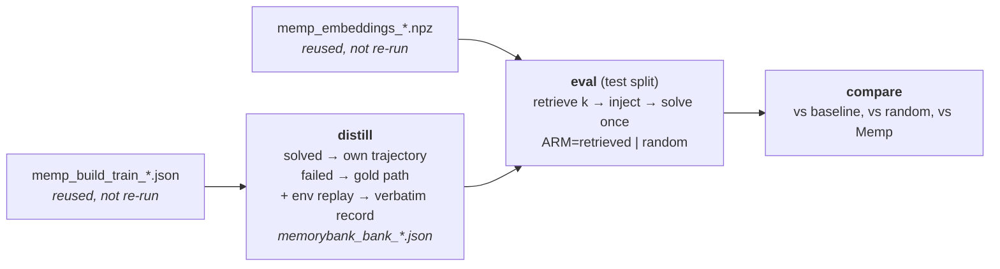

# MemoryBank on SPaRC — setup and results

MemoryBank (Zhong et al., AAAI 2024) applied to the SPaRC spatial-reasoning
benchmark: the **declarative** arm of the thesis, alongside Reflexion (episodic,
`docs/reflexion_results.md`) and Memp (procedural, `docs/memp.md`). Source data:
`results/json/memorybank_bank_*`, `memorybank_eval_*`; baselines are each model's
Reflexion trial 1 (`results/json/reflexion_root_*`), the same memoryless pass Memp
compares against.

**Status:** banks built for all three models (§4.6-4.7); the 12 eval arms are queued as of
2026-08-26. Sections 4.1-4.5 are scaffolding to be
filled as jobs finish; everything before them is fixed by the design.

---

## 1. What the paper is, and what this port keeps

MemoryBank gives an LLM long-term memory over past **interactions**: it stores each
one, recalls the relevant ones by dense retrieval, and thereby answers questions
about things said days earlier. Its storage has two text layers per interaction —
the conversation kept **verbatim**, and an LLM-written **event summary** of it
("Summarize the events and key information in the content [dialog]") — plus a
memory-updating mechanism modelled on the Ebbinghaus forgetting curve.

The mapping onto SPaRC is: **one past puzzle is one past interaction.** A bank
entry therefore holds both of the paper's layers, for one train puzzle:

| Field | Paper's layer | Written by | Content |
|---|---|---|---|
| `trajectory` | in-depth storage (the interaction, verbatim) | **code** — env replay of the entry's own winning line | starting grid, every move with the resulting path head, final grid with the path drawn |
| `case_note` | hierarchical event summary | LLM (`CaseDistiller`) | 2–3 sentences recounting *that* puzzle and how it was solved |
| `exemplar` | — | code | compact action list + grid census, for the `case` granularity |

Written by code where it can be, by the model only where it must be: the trajectory
is a replayed transcript, so unlike an LLM-written summary it **cannot** misstate
what happened. This is the same construction Memp's `trajectory` granularity uses,
and `docs/memp.md` §3.6 is why it is the default here rather than an option.

### What is deliberately dropped

| Paper component | Why it is not ported |
|---|---|
| **Ebbinghaus forgetting curve / memory-strength updating** | The mechanism needs a *repeat-recall* event: `S` grows only when a memory piece is retrieved again in a later turn. Our bank is built by a single parallel pass over the train split that never re-queries earlier entries, and is frozen at test time — so nothing would ever reinforce, and decay would be a pure function of insertion order. The paper never ablates it quantitatively either (its Table 2 has no forgetting on/off comparison). |
| **User portrait / personality** | SPaRC has no user to have a personality. No analogue exists. |
| **Global summary** (summary-of-summaries) | Would inject byte-identical text for every test puzzle — that is Memp's `fixed` arm, already measured and inert. |
| **Dual-tower retrieval over each memory piece's own text** | Replaced by the shared `puzzle_key_text` embedding (below). The paper explicitly says the encoder "can be interchanged to any suitable model". |

Dropping the forgetting curve is the one substantive departure, and it is
deliberate: the thesis proposal defines this arm operationally as *"a declarative
agent that retrieves similar solved cases via dense embedding search"*, which is
what is built here.

### Why retrieval is Memp's, verbatim

MemoryBank entries are retrieved by cosine similarity over `puzzle_key_text`
(key-fn `puzzle-key-v1`) — the *same* renderer, the *same* `memp_embeddings_*.npz`,
the same top-k, the same `(-similarity, id)` tie-break. `MemoryBankMemory` is a
subclass of `MempMemory` that overrides only its schema tag.

That is the experiment, not a shortcut. Sub-question 2 of the proposal asks which
*memory type* helps most; the contrast is only interpretable if the two cross-task
methods differ in **what the memory says** (a concrete case vs. an abstracted
procedure) and in nothing else. Sharing the retriever holds everything else fixed.
It is also empirically well-founded: `docs/memp.md` §3.4 measured that no retrieval
policy on SPaRC ever significantly beat any other, so this axis carries no signal
to lose.

---

## 2. The pipeline

Two of the four stages are **not re-run** — the memoryless train pass and the
embeddings are method-agnostic and already exist from the Memp campaign.



| Phase | Runs on | Reads → writes |
|---|---|---|
| `distill` | chat model (~1 h) | Memp build file → `memorybank_bank_<tag>_<rp\|norp>.json` |
| `eval` | chat model | bank + Memp vectors → `memorybank_eval_<arm>_<tag>.json` |
| `compare` | login node, no GPU | 3–4 result files → `results/txt/memorybank_vs_baseline_<tag>.txt` |

The verbatim record is attached **inside** `distill` (a pure-CPU env replay), not in
a separate phase like Memp's `upgrade`: for MemoryBank the record is not an optional
granularity, it is half of what the paper stores, so no entry may exist without one.
The eval phase refuses to run at `case-record` granularity if any entry lacks it.

```bash
sbatch -J mb-dist --export=ALL,DRIVER=memorybank,PHASE=distill,RULES_PREAMBLE=on,BUILD=results/json/memp_build_train_<tag>.json scripts/serve_and_run.sbatch
sbatch -J mb-ret  --export=ALL,DRIVER=memorybank,PHASE=eval,ARM=retrieved,BANK=<bank.json>,EMBEDDINGS=results/json/memp_embeddings_qwen3emb06b.npz scripts/serve_and_run.sbatch
sbatch -J mb-rnd  --export=ALL,DRIVER=memorybank,PHASE=eval,ARM=random,BANK=<bank.json>,EMBEDDINGS=results/json/memp_embeddings_qwen3emb06b.npz scripts/serve_and_run.sbatch
python scripts/run_memorybank.py --phase compare --baseline results/json/reflexion_root_<tag>.json --retrieved <ret.json> --random <rnd.json> --memp <memp_eval_retrieved_*.json>
```

---

## 3. What is held constant in every arm

Identical to Memp's protocol (`docs/memp.md` §2), which is what makes the two
methods comparable to each other as well as to the baseline:

- **500 test puzzles, one attempt each.** No retry, so cumulative accuracy cannot
  drift upward the way Reflexion's does — no `lift ≥ 0` artifact, no control arm
  needed. Memory can also *hurt*, which makes it a genuine two-sided test.
- **Sampling:** seed 0, `temperature 0.6`, `top_p 0.95`, `top_k 20`,
  `max_tokens 12288` — Qwen3 thinking-mode defaults, used for gpt-oss too so every
  model stays config-matched with its own baseline.
- **Baseline:** each model's Reflexion trial 1 — the memoryless pass over the same
  500 puzzles at the same seed and the same code.
- **Injection point:** the case block is appended *after* the full system prompt,
  exactly as Reflexion's and Memp's blocks are, preserving the shared KV prefix for
  `--enable-prefix-caching`.
- **Block format:** both arms render identically. Similarity scores are logged in
  the results and never shown to the model, so the arms differ only in *which*
  cases appear.
- **Retrieval determinism:** ties break on entry id; the random arm is seeded per
  puzzle (`f"{seed}:{pid}"`), so a resumed job injects byte-identical blocks.
- **k = 3**, matching Memp, so cross-method contrasts are apples-to-apples.

### The rules-preamble ablation

`docs/memp.md` §3.5 found that Memp's v1 banks misstated SPaRC's square/star rule in
33–51% of entries, because no distillation prompt contained the rulebook. Prepending
it (`distill_rules_preamble`) fixed that decisively — measured on the existing banks
with `scripts/audit_bank.py`:

| gpt-oss-120b bank | region framed correctly | tells the agent to step on the cell (wrong) |
|---|---|---|
| v1 (no preamble) | 50.7% | 71.8% |
| v2 (preamble) | **99.8%** | **10.2%** |

Whether a *case note* needs the same treatment is genuinely open: it recounts an
instance rather than asserting a rule, so a plain prompt is closer to the paper's
"summarize the events" instruction — but a note that says "I stepped through the
blue square" misinforms the actor just as a wrong procedure does. So both banks are
built (`--rules-preamble on|off`, frozen into the bank and named in its filename),
audited with the same script, and evaluated. The two retrieved arms are a paired
McNemar over the same 500 puzzles, so the preamble's effect gets a significance test
for free.

### What the actor actually reads

`case-record` granularity (the default), k=3 → ~1.7k injected tokens:

```
Declarative memory: specific past cases similar to this puzzle, from puzzles you
solved before. Use them only as loose analogies for the kind of layout and rule
combination involved -- not as instructions to follow. This puzzle is a different
one: never copy a case's move sequence verbatim.

Case 1:
<2-3 sentence recollection of that specific puzzle>
  Its starting grid:
  ['+', '+', '+', '+', 'S']
  ...
  The solution, move by move (0=right, 1=up, 2=left, 3=down):
  move 0: down -> path head at [4, 1]
  ...
  Its final grid, with the solution path drawn (V=visited, L=end):
  ...
```

The framing sentence is the one place the two cross-task methods deliberately
differ in wording: Memp introduces its entries as *strategies to adapt*, MemoryBank
as *past cases to reason from by analogy*. A `case` granularity (note + compact
action list, ~390 tokens) is implemented as an eval knob for a contrast against
Memp's `script` arm, but is not part of the main campaign.

---

## 4. Results

*(to be filled)*

### 4.1 Does declarative memory help?

| Model | Baseline | Random k=3 | Retrieved k=3 | retrieved vs base | random vs base | retrieved vs random |
|---|---|---|---|---|---|---|
| Qwen3-0.6B | 14/500 (2.8%) | | | | | |
| Qwen3-32B | 55/500 (11.0%) | | | | | |
| gpt-oss-120b | 70/500 (14.0%) | | | | | |

### 4.2 Rules preamble on vs. off

| Model | Bank | region ok | visit wrong | Retrieved k=3 | vs the other bank |
|---|---|---|---|---|---|
| | rp | | | | |
| | norp | | | | |

### 4.3 Per-difficulty

SPaRC difficulty 1–5, n = 86 / 118 / 121 / 86 / 89.

### 4.4 Failure modes

| Model | Arm | Solved | Wrong-solution | Dead-end |
|---|---|---|---|---|

### 4.5 Declarative vs. procedural (the cross-method contrast)

MemoryBank-retrieved vs Memp-retrieved over the same 500 puzzles, same retriever,
same k, same injection point — the paired test `--phase compare --memp` reports.
Memp's reference points at matched granularity (gpt-oss-120b): baseline 70/500,
trajectory 102/500, proceduralization 103/500.

| Model | MemoryBank (case-record) | Memp (proceduralization) | McNemar p |
|---|---|---|---|

### 4.6 Bank construction

All six banks built 2026-08-25/26 (jobs 15475825-30), distilled from the existing Memp
train passes. Every bank is complete and structurally clean:

| Model | Entries | Agent / gold | Records attached (all replays solved) | Empty | Failed | Mean note length |
|---|---|---|---|---|---|---|
| Qwen3-0.6B rp | 500 | 9 / 491 | 500 (500) | 0 | 0 | 58 w |
| Qwen3-0.6B norp | 500 | 9 / 491 | 500 (500) | 0 | 0 | 49 w |
| Qwen3-32B rp | 500 | 41 / 459 | 500 (500) | 0 | 0 | 93 w |
| Qwen3-32B norp | 500 | 41 / 459 | 500 (500) | 0 | 0 | 96 w |
| gpt-oss-120b rp | 500 | 71 / 429 | 500 (500) | 0 | 0 | 115 w |
| gpt-oss-120b norp | 500 | 71 / 429 | 500 (500) | 0 | 0 | 106 w |

Provenance matches the source build files exactly, and 500/500 replays reached a solved
state in every bank — so every stored record is a genuine winning line, and the bank is
overwhelmingly gold-path hindsight (86-98%), exactly as Memp's is. Distill wall-clock was
13-37 min per bank.

### 4.7 Does the rules preamble change the case notes? (pre-eval, bank-level)

Measured before spending any eval hours, over the 432 entries whose puzzle carries a
square or star rule. **`scripts/audit_bank.py`'s regexes are unreliable here** and its raw
numbers should not be compared against Memp's: they were written for procedures that
assert rules in the imperative, and they misfire on past-tense narrative — a polyshape's
shape id (`polyshape (816)`) reads as a visit count, and the correct phrase "passes
through dots and avoids polyshapes" trips the visit pattern. The table below uses patterns
written for narrative text instead, and was corroborated by reading samples:

| Bank | says the path went **around** rule cells | says it **visited** them (wrong) |
|---|---|---|
| Qwen3-0.6B norp → rp | 13.2% → **50.7%** | 0.2% → 3.2% |
| Qwen3-32B norp → rp | 36.1% → **88.0%** | 6.9% → **0.5%** |
| gpt-oss-120b norp → rp | 21.5% → **62.0%** | 6.9% → **1.2%** |

The preamble substantially improves how well-grounded the recollections are, and on the
two larger models it also removes the classic error. Direct reading confirms the
mechanism — the same gpt-oss train puzzle, both variants:

> **norp:** "...swept left across the bottom row to **visit** the green poly, the yellow
> square and the dot..."  ← wrong: the path goes *around* squares and polys
>
> **rp:** "...dropped down **around** the blue polyshape, swept across the bottom of the
> grid, rose up the right side to **thread between** the yellow square and the green
> poly..."  ← correct

Both variants nonetheless produce coherent, concrete, un-procedural case notes, so neither
bank is broken and both proceed to eval. Whether better rule grounding translates into
*accuracy* is the open question the eval arms answer — Memp's campaign is a warning that it
may not, since there the rule-correct v2 scripts still left the retrieved arm inert.


---

## 5. Cost

| Phase | GPU-hours |
|---|---|
| Build pass | 0 (reused from Memp) |
| Embeddings | 0 (reused from Memp) |
| Distill (3 models × 2 preamble variants) | |
| Evals | |

---

## 6. Conclusions

*(to be filled)*

### Threats to validity

- **Single seed, single attempt per puzzle** — no variance estimate across repeats,
  the same limitation Memp's campaign carries.
- **The forgetting mechanism is not evaluated**, so this is a test of MemoryBank's
  retrieval-and-recall design, not of the paper in full. Section 1 argues the
  mechanism is inert under a frozen bank; that argument is not itself measured.
- **Retrieval is shared with Memp by construction**, so any conclusion about
  *retrieval* quality transfers from `docs/memp.md` §3.4 rather than being
  independently established here.
- **The rule-error rates are a regex proxy** (`scripts/audit_bank.py`), reliable for
  comparing two banks under one definition, indicative rather than exact as an
  absolute percentage.
