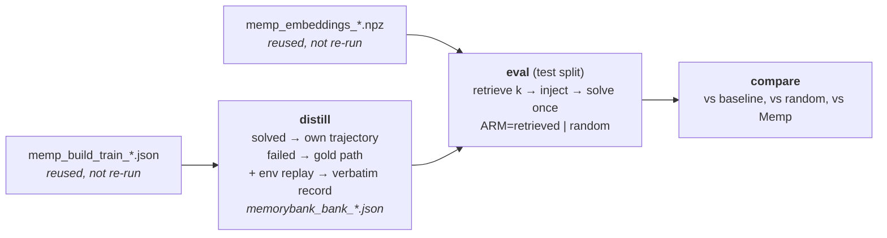

# MemoryBank on SPaRC — setup and results

MemoryBank (Zhong et al., AAAI 2024) applied to the SPaRC spatial-reasoning
benchmark: the **declarative** arm of the thesis, alongside Reflexion (episodic,
`docs/reflexion_results.md`) and Memp (procedural, `docs/memp.md`). Source data:
`results/json/memorybank_bank_*`, `memorybank_eval_*`; baselines are each model's
Reflexion trial 1 (`results/json/reflexion_root_*`), the same memoryless pass Memp
compares against.

**Status:** complete. Banks built 2026-08-25/26, all 12 eval arms finished 2026-08-29,
results and conclusions below. §0 is generated by `scripts/memorybank_report.py`.

**Headline:** declarative memory helps only the strongest actor — gpt-oss-120b 70 →
89-98/500, all four arms significant — while never beating baseline on Qwen3-32B and
doing nothing measurable on Qwen3-0.6B. Three separate knobs that ought to matter do not:
a *random* case performs as well as a *retrieved* one (all six pairings n.s.), making the
case notes markedly more rule-correct changes accuracy by nothing (§4.2), and declarative
is indistinguishable from Memp's procedural memory (all six contrasts n.s.). What is left
as the active ingredient is the presence of a correct worked example at all. It is also
the project's most expensive arm: the block triples prompt tokens per step and Memp
reaches the same accuracy for 40-60% fewer tokens per solve (§0, §5).

---

## 0. All runs at a glance

Every MemoryBank arm run on SPaRC, generated from the result files by
`scripts/memorybank_report.py` (re-run it after adding an arm; the numbers below are not
maintained by hand). All arms: 500 test puzzles, one attempt each, seed 0,
`temperature 0.6`, k=3, granularity `case-record`. `rules-preamble` / `NO preamble` are
the two banks per actor — case notes distilled with the rulebook prepended to the prompt
or without it (§4.2). Baselines are each actor's Reflexion trial 1. The Memp row is a
**reference, not a MemoryBank arm**: its rule-correct (v2) retrieved arm, the
like-for-like procedural counterpart at the same retriever and k.

### Success rate

| Actor | Arm | Solved /500 | Accuracy | vs baseline |
|---|---|---|---|---|
| Qwen3-0.6B | baseline (memoryless) | 14 | 2.8% | — |
|  | retrieved k=3, rules-preamble | 16 | 3.2% | +2, p=0.8145 |
|  | random k=3, rules-preamble | 19 | 3.8% | +5, p=0.3833 |
|  | retrieved k=3, NO preamble | 13 | 2.6% | -1, p=1.0000 |
|  | random k=3, NO preamble | 12 | 2.4% | -2, p=0.8145 |
|  | _(ref)_ Memp retrieved, script (v2) | 19 | 3.8% | +5, p=0.4244 |
| Qwen3-32B | baseline (memoryless) | 55 | 11.0% | — |
|  | retrieved k=3, rules-preamble | 48 | 9.6% | -7, p=0.4188 |
|  | random k=3, rules-preamble | 35 | 7.0% | **-20, p=0.0017** |
|  | retrieved k=3, NO preamble | 48 | 9.6% | -7, p=0.3817 |
|  | random k=3, NO preamble | 48 | 9.6% | -7, p=0.3489 |
|  | _(ref)_ Memp retrieved, script (v2) | 40 | 8.0% | **-15, p=0.0357** |
| gpt-oss-120b | baseline (memoryless) | 70 | 14.0% | — |
|  | retrieved k=3, rules-preamble | 89 | 17.8% | **+19, p=0.0110** |
|  | random k=3, rules-preamble | 97 | 19.4% | **+27, p=0.0007** |
|  | retrieved k=3, NO preamble | 98 | 19.6% | **+28, p=0.0011** |
|  | random k=3, NO preamble | 91 | 18.2% | **+21, p=0.0111** |
|  | _(ref)_ Memp retrieved, script (v2) | 90 | 18.0% | **+20, p=0.0225** |

Bold = p < 0.05 on an exact McNemar against that actor's own memoryless baseline. The
campaign's shape is visible in this one table: memory helps only gpt-oss-120b, where all
four arms clear significance; it is never better than baseline on Qwen3-32B and
significantly worse in one arm; and it does nothing measurable on Qwen3-0.6B. Within each
actor the four MemoryBank arms sit close together — the preamble does not separate them
(§4.2), and neither does retrieved-vs-random (§4.1) — and they sit close to the Memp
reference too (§4.5).

**Do not read the bolded gpt-oss random arm (97, p=0.0007) as "irrelevant memory beats
relevant memory."** Those p-values are each arm against its *baseline*, not against each
other; retrieved-vs-random on that bank is p=0.332, and the sign flips between the two
banks (rp: random +8; norp: retrieved +7). The arms are not mixed up — the retrieved arm
injects cases matching the test puzzle's exact rule set 65.2% of the time against random's
2.4% (Jaccard 0.903 vs 0.419, and the two arms share an injected case on only 7/500
puzzles), figures identical to `docs/memp.md` §3.4 because the retriever, embeddings and
source puzzles are the same. Relevance was achieved; it simply did not convert.

### Success by difficulty

Accuracy within each SPaRC difficulty band (n = 86 / 118 / 121 / 86 / 89).

| Actor | Arm | d1 | d2 | d3 | d4 | d5 |
|---|---|---|---|---|---|---|
| Qwen3-0.6B | baseline (memoryless) | 4.7% | 5.9% | 2.5% | 0.0% | 0.0% |
|  | retrieved k=3, rules-preamble | 8.1% | 4.2% | 3.3% | 0.0% | 0.0% |
|  | random k=3, rules-preamble | 10.5% | 5.9% | 2.5% | 0.0% | 0.0% |
|  | retrieved k=3, NO preamble | 7.0% | 5.1% | 0.8% | 0.0% | 0.0% |
|  | random k=3, NO preamble | 5.8% | 3.4% | 2.5% | 0.0% | 0.0% |
|  | _(ref)_ Memp retrieved, script (v2) | 8.1% | 5.1% | 3.3% | 2.3% | 0.0% |
| Qwen3-32B | baseline (memoryless) | 32.6% | 13.6% | 6.6% | 3.5% | 0.0% |
|  | retrieved k=3, rules-preamble | 27.9% | 11.0% | 5.8% | 3.5% | 1.1% |
|  | random k=3, rules-preamble | 20.9% | 8.5% | 4.1% | 1.2% | 1.1% |
|  | retrieved k=3, NO preamble | 26.7% | 11.9% | 6.6% | 3.5% | 0.0% |
|  | random k=3, NO preamble | 29.1% | 13.6% | 5.0% | 1.2% | 0.0% |
|  | _(ref)_ Memp retrieved, script (v2) | 25.6% | 11.0% | 3.3% | 1.2% | 0.0% |
| gpt-oss-120b | baseline (memoryless) | 38.4% | 17.8% | 9.9% | 3.5% | 1.1% |
|  | retrieved k=3, rules-preamble | 51.2% | 26.3% | 9.1% | 3.5% | 0.0% |
|  | random k=3, rules-preamble | 55.8% | 25.4% | 13.2% | 3.5% | 0.0% |
|  | retrieved k=3, NO preamble | 58.1% | 23.7% | 11.6% | 5.8% | 1.1% |
|  | random k=3, NO preamble | 55.8% | 23.7% | 9.9% | 2.3% | 1.1% |
|  | _(ref)_ Memp retrieved, script (v2) | 51.2% | 27.1% | 7.4% | 3.5% | 2.2% |

Gains concentrate in bands 1-2 and are gone by band 3. Nothing in this campaign moved
difficulty 5 off the floor for any actor or arm. gpt-oss's best arm lifts band 1 from
38.4% to 58.1%; Qwen3-32B loses ground in bands 1-2 and is flat elsewhere.

### Failure modes

Terminal reason for all 500 episodes. `format-failure` = never produced a parseable move; `error` = a transient serving failure, excluded from reflection but still counted as an attempt.

| Actor | Arm | Solved | Wrong-sol | Dead-end | Format-fail | Error |
|---|---|---|---|---|---|---|
| Qwen3-0.6B | baseline (memoryless) | 14 | 176 | 303 | 7 | 0 |
|  | retrieved k=3, rules-preamble | 16 | 156 | 256 | 72 | 0 |
|  | random k=3, rules-preamble | 19 | 142 | 248 | 91 | 0 |
|  | retrieved k=3, NO preamble | 13 | 172 | 242 | 73 | 0 |
|  | random k=3, NO preamble | 12 | 163 | 254 | 71 | 0 |
|  | _(ref)_ Memp retrieved, script (v2) | 19 | 165 | 309 | 7 | 0 |
| Qwen3-32B | baseline (memoryless) | 55 | 210 | 235 | 0 | 0 |
|  | retrieved k=3, rules-preamble | 48 | 200 | 252 | 0 | 0 |
|  | random k=3, rules-preamble | 35 | 191 | 274 | 0 | 0 |
|  | retrieved k=3, NO preamble | 48 | 201 | 251 | 0 | 0 |
|  | random k=3, NO preamble | 48 | 202 | 250 | 0 | 0 |
|  | _(ref)_ Memp retrieved, script (v2) | 40 | 160 | 300 | 0 | 0 |
| gpt-oss-120b | baseline (memoryless) | 70 | 203 | 227 | 0 | 0 |
|  | retrieved k=3, rules-preamble | 89 | 256 | 152 | 3 | 0 |
|  | random k=3, rules-preamble | 97 | 244 | 157 | 2 | 0 |
|  | retrieved k=3, NO preamble | 98 | 223 | 178 | 1 | 0 |
|  | random k=3, NO preamble | 91 | 222 | 186 | 1 | 0 |
|  | _(ref)_ Memp retrieved, script (v2) | 90 | 180 | 229 | 1 | 0 |

The most informative table here. On gpt-oss the case block **trades wrong-solutions for
dead-ends in the opposite direction to the rule-corrected Memp script**: dead-ends
collapse (227→152-186) while wrong-solutions rise (203→222-256), whereas Memp's v2 script
does the reverse (203→180 wrong, 227→229 dead). The verbatim record teaches navigation,
not rules — the same mechanism Memp's trajectory arm showed, which is unsurprising given
both inject a mechanically-replayed winning line.

The Qwen3-0.6B rows carry a separate warning: **format-failures jump from 7 to 71-91** (14-18%
of the split) under a ~1.8k-token block. Its flat accuracy is not "memory did nothing" —
it is memory breaking the actor's ability to hold the `Final: <digit>` contract. Any read
of the 0.6B numbers has to carry that caveat.

### Token cost and efficiency

Prompt + completion + retry tokens over all 500 episodes. **Tokens/solve** is the efficiency figure: an arm that solves more puzzles can still be cheaper per solved puzzle.

| Actor | Arm | Total | ktok/puzzle | Solved | Mtok/solve | vs baseline |
|---|---|---|---|---|---|---|
| Qwen3-0.6B | baseline (memoryless) | 45.7M | 91.3 | 14 | 3.261 | — |
|  | retrieved k=3, rules-preamble | 81.5M | 163.0 | 16 | 5.095 | +56% |
|  | random k=3, rules-preamble | 78.9M | 157.8 | 19 | 4.153 | +27% |
|  | retrieved k=3, NO preamble | 84.4M | 168.7 | 13 | 6.489 | +99% |
|  | random k=3, NO preamble | 74.3M | 148.7 | 12 | 6.195 | +90% |
|  | _(ref)_ Memp retrieved, script (v2) | 34.1M | 68.2 | 19 | 1.795 | -45% |
| Qwen3-32B | baseline (memoryless) | 37.5M | 75.0 | 55 | 0.682 | — |
|  | retrieved k=3, rules-preamble | 61.0M | 122.1 | 48 | 1.272 | +86% |
|  | random k=3, rules-preamble | 59.7M | 119.4 | 35 | 1.705 | +150% |
|  | retrieved k=3, NO preamble | 58.9M | 117.8 | 48 | 1.227 | +80% |
|  | random k=3, NO preamble | 58.9M | 117.7 | 48 | 1.226 | +80% |
|  | _(ref)_ Memp retrieved, script (v2) | 46.5M | 93.0 | 40 | 1.163 | +70% |
| gpt-oss-120b | baseline (memoryless) | 27.7M | 55.5 | 70 | 0.396 | — |
|  | retrieved k=3, rules-preamble | 73.4M | 146.7 | 89 | 0.824 | +108% |
|  | random k=3, rules-preamble | 70.0M | 139.9 | 97 | 0.721 | +82% |
|  | retrieved k=3, NO preamble | 73.5M | 147.0 | 98 | 0.750 | +89% |
|  | random k=3, NO preamble | 71.5M | 143.0 | 91 | 0.786 | +98% |
|  | _(ref)_ Memp retrieved, script (v2) | 46.3M | 92.6 | 90 | 0.514 | +30% |

**MemoryBank is the most expensive memory arm in the project.** The case-record block
roughly triples prompt tokens (below) and doubles total cost per puzzle: gpt-oss goes
55.5 → 139.9-147.0 ktok/puzzle, and 0.396 → 0.721-0.824 Mtok per solved puzzle (+82 to
+108%). Set against the Memp reference, this is the sharpest practical result in the
document: **Memp reaches statistically indistinguishable accuracy on gpt-oss (90 vs
89-98) at 0.514 Mtok/solve against MemoryBank's 0.721-0.824** — roughly 40-60% cheaper
per solve for the same outcome. On Qwen3-0.6B the contrast is starker still, because
MemoryBank's arms are both worse *and* 2.3-3.6x more expensive per solve than Memp's.

### Token breakdown: prompt vs completion

The same tokens as the previous table, split by kind. **tok/step** is prompt tokens divided by env steps — the clearest measure of what a memory block actually costs, since the block is re-sent on every step of the episode. `retry` is prompt+completion spent on replies that yielded no parseable move (tracked as one aggregate, not split further).

| Actor | Arm | Prompt | Completion | Retry | Prompt share | Prompt tok/step |
|---|---|---|---|---|---|---|
| Qwen3-0.6B | baseline (memoryless) | 20.9M | 20.2M | 4.55M | 46% | 2246 |
|  | retrieved k=3, rules-preamble | 55.5M | 12.5M | 13.48M | 68% | 6037 |
|  | random k=3, rules-preamble | 53.1M | 12.5M | 13.37M | 67% | 5993 |
|  | retrieved k=3, NO preamble | 57.3M | 14.0M | 13.06M | 68% | 5878 |
|  | random k=3, NO preamble | 49.9M | 12.3M | 12.16M | 67% | 5906 |
|  | _(ref)_ Memp retrieved, script (v2) | 21.6M | 10.6M | 1.91M | 63% | 2945 |
| Qwen3-32B | baseline (memoryless) | 15.2M | 22.3M | 0.06M | 40% | 2026 |
|  | retrieved k=3, rules-preamble | 38.4M | 22.4M | 0.18M | 63% | 5083 |
|  | random k=3, rules-preamble | 37.4M | 22.2M | 0.03M | 63% | 4945 |
|  | retrieved k=3, NO preamble | 37.7M | 21.1M | 0.05M | 64% | 5078 |
|  | random k=3, NO preamble | 37.5M | 21.3M | 0.07M | 64% | 4988 |
|  | _(ref)_ Memp retrieved, script (v2) | 23.1M | 23.4M | 0.06M | 50% | 2989 |
| gpt-oss-120b | baseline (memoryless) | 16.7M | 10.7M | 0.29M | 60% | 2090 |
|  | retrieved k=3, rules-preamble | 47.0M | 23.8M | 2.59M | 64% | 5314 |
|  | random k=3, rules-preamble | 44.7M | 22.7M | 2.64M | 64% | 5145 |
|  | retrieved k=3, NO preamble | 46.9M | 23.8M | 2.72M | 64% | 5253 |
|  | random k=3, NO preamble | 44.9M | 23.6M | 2.97M | 63% | 5096 |
|  | _(ref)_ Memp retrieved, script (v2) | 27.0M | 18.0M | 1.25M | 58% | 3143 |

Where the money goes: prompt tokens rise from ~2.0-2.2k per step to ~5.0-6.0k, a ~2.5x
increase, because the block is re-sent on **every step** of an episode that averages
15-18 steps. This is the structural cost of a large injected memory in a per-step MDP,
and it is why the case-record granularity is expensive in a way the `case` granularity
(~440-700 tokens, never run) would not be. Qwen3-0.6B additionally burns 12-13.5M retry
tokens against the baseline's 4.6M — the format-failure spike showing up as wasted spend.

### Steps in the environment

Env steps per episode (`max_steps=100`). Split by outcome: a solved episode's step count is essentially the path length, while a failed one shows how long the agent kept moving before dying.

| Actor | Arm | Mean (all) | Mean (solved) | Mean (failed) |
|---|---|---|---|---|
| Qwen3-0.6B | baseline (memoryless) | 18.6 | 18.2 | 18.6 |
|  | retrieved k=3, rules-preamble | 18.4 | 16.8 | 18.5 |
|  | random k=3, rules-preamble | 17.7 | 11.8 | 17.9 |
|  | retrieved k=3, NO preamble | 19.5 | 19.4 | 19.5 |
|  | random k=3, NO preamble | 16.9 | 19.4 | 16.8 |
|  | _(ref)_ Memp retrieved, script (v2) | 14.6 | 14.3 | 14.7 |
| Qwen3-32B | baseline (memoryless) | 15.0 | 12.2 | 15.3 |
|  | retrieved k=3, rules-preamble | 15.1 | 12.1 | 15.4 |
|  | random k=3, rules-preamble | 15.1 | 12.7 | 15.3 |
|  | retrieved k=3, NO preamble | 14.9 | 11.8 | 15.2 |
|  | random k=3, NO preamble | 15.0 | 11.9 | 15.4 |
|  | _(ref)_ Memp retrieved, script (v2) | 15.4 | 11.7 | 15.8 |
| gpt-oss-120b | baseline (memoryless) | 16.0 | 12.8 | 16.5 |
|  | retrieved k=3, rules-preamble | 17.7 | 13.4 | 18.6 |
|  | random k=3, rules-preamble | 17.4 | 13.6 | 18.3 |
|  | retrieved k=3, NO preamble | 17.9 | 14.1 | 18.8 |
|  | random k=3, NO preamble | 17.6 | 14.2 | 18.4 |
|  | _(ref)_ Memp retrieved, script (v2) | 17.2 | 15.0 | 17.7 |

Episode length barely moves in aggregate, but the split is informative for gpt-oss:
**failed** episodes get *longer* (16.5 → 18.3-18.8) while dead-ends fall sharply. The
agent keeps making legal moves for longer instead of painting itself into a corner early,
which is exactly the navigational effect §4.4 describes, visible here as duration.

---

## 1. What the paper is, and what this port keeps

MemoryBank gives an LLM long-term memory over past **interactions**: it stores each
one, recalls the relevant ones by dense retrieval, and thereby answers questions
about things said days earlier. Its storage has two text layers per interaction —
the conversation kept **verbatim**, and an LLM-written **event summary** of it
("Summarize the events and key information in the content [dialog]") — plus a
memory-updating mechanism modelled on the Ebbinghaus forgetting curve.

The mapping onto SPaRC is: **one past puzzle is one past interaction.** A bank
entry therefore holds both of the paper's layers, for one train puzzle:

| Field | Paper's layer | Written by | Content |
|---|---|---|---|
| `trajectory` | in-depth storage (the interaction, verbatim) | **code** — env replay of the entry's own winning line | starting grid, every move with the resulting path head, final grid with the path drawn |
| `case_note` | hierarchical event summary | LLM (`CaseDistiller`) | 2–3 sentences recounting *that* puzzle and how it was solved |
| `exemplar` | — | code | compact action list + grid census, for the `case` granularity |

Written by code where it can be, by the model only where it must be: the trajectory
is a replayed transcript, so unlike an LLM-written summary it **cannot** misstate
what happened. This is the same construction Memp's `trajectory` granularity uses,
and `docs/memp.md` §3.6 is why it is the default here rather than an option.

### What is deliberately dropped

| Paper component | Why it is not ported |
|---|---|
| **Ebbinghaus forgetting curve / memory-strength updating** | The mechanism needs a *repeat-recall* event: `S` grows only when a memory piece is retrieved again in a later turn. Our bank is built by a single parallel pass over the train split that never re-queries earlier entries, and is frozen at test time — so nothing would ever reinforce, and decay would be a pure function of insertion order. The paper never ablates it quantitatively either (its Table 2 has no forgetting on/off comparison). |
| **User portrait / personality** | SPaRC has no user to have a personality. No analogue exists. |
| **Global summary** (summary-of-summaries) | Would inject byte-identical text for every test puzzle — that is Memp's `fixed` arm, already measured and inert. |
| **Dual-tower retrieval over each memory piece's own text** | Replaced by the shared `puzzle_key_text` embedding (below). The paper explicitly says the encoder "can be interchanged to any suitable model". |

Dropping the forgetting curve is the one substantive departure, and it is
deliberate: the thesis proposal defines this arm operationally as *"a declarative
agent that retrieves similar solved cases via dense embedding search"*, which is
what is built here.

> The same argument is why the contrastive method's retrieval is also Memp's, verbatim
> ([contrastive.md](contrastive.md) §3) — three cross-task methods, one retriever, so
> every cross-method contrast isolates content.

### Why retrieval is Memp's, verbatim

MemoryBank entries are retrieved by cosine similarity over `puzzle_key_text`
(key-fn `puzzle-key-v1`) — the *same* renderer, the *same* `memp_embeddings_*.npz`,
the same top-k, the same `(-similarity, id)` tie-break. `MemoryBankMemory` is a
subclass of `MempMemory` that overrides only its schema tag.

That is the experiment, not a shortcut. Sub-question 2 of the proposal asks which
*memory type* helps most; the contrast is only interpretable if the two cross-task
methods differ in **what the memory says** (a concrete case vs. an abstracted
procedure) and in nothing else. Sharing the retriever holds everything else fixed.
It is also empirically well-founded: `docs/memp.md` §3.4 measured that no retrieval
policy on SPaRC ever significantly beat any other, so this axis carries no signal
to lose.

---

## 2. The pipeline

Two of the four stages are **not re-run** — the memoryless train pass and the
embeddings are method-agnostic and already exist from the Memp campaign.



| Phase | Runs on | Reads → writes |
|---|---|---|
| `distill` | chat model (~1 h) | Memp build file → `memorybank_bank_<tag>_<rp\|norp>.json` |
| `eval` | chat model | bank + Memp vectors → `memorybank_eval_<arm>_<tag>.json` |
| `compare` | login node, no GPU | 3–4 result files → `results/txt/memorybank_vs_baseline_<tag>.txt` |

The verbatim record is attached **inside** `distill` (a pure-CPU env replay), not in
a separate phase like Memp's `upgrade`: for MemoryBank the record is not an optional
granularity, it is half of what the paper stores, so no entry may exist without one.
The eval phase refuses to run at `case-record` granularity if any entry lacks it.

```bash
sbatch -J mb-dist --export=ALL,DRIVER=memorybank,PHASE=distill,RULES_PREAMBLE=on,BUILD=results/json/memp_build_train_<tag>.json scripts/serve_and_run.sbatch
sbatch -J mb-ret  --export=ALL,DRIVER=memorybank,PHASE=eval,ARM=retrieved,BANK=<bank.json>,EMBEDDINGS=results/json/memp_embeddings_qwen3emb06b.npz scripts/serve_and_run.sbatch
sbatch -J mb-rnd  --export=ALL,DRIVER=memorybank,PHASE=eval,ARM=random,BANK=<bank.json>,EMBEDDINGS=results/json/memp_embeddings_qwen3emb06b.npz scripts/serve_and_run.sbatch
python scripts/run_memorybank.py --phase compare --baseline results/json/reflexion_root_<tag>.json --retrieved <ret.json> --random <rnd.json> --memp <memp_eval_retrieved_*.json>
```

---

## 3. What is held constant in every arm

Identical to Memp's protocol (`docs/memp.md` §2), which is what makes the two
methods comparable to each other as well as to the baseline:

- **500 test puzzles, one attempt each.** No retry, so cumulative accuracy cannot
  drift upward the way Reflexion's does — no `lift ≥ 0` artifact, no control arm
  needed. Memory can also *hurt*, which makes it a genuine two-sided test.
- **Sampling:** seed 0, `temperature 0.6`, `top_p 0.95`, `top_k 20`,
  `max_tokens 12288` — Qwen3 thinking-mode defaults, used for gpt-oss too so every
  model stays config-matched with its own baseline.
- **Baseline:** each model's Reflexion trial 1 — the memoryless pass over the same
  500 puzzles at the same seed and the same code.
- **Injection point:** the case block is appended *after* the full system prompt,
  exactly as Reflexion's and Memp's blocks are, preserving the shared KV prefix for
  `--enable-prefix-caching`.
- **Block format:** both arms render identically. Similarity scores are logged in
  the results and never shown to the model, so the arms differ only in *which*
  cases appear.
- **Retrieval determinism:** ties break on entry id; the random arm is seeded per
  puzzle (`f"{seed}:{pid}"`), so a resumed job injects byte-identical blocks.
- **k = 3**, matching Memp, so cross-method contrasts are apples-to-apples.

### The rules-preamble ablation

`docs/memp.md` §3.5 found that Memp's v1 banks misstated SPaRC's square/star rule in
33–51% of entries, because no distillation prompt contained the rulebook. Prepending
it (`distill_rules_preamble`) fixed that decisively — measured on the existing banks
with `scripts/audit_bank.py`:

| gpt-oss-120b bank | region framed correctly | tells the agent to step on the cell (wrong) |
|---|---|---|
| v1 (no preamble) | 50.7% | 71.8% |
| v2 (preamble) | **99.8%** | **10.2%** |

Whether a *case note* needs the same treatment is genuinely open: it recounts an
instance rather than asserting a rule, so a plain prompt is closer to the paper's
"summarize the events" instruction — but a note that says "I stepped through the
blue square" misinforms the actor just as a wrong procedure does. So both banks are
built (`--rules-preamble on|off`, frozen into the bank and named in its filename),
audited with the same script, and evaluated. The two retrieved arms are a paired
McNemar over the same 500 puzzles, so the preamble's effect gets a significance test
for free.

### What the actor actually reads

`case-record` granularity (the default), k=3 → ~1.7-1.9k injected tokens
(measured over the built banks; the `case` granularity is ~440-700):

```
Declarative memory: specific past cases similar to this puzzle, from puzzles you
solved before. Use them only as loose analogies for the kind of layout and rule
combination involved -- not as instructions to follow. This puzzle is a different
one: never copy a case's move sequence verbatim.

Case 1:
<2-3 sentence recollection of that specific puzzle>
  Its starting grid:
  ['+', '+', '+', '+', 'S']
  ...
  The solution, move by move (0=right, 1=up, 2=left, 3=down):
  move 0: down -> path head at [4, 1]
  ...
  Its final grid, with the solution path drawn (V=visited, L=end):
  ...
```

The framing sentence is the one place the two cross-task methods deliberately
differ in wording: Memp introduces its entries as *strategies to adapt*, MemoryBank
as *past cases to reason from by analogy*. A `case` granularity (note + compact
action list, ~440-700 tokens) is implemented as an eval knob for a contrast against
Memp's `script` arm, but is not part of the main campaign.

---

## 4. Results

Campaign of 2026-08-26/29: 12 eval jobs, all COMPLETED, 500/500 puzzles each, zero
errored episodes. Baselines are each model's Reflexion trial 1 over the same split at
the same seed.

### 4.1 Does declarative memory help?

| Model | Baseline | Bank | Retrieved k=3 | Random k=3 | retr vs base | rand vs base | retr vs rand |
|---|---|---|---|---|---|---|---|
| Qwen3-0.6B | 14/500 (2.8%) | rp | 16 (3.2%) | 19 (3.8%) | p=0.815 | p=0.383 | p=0.690 |
| | | norp | 13 (2.6%) | 12 (2.4%) | p=1.000 | p=0.815 | p=1.000 |
| Qwen3-32B | 55/500 (11.0%) | rp | 48 (9.6%) | **35 (7.0%)** | p=0.419 | **p=0.0017** | p=0.066 |
| | | norp | 48 (9.6%) | 48 (9.6%) | p=0.382 | p=0.349 | p=1.000 |
| gpt-oss-120b | 70/500 (14.0%) | rp | **89 (17.8%)** | **97 (19.4%)** | **p=0.0110** | **p=0.0007** | p=0.332 |
| | | norp | **98 (19.6%)** | **91 (18.2%)** | **p=0.0011** | **p=0.0111** | p=0.470 |

Three findings, and only the first is the one the method predicts:

1. **Memory helps the strongest model substantially** — gpt-oss gains +19 to +28 puzzles
   over its memoryless baseline across all four of its arms, the largest effect any
   memory method has produced on SPaRC in this project except Memp's trajectory arm.
2. **It hurts Qwen3-32B**, exactly as Memp did. The rp random arm loses 20 puzzles
   (p=0.0017) and no arm of any kind beats baseline.
3. **Retrieved and random are statistically indistinguishable in all six pairings**
   (p ≥ 0.066, four of them p ≥ 0.33), and in two of the six the *random* arm scored
   higher. Relevance again contributes nothing.

Under Holm–Bonferroni over the family of 12 "does memory move accuracy" tests
(α = 0.05), three survive: gpt-oss rp random (p=0.0007), gpt-oss norp retrieved
(p=0.0011), and Qwen3-32B rp random as *harm* (p=0.0017). gpt-oss's other two arms
(p≈0.011) fall just short of their 0.0056/0.0063 thresholds.

### 4.2 Rules preamble on vs. off — the ablation

The two banks per model differ **only** in whether the case-note prompt was prefixed
with the verbatim rulebook. §4.7 shows that changed the notes a great deal. It changed
accuracy not at all:

| Model | Arm | rp | norp | McNemar p |
|---|---|---|---|---|
| Qwen3-0.6B | retrieved | 16 | 13 | 0.607 |
| | random | 19 | 12 | 0.230 |
| Qwen3-32B | retrieved | 48 | 48 | 1.000 |
| | random | 35 | 48 | 0.053 |
| gpt-oss-120b | retrieved | 89 | **98** | 0.298 |
| | random | **97** | 91 | 0.526 |

**No contrast is significant, and the sign is inconsistent** — gpt-oss's best single arm
is a *norp* one (98), and the one contrast that comes close (Qwen3-32B random, p=0.053)
favours norp too. So making the case notes markedly more rule-correct — "around/avoid"
framing 13→51%, 36→88%, 22→62%, and the outright visit error 6.9%→0.5/1.2% on the two
larger models — bought nothing measurable.

This is the same shape of result as Memp's, arrived at from the other direction. There,
*relevance* was achieved and did not matter; here, *content correctness* was achieved and
did not matter either.

### 4.3 Per-difficulty

SPaRC difficulty 1–5, n = 86 / 118 / 121 / 86 / 89. Retrieved arms shown.

| Model | Diff | Baseline | Retrieved rp | Retrieved norp |
|---|---|---|---|---|
| Qwen3-0.6B | 1 | 4.7% | 8.1% | 7.0% |
|  | 2 | 5.9% | 4.2% | 5.1% |
|  | 3 | 2.5% | 3.3% | 0.8% |
|  | 4 | 0.0% | 0.0% | 0.0% |
|  | 5 | 0.0% | 0.0% | 0.0% |
| Qwen3-32B | 1 | 32.6% | 27.9% | 26.7% |
|  | 2 | 13.6% | 11.0% | 11.9% |
|  | 3 | 6.6% | 5.8% | 6.6% |
|  | 4 | 3.5% | 3.5% | 3.5% |
|  | 5 | 0.0% | 1.1% | 0.0% |
| gpt-oss-120b | 1 | 38.4% | 51.2% | 58.1% |
|  | 2 | 17.8% | 26.3% | 23.7% |
|  | 3 | 9.9% | 9.1% | 11.6% |
|  | 4 | 3.5% | 3.5% | 5.8% |
|  | 5 | 1.1% | 0.0% | 1.1% |

gpt-oss's entire gain sits at difficulty 1–2 (38.4→51.2/58.1% and 17.8→26.3/23.7%) and
has vanished by difficulty 3 — memory converts puzzles already near the model's reach,
not hard ones. Qwen3-32B loses ground at difficulty 1–2 and is flat elsewhere. Nothing
moves at difficulty 4–5 for any model or arm: the floor is untouched.

### 4.4 Failure modes

Terminal reason over all 500 episodes (token cost for the same arms is in §0).

| Model | Arm | Solved | Wrong-solution | Dead-end | Format-failure |
|---|---|---|---|---|---|
| Qwen3-0.6B | baseline | 14 | 176 | 303 | 7 |
| | retrieved rp | 16 | 156 | 256 | **72** |
| | random rp | 19 | 142 | 248 | **91** |
| | retrieved norp | 13 | 172 | 242 | **73** |
| | random norp | 12 | 163 | 254 | **71** |
| Qwen3-32B | baseline | 55 | 210 | 235 | 0 |
| | retrieved rp | 48 | 200 | 252 | 0 |
| | random rp | 35 | 191 | 274 | 0 |
| | retrieved norp | 48 | 201 | 251 | 0 |
| | random norp | 48 | 202 | 250 | 0 |
| gpt-oss-120b | baseline | 70 | 203 | 227 | 0 |
| | retrieved rp | 89 | 256 | **152** | 3 |
| | random rp | 97 | 244 | **157** | 2 |
| | retrieved norp | 98 | 223 | **178** | 1 |
| | random norp | 91 | 222 | **186** | 1 |

**gpt-oss: the mechanism is navigational, not rule-based.** Dead-ends collapse
(227→152–186) while wrong-solutions *rise* (203→222–256). The verbatim record teaches
the model how to keep making progress without stalling; it does not teach it the rules,
and the freed attempts partly convert into invalid submissions. This is precisely the
trade Memp's trajectory arm produced (227→156, wrong-solutions 203→240), which is
unsurprising — both inject a mechanically-replayed winning line, and §4.2 says the prose
wrapped around it does not matter.

**Qwen3-0.6B: the block breaks the actor.** Format failures jump from 7 to 71–91 (14–18%
of the split) — the ~1.7k-token case-record block crowds out the 0.6B model's ability to
hold the `Final: <digit>` contract. Its *completion* tokens fall (40.5k→25k per puzzle)
because episodes die early, even as total spend nearly doubles (§0) — 12–13.5M of it
burned on retries against the baseline's 4.6M. Its flat accuracy is therefore not "memory did nothing"; it is memory
helping and hurting in roughly equal measure while damaging the I/O contract.

**Qwen3-32B: memory makes it commit and get trapped.** Dead-ends rise (235→250–274),
wrong-solutions fall slightly, and solved drops — the same failure signature Memp
produced on this model.

### 4.5 Declarative vs. procedural (the cross-method contrast)

MemoryBank retrieved vs Memp retrieved (v2, rule-correct banks), same 500 puzzles, same
retriever, same k, same injection point — the sub-question-2 contrast:

| Model | Bank | MemoryBank | Memp v2 | MemoryBank alone won | Memp alone won | p |
|---|---|---|---|---|---|---|
| Qwen3-0.6B | rp | 16 | 19 | 10 | 13 | 0.678 |
| | norp | 13 | 19 | 7 | 13 | 0.263 |
| Qwen3-32B | rp | 48 | 40 | 26 | 18 | 0.291 |
| | norp | 48 | 40 | 24 | 16 | 0.268 |
| gpt-oss-120b | rp | 89 | 90 | 31 | 32 | 1.000 |
| | norp | 98 | 90 | 38 | 30 | 0.396 |

**No significant difference anywhere** (all p ≥ 0.26). Declarative and procedural memory
perform the same on SPaRC, per model, despite the two injecting visibly different prose.

**Caveat on what this table compares.** The Memp arm used above is its *script* build,
which is **not granularity-matched** to MemoryBank's `case-record`. The two methods share
far more than the table implies — see §4.8, which is the comparison to cite.

### 4.6 Bank construction

All six banks built 2026-08-25/26 (jobs 15475825-30), distilled from the existing Memp
train passes. Every bank is complete and structurally clean:

| Model | Entries | Agent / gold | Records attached (all replays solved) | Empty | Failed | Mean note length |
|---|---|---|---|---|---|---|
| Qwen3-0.6B rp | 500 | 9 / 491 | 500 (500) | 0 | 0 | 58 w |
| Qwen3-0.6B norp | 500 | 9 / 491 | 500 (500) | 0 | 0 | 49 w |
| Qwen3-32B rp | 500 | 41 / 459 | 500 (500) | 0 | 0 | 93 w |
| Qwen3-32B norp | 500 | 41 / 459 | 500 (500) | 0 | 0 | 96 w |
| gpt-oss-120b rp | 500 | 71 / 429 | 500 (500) | 0 | 0 | 115 w |
| gpt-oss-120b norp | 500 | 71 / 429 | 500 (500) | 0 | 0 | 106 w |

Provenance matches the source build files exactly, and 500/500 replays reached a solved
state in every bank — so every stored record is a genuine winning line, and the bank is
overwhelmingly gold-path hindsight (86-98%), exactly as Memp's is. Distill wall-clock was
13-37 min per bank.

### 4.7 Does the rules preamble change the case notes? (pre-eval, bank-level)

Measured before spending any eval hours, over the 432 entries whose puzzle carries a
square or star rule. **`scripts/audit_bank.py`'s regexes are unreliable here** and its raw
numbers should not be compared against Memp's: they were written for procedures that
assert rules in the imperative, and they misfire on past-tense narrative — a polyshape's
shape id (`polyshape (816)`) reads as a visit count, and the correct phrase "passes
through dots and avoids polyshapes" trips the visit pattern. The table below uses patterns
written for narrative text instead, and was corroborated by reading samples:

| Bank | says the path went **around** rule cells | says it **visited** them (wrong) |
|---|---|---|
| Qwen3-0.6B norp → rp | 13.2% → **50.7%** | 0.2% → 3.2% |
| Qwen3-32B norp → rp | 36.1% → **88.0%** | 6.9% → **0.5%** |
| gpt-oss-120b norp → rp | 21.5% → **62.0%** | 6.9% → **1.2%** |

The preamble substantially improves how well-grounded the recollections are, and on the
two larger models it also removes the classic error. Direct reading confirms the
mechanism — the same gpt-oss train puzzle, both variants:

> **norp:** "...swept left across the bottom row to **visit** the green poly, the yellow
> square and the dot..."  ← wrong: the path goes *around* squares and polys
>
> **rp:** "...dropped down **around** the blue polyshape, swept across the bottom of the
> grid, rose up the right side to **thread between** the yellow square and the green
> poly..."  ← correct

Both variants nonetheless produce coherent, concrete, un-procedural case notes, so neither
bank is broken and both proceed to eval. Whether better rule grounding translates into
*accuracy* is the open question the eval arms answer — Memp's campaign is a warning that it
may not, since there the rule-correct v2 scripts still left the retrieved arm inert.


---

### 4.8 How similar are MemoryBank and Memp, actually?

Very. The two banks are distilled from the *same* `memp_build_train_*.json`, so they carry
the same exemplars, replayed through the same env: **all 500 stored trajectories are
byte-identical** between `memp_bank_gptoss120b_v2_traj.json` and
`memorybank_bank_gptoss120b_rp.json` (verified). The injected blocks are therefore the
same object with different prose around it:

| Block | Structure | ~tokens (k=1) |
|---|---|---|
| Memp `trajectory` | procedural framing + **[verbatim record]** | 557 |
| Memp `proceduralization` | procedural framing + *script* + **[verbatim record]** | 755 |
| MemoryBank `case-record` | declarative framing + *case note* + **[verbatim record]** | 748 |

Diffing a Memp `trajectory` block against the MemoryBank `case-record` block for the same
source puzzle: **48 of 53 lines are identical.** The five that differ are the framing
sentence and the case note. So MemoryBank `case-record` is structurally *the same shape as
Memp `proceduralization`* — prose plus an identical verbatim record — and differs only in
whether that prose is an abstracted procedure or a concrete recollection.

Compared against the granularity-matched arms (gpt-oss-120b, 500 puzzles):

| Memp arm | Memp | vs MemoryBank rp (89) | vs MemoryBank norp (98) |
|---|---|---|---|
| script v2 (used in §4.5) | 90 | −1, p=1.000 | +8, p=0.396 |
| **TRAJECTORY** (record only) | 102 | −13, p=0.136 | −4, p=0.699 |
| **PROCEDURALIZATION v1** | 103 | −14, p=0.087 | −5, p=0.590 |
| **PROCEDURALIZATION v2** | 105 | −16, p=0.068 | −7, p=0.470 |

MemoryBank sits numerically *below* every trajectory-bearing Memp arm, though no contrast
reaches significance (p = 0.068–0.70) and the gap is within the spread of MemoryBank's own
four arms (89–98).

**What this does to the thesis's sub-question 2.** It sharpens the answer rather than
weakening it. Memp §3.6 established that adding a *script* on top of the trajectory buys
nothing (proceduralization ≈ trajectory, +1 puzzle). This campaign establishes the same
for a *case note* (§4.2: rule-correctness of the note is worth nothing; here: case-record
≈ trajectory). Two different kinds of LLM-written prose, wrapped around the same verified
worked example, both inert. The consistent finding across both cross-task methods is that
**the mechanically-extracted trajectory carries the effect and the prose around it does
not matter — including which memory *type* the prose represents.**

The corollary is that `case-record` was arguably the wrong default for a clean
declarative-vs-procedural test: it bundles the case note with a component already known to
dominate. The `case` granularity (note + compact exemplar, ~440–700 tokens, §3) is the
true analogue of Memp's `script` arm and is the single most informative run still missing
— it would isolate the declarative prose from the trajectory that swamps it.

## 5. Cost

| Phase | GPU-hours |
|---|---|
| Train build pass | 0 (reused from Memp) |
| Embeddings | 0 (reused from Memp) |
| Distill, 3 models x 2 preamble variants | 2.4 |
| Eval, 12 arms | 73.7 |
| **Total** | **76.1** |

Reusing Memp's build pass and embeddings saved roughly 25 GPU-h of rebuild. Distill is
almost free (13–37 min per bank); the eval grid is the entire cost, and Qwen3-32B alone
accounts for about 47 of the 73.7 eval hours (four arms at ~11–13 h each).

Token cost, gpt-oss-120b — memory is not free even when it works. Figures are
prompt + completion + retry over all 500 episodes, matching `docs/memp.md`'s convention
(§0 has the full table for every actor and arm):

| Arm | Solved | ktok/puzzle | Mtok/solve | vs baseline |
|---|---|---|---|---|
| baseline | 70 | 55.5 | 0.396 | — |
| retrieved rp | 89 | 146.7 | 0.824 | +108% |
| retrieved norp | 98 | 147.0 | 0.750 | +89% |
| _(ref)_ Memp retrieved v2 | 90 | 92.6 | 0.514 | +30% |

The case-record block roughly triples prompt tokens per step (2.1k → 5.3k) because it is
re-sent on every step of a 15–18 step episode, which doubles total cost per puzzle. So
the +28 puzzles cost about 89–108% more tokens per solve than the memoryless baseline —
and, set against the Memp reference, MemoryBank buys statistically indistinguishable
accuracy for roughly 40–60% more tokens per solve than the procedural method does.

## 6. Conclusions

1. **Declarative memory produces a large gain on the strongest model and harm on a
   mid-size one.** gpt-oss-120b goes 70 → 89–98/500 across all four arms (best arm
   +28 puzzles, p=0.0011); Qwen3-32B never beats its baseline and loses 20 puzzles in
   one arm (p=0.0017). The direction of the effect is a property of the actor, not of
   the method.
2. **Relevance does not matter.** Retrieved and random are indistinguishable in all six
   pairings, and random scored higher in two of them. This replicates `docs/memp.md`
   §3.4 exactly, now with a different memory type, and extends it: the retrieved-vs-random
   null was previously only measured at Memp's inert script granularity, whereas here it
   holds at a granularity that *does* move accuracy.
3. **Content correctness does not matter either — the campaign's most informative
   negative.** The rules preamble made the case notes dramatically better grounded
   (§4.7: correct "around" framing 13→51%, 36→88%, 22→62%; the outright visit error
   6.9%→0.5/1.2%) and changed accuracy by nothing significant in any of six paired tests,
   with gpt-oss's single best arm coming from the *less* rule-correct bank. Memp §3.5
   diagnosed wrong memory content as the reason relevance did not pay off; this arm tests
   that diagnosis directly and finds it insufficient.
4. **Declarative and procedural memory are indistinguishable on SPaRC — and share more
   than the labels suggest.** All six MemoryBank-vs-Memp contrasts land at p ≥ 0.26, and
   §4.8 shows why that is almost overdetermined: the two methods' banks hold **byte-identical
   trajectories** (500/500, same build file, same replay), so a `case-record` block is a
   Memp `trajectory` block with a case note in place of a script — 48 of 53 lines the same.
   Against the granularity-matched Memp arms MemoryBank sits numerically lower (89-98 vs
   102-105) but not significantly (p = 0.068-0.70). Taken with (2) and (3), what survives
   as the active ingredient is not the retriever, not the prose, and not the memory type,
   but the presence of a correct worked example in context.
5. **The mechanism is navigational.** On gpt-oss, dead-ends collapse (227→152–186) while
   wrong-solutions rise (203→222–256): a concrete past solution teaches the model to keep
   making progress, not to obey the rules. Identical in shape to Memp's trajectory arm.
6. **The injected block can break a small actor.** Qwen3-0.6B's format failures rise from
   7 to 71–91 of 500 under a ~1.7k-token block, with completion tokens *falling* because
   episodes die early. Its flat accuracy hides a damaged I/O contract rather than an inert
   memory.
7. **It is the most expensive arm in the project.** The block triples prompt tokens per
   step (re-sent every step of a 15–18 step episode), doubling per-puzzle cost and adding
   89–108% to tokens per solve on gpt-oss. Memp reaches indistinguishable accuracy there
   for 40–60% fewer tokens per solve, so on cost-per-solve the procedural method wins
   outright even though the two tie on accuracy. Campaign cost 76 GPU-h.

### Threats to validity

- **One generation per item at one seed is worth less than it looks** (measured
  2026-09-16 on gpt-oss-120b/SPaRC, `docs/contrastive.md` §6.3). Two jobs that injected
  a **byte-identical** prompt into the same 144 test puzzles — same seed 0, same
  `temperature 0.6 / top_p 0.95 / top_k 20`, same model and code — produced episodes of
  a *different length* on 65% of them and flipped the solved/unsolved outcome on 33,
  46% of the 72 either run solved. The paired test on that pure non-determinism reads
  p = 0.0351. vLLM's seed does not pin generation across jobs: continuous batching
  changes the reduction order, so logits and samples differ. **Read any difference
  below ~15 puzzles in this document as unresolved rather than as an effect**, and
  treat repeated seeds as the highest-value unspent GPU-hours in the campaign.

- **Retrieved and random differ in presentation ORDER as well as in content**
  (found 2026-09-16). `MempMemory.retrieve` returns entries in similarity order —
  `(-similarity, id)`, the id only a tie-break — while `random_retrieve` sorts by
  entry id. A comment asserted the two shared a convention; they do not. The two draws
  share almost no entries, so order is the smaller of the two differences here and it
  adds variance to a contrast that already reports a null — i.e. it cuts toward the
  reported result, not against it. Left unchanged on purpose: altering the retriever
  now would make future runs incomparable with this completed campaign. See
  `docs/contrastive.md` §6.3, where the same defect was load-bearing.

- **`case-record` is not a clean test of the memory *type*.** It bundles the case note
  with a verbatim trajectory that §4.8 shows is shared byte-for-byte with Memp and that
  Memp §3.6 shows dominates. Any declarative-vs-procedural claim from this campaign is
  really a claim about the prose wrapped around a common component. The `case`
  granularity would separate them and has not been run.

- **Single seed, single attempt per puzzle** — no variance estimate across repeats. Two
  results sit close enough to a threshold that a repeat could move them: gpt-oss's rp
  retrieved and norp random arms (p≈0.011, just short of their Holm thresholds), and the
  Qwen3-32B random preamble contrast (p=0.053).
- **The forgetting mechanism is not evaluated**, so this tests MemoryBank's
  retrieval-and-recall design, not the paper in full. §1 argues the mechanism is inert
  under a frozen bank; that argument is reasoned, not measured.
- **Retrieval is shared with Memp by construction**, so §4.1's retrieved-vs-random null
  is a statement about this retriever on this key text, not about dense retrieval in
  general — though it now replicates across two memory types.
- **The null results in §4.2 and §4.5 are underpowered against small effects.** At these
  accuracies, a paired test over 500 puzzles detects differences of roughly 15+ puzzles;
  a real 5-puzzle advantage for rule-correct notes or for one memory type would not
  reliably show. The claim is "no detectable difference at this scale", not "identical".
- **The rule-grounding measurement in §4.7 is a regex proxy** over narrative text, and a
  different one from `scripts/audit_bank.py`'s (whose patterns assume imperative
  procedures and misfire here — see §4.7). Reliable for comparing the two variants under
  one definition; indicative, not exact, as an absolute percentage.
- **Qwen3-0.6B's arms are confounded by the format-failure spike** (§4.4). Its flat
  accuracy cannot be read as "memory is inert for small models" when 14–18% of its
  episodes never produced a parseable move.
