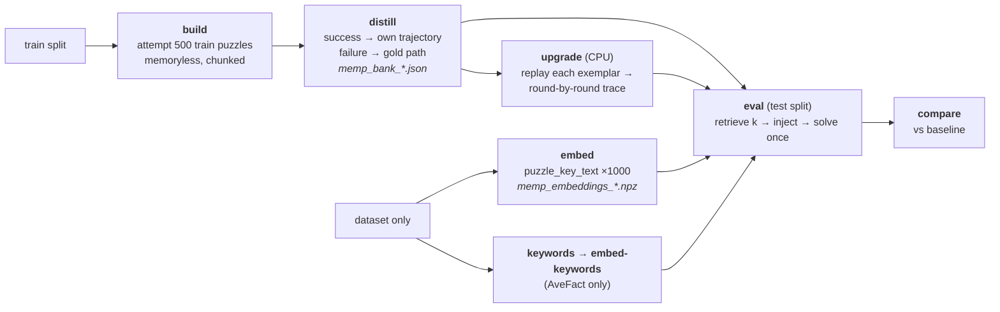

# Memp on SPaRC — setup and results

Memp (Fang et al., Findings of ACL 2026) applied to the SPaRC spatial-reasoning
benchmark, over three models, with a retrieved-vs-random ablation and a set of
build-policy replications. Source data: `results/json/memp_*`, `memp_bank_*`,
`memp_eval_*`; baselines are each model's Reflexion trial 1
(`results/json/reflexion_root_*`).

**Headline:** the original build — a distilled script plus a one-line action
exemplar — reproduces a weak, inconsistent effect: it helps the strongest model only
slightly, hurts a mid-size model significantly, and in every case a *random* memory
performs the same as a *retrieved* one. Storing the winning trajectory **verbatim**
instead of compressing it to an action list turns that weak effect into the strongest,
most significant result in the whole campaign (+32 puzzles, p = 0.0001) — and it does so
without the retrieved memory ever being more relevant than a random one. The mechanism
is legible: procedures written by the model are frequently wrong about SPaRC's rules;
the verbatim trace is correct by construction and cannot be.

---

## 1. The pipeline

Each phase writes a file the next one reads, so any stage can be re-run without
repeating the ones before it.



| Phase | Runs on | Reads → writes |
|---|---|---|
| `build` | chat model | dataset → `memp_build_train_<tag>.json` |
| `distill` | chat model | build file → `memp_bank_<tag>.json` |
| `upgrade` | **login node, no GPU** | bank → `memp_bank_<tag>_traj.json` |
| `embed` | embedding model, 1 GPU | dataset → `memp_embeddings_<tag>.npz` + `.meta.json` |
| `keywords` | chat model | dataset → `memp_keywords_<tag>.json` |
| `embed-keywords` | embedding model, 1 GPU | keywords → `memp_keywords_<tag>.npz` |
| `eval` | chat model | bank + vectors → `memp_eval_<arm>_<tag>.json` |
| `compare` | login node | 3 result files → `results/txt/memp_vs_baseline_<tag>.txt` |

**Why `embed` is decoupled from the bank:** `puzzle_key_text(record)` is deterministic
from the dataset alone, and a bank entry's vector is just the embedding of its source
puzzle's key text. So all 500 train keys and 500 test queries are computed once, in a
~11-minute 1-GPU job that can run in parallel with build/distill — and every later
eval needs only the chat model. vLLM serves one model per process, so this is what
keeps any single job from needing two.

**Why `upgrade` exists:** the paper's `Trajectory` condition stores the run verbatim,
round by round. Our bank stored only a compact action list. `upgrade` replays each
entry's own exemplar through a real env and attaches the resulting trace. Doing it for
the *whole* bank rather than only the agent-solved entries keeps granularity from being
confounded with bank size (500 vs 71 entries). Verified: 500/500 entries upgraded, and
all 500 replays reached a solved state, so every stored exemplar is a genuine winning
line.

---

## 2. What is held constant in every arm

This is what makes the arms comparable, and it is the part not to touch.

- **500 test puzzles, one attempt each.** No retry. Cumulative accuracy cannot drift
  upward the way it does in Reflexion, so there is no `lift ≥ 0` artifact and no
  control arm is needed — but memory can also *hurt*, which makes it a genuine
  two-sided test.
- **Sampling:** seed 0, `temperature 0.6`, `top_p 0.95`, `top_k 20`, `max_tokens 12288`
  — the Qwen3 thinking-mode defaults, used for gpt-oss too so the models stay
  config-matched with their own baselines.
- **Baseline:** each model's Reflexion trial 1 — the memoryless pass over the same 500
  puzzles at the same seed and the same code. `--phase compare` accepts those root
  files directly, so no separate baseline run is needed.
- **Injection point:** the block is appended *after* the full system prompt, exactly as
  Reflexion's is. The ~145 lines before the per-puzzle polyshapes stay byte-identical,
  preserving the shared KV prefix for `--enable-prefix-caching`.
- **Block format:** every arm renders the block identically. Similarity scores are
  logged in the results but never shown to the model, so the retrieval arms differ only
  in *which* entries appear, never in how they are laid out.
- **Retrieval determinism:** ties break on entry id, and the random arm is seeded per
  puzzle (`f"{seed}:{pid}"`), so a resumed job injects byte-identical blocks.

---

## 3. Results

### 3.1 The original campaign: does memory help at all?

Baseline, a bank of 500 script+exemplar entries retrieved by cosine similarity (k=3),
and the same bank sampled at random (k=3) — over all three models.

| Model | Baseline | Random k=3 | Retrieved k=3 | retrieved vs base | random vs base | retrieved vs random |
|---|---|---|---|---|---|---|
| Qwen3-0.6B | 14/500 (2.8%) | 12/500 (2.4%) | 14/500 (2.8%) | p=1.000 | p=0.791 | p=0.791 |
| Qwen3-32B | 55/500 (11.0%) | 33/500 (6.6%) | 40/500 (8.0%) | **p=0.036** | **p=0.0007** | p=0.360 |
| gpt-oss-120b | 70/500 (14.0%) | **87/500 (17.4%)** | 86/500 (17.2%) | p=0.060 | p=0.046 | p=1.000 |

Three findings, none of them the paper's:

1. **Memory hurts on Qwen3-32B**, significantly (p = 0.036 for the real retriever,
   p = 0.0007 for random). This is the single strongest effect in the original
   campaign, and it points the wrong way.
2. **Memory helps gpt-oss-120b only marginally** (p = 0.060, not significant at α=0.05).
3. **In every model, retrieved and random are statistically indistinguishable**
   (p ≥ 0.36 in all three cases). On gpt-oss the random arm even scores one puzzle
   *higher* than the real retriever. Whatever effect memory has, it does not come from
   retrieving the *right* memory.

### 3.2 Per-difficulty

SPaRC difficulty 1–5, n = 86 / 118 / 121 / 86 / 89.

| Model | Diff | Baseline | Random | Retrieved |
|---|---|---|---|---|
| Qwen3-0.6B | 1 | 4.7% | 4.7% | **8.1%** |
| | 2 | **5.9%** | 3.4% | 2.5% |
| | 3 | 2.5% | 2.5% | 3.3% |
| | 4 | 0.0% | 1.2% | 0.0% |
| | 5 | 0.0% | 0.0% | 0.0% |
| Qwen3-32B | 1 | **32.6%** | 23.5% | 22.4% |
| | 2 | **13.6%** | 7.6% | 11.0% |
| | 3 | **6.6%** | 3.3% | 5.0% |
| | 4 | **3.5%** | 0.0% | 2.3% |
| | 5 | 0.0% | 0.0% | 0.0% |
| gpt-oss-120b | 1 | 38.4% | 50.0% | **51.2%** |
| | 2 | 17.8% | **27.1%** | 21.2% |
| | 3 | 9.9% | 9.1% | 9.9% |
| | 4 | 3.5% | 0.0% | **5.8%** |
| | 5 | **1.1%** | 1.1% | 0.0% |

Qwen3-32B loses ground at *every* difficulty except 5 (where all arms are at floor);
memory's harm is not concentrated in one band, it is pervasive. gpt-oss's gain sits at
difficulty 1–2 and is gone by difficulty 3 — memory converts puzzles already near the
model's reach, not hard ones.

### 3.3 Failure modes: what memory actually changes

| Model | Arm | Solved | Wrong-solution | Dead-end |
|---|---|---|---|---|
| Qwen3-0.6B | baseline | 14 | 176 | 303 |
| | random | 12 | 187 | 298 |
| | retrieved | 14 | 187 | 293 |
| Qwen3-32B | baseline | 55 | 210 | 235 |
| | random | 33 | 196 | 270 |
| | retrieved | 40 | 179 | 280 |
| gpt-oss-120b | baseline | 70 | 203 | 227 |
| | random | 87 | 194 | 219 |
| | retrieved | 86 | 192 | 222 |

On Qwen3-32B, memory trades wrong-solutions for dead-ends (210→179/196, but
235→270/280+35) and the trade is a net loss: fewer invalid submissions, far more
stalls, and solved count drops by a third. On gpt-oss both failure modes shrink a
little and the freed attempts become solves — the same trade Reflexion showed, but at
much smaller magnitude here because (see §3.5) the injected content is often wrong.

### 3.4 Why relevance doesn't matter: retrieval was not the problem

The retrieved and random arms are matched on bank, k, and block format — they differ
only in *which* three entries appear. Measuring that difference directly (gpt-oss,
rule types parsed from each puzzle's canonical key text):

| | Retrieved | Random |
|---|---|---|
| Share matching the test puzzle's **exact rule set** | **65.2%** | 2.4% |
| Mean Jaccard overlap of rule types | **0.903** | 0.419 |
| Mean difficulty distance from the test puzzle | **0.685** | 1.556 |

Retrieval hit the exact rule combination 27× more often than chance, and it did not
matter (§3.1: 86 vs 87 solved). Relevance was achieved and changed nothing — so the
ceiling on this method is not in the retriever.

### 3.5 Why: the memory itself is often wrong

Reading the bank shows why relevance didn't help. Every train puzzle with a square or
star rule was checked for whether its distilled script frames it correctly — SPaRC's
actual rule is a **region/colour constraint** (same-colour squares must share a
region, the path goes *around* rule cells) — against the common error of describing it
as a cell to be **visited** (that is the triangle rule).

| Bank | Frames it as a region/colour rule | Tells the agent to step on the cell (wrong) |
|---|---|---|
| Qwen3-0.6B | 99.6% | 0.0% |
| Qwen3-32B | 32.8% | 10.2% |
| gpt-oss-120b | 53.0% | **50.6%** |

gpt-oss's bank — the one that did best — is still wrong about the rule half the time,
and 61% of its injected blocks assert *both* "squares are walls" and "visit the
squares" in the same prompt. Qwen3-0.6B's near-perfect score is not comprehension: 110
of its 500 scripts are near-verbatim copies of the single few-shot example in the
distillation prompt (0 such copies in the other two banks), so its bank carries almost
no puzzle-specific information — consistent with an arm that moved accuracy by exactly
zero.

### 3.6 The replication arms: granularity is what mattered

First, what the three build policies actually put in the prompt. Same bank entry,
rendered three ways — `format_procedures(entries, granularity=...)`:

**Script (the original build)** — an LLM-written paragraph plus a one-line move
summary. Nothing here is checkable against the puzzle it came from:

```
Procedure 1:
Applies to: path-finding puzzles with impassable gap cells
1. Find a gap-free row or column that contains both start and end - this is a
   straight corridor.
2. If it exists, follow it directly; any side step wastes cells and may create
   dead-ends.
3. When blocked, locate the nearest gap-free segment reachable with a single
   orthogonal turn and make an L-shaped detour...
Example (2x4 grid, start (4,0) -> end (1,0), 3 moves: 2 2 2; 0=right,1=up,2=left,3=down)
  its grid had: gap x4
```

**Trajectory (new)** — no script at all. The starting grid, the move-by-move log, and
the final grid with the path drawn on it, mechanically produced by replaying the
entry's own solution through the real environment (`replay_path`). It cannot misstate
a rule because it is not a claim about the rule, it is a verified transcript:

```
Procedure 1:
  Its starting grid:
  ['+', 'E', '+', '+', 'S']
  ['+', 'N', 'G', 'N', '+']
  ['+', 'G', '+', 'G', '+']
  ...
  The solution, move by move (0=right, 1=up, 2=left, 3=down):
  move 0: left -> path head at [3, 0]
  move 1: left -> path head at [2, 0]
  move 2: left -> path head at [1, 0]
  Its final grid, with the solution path drawn (V=visited, L=end):
  ['+', 'L', 'V', 'V', 'V']
  ['+', 'N', 'G', 'N', '+']
  ...
```

**Proceduralization (new)** — both stapled together, the paper's official winning
condition: the script paragraph *and* the full trajectory. Largest block of the three
(~408 tokens here vs ~254 for script-only on this entry).

All on gpt-oss-120b, the model where memory showed the clearest (if marginal) benefit.
Reference points: memoryless baseline 70/500, the original script-granularity arm
86/500.

| Arm | Solved | Acc | Wrong-sol | Dead-end | ktok/puzzle | vs baseline |
|---|---|---|---|---|---|---|
| baseline | 70 | 14.0% | 203 | 227 | 21.5 | — |
| script k=3 (original) | 86 | 17.2% | 192 | 222 | 34.4 | p=0.060 |
| random k=3 | 87 | 17.4% | 194 | 219 | 34.6 | p=0.046 |
| **trajectory** | **102** | **20.4%** | 240 | **156** | 41.2 | **p=0.0001** |
| **proceduralization** | **103** | **20.6%** | 215 | 181 | 46.3 | **p=0.0001** |
| k = 10 (script) | 89 | 17.8% | 176 | 235 | 36.4 | p=0.023 |
| agent-only bank (71 entries) | 80 | 16.0% | 205 | 215 | 32.4 | p=0.229 |
| AveFact keys (script) | 94 | 18.8% | 196 | 210 | 36.0 | p=0.0056 |

**Granularity is the whole story.** Storing the run verbatim, round by round, turns
Memp from a marginal effect into the strongest result in the campaign: +32 puzzles
over the memoryless baseline. It works by a specific, legible mechanism — dead-ends
fall sharply (227→156/181) because the model now has a concrete worked example of how
to keep navigating without stalling. Wrong-solutions *rise* (203→240/215): a concrete
trace teaches navigation, not rules, so it does not reduce rule violations at all.

**The script contributes nothing on top of the trajectory.** Proceduralization beats
Trajectory by one puzzle (p = 1.00). This diverges from the paper, where
Proceduralization clearly wins, and it is exactly what §3.5 predicts: the LLM-written
abstraction is often wrong, the mechanically-extracted trace is correct by
construction. On SPaRC the concrete example carries the entire effect.

**Neither more retrieval nor better retrieval helps at script granularity.** k=10 adds
nothing over k=3 (89 vs 86, +3, not significant against script k=3). AveFact — the
paper's best key-construction strategy — reaches 94/500, its strongest script-only
result and the second arm (after the trajectory pair) to clear p<0.05 against baseline
on its own, but it is still statistically indistinguishable from plain cosine
retrieval (p = 0.428) or from random sampling (p = 0.477). More of an inert signal, or
a better-ranked inert signal, is still inert.

**The successes-only bank does not help.** 80/500 (−6 vs the full bank), which settles
the agent-vs-gold provenance question in the negative — restricting the bank to
self-generated procedures does not reproduce the association visible in a raw
per-entry breakdown of the original campaign. Caveat: this arm changes provenance
*and* bank size (500→71) at once, so it is not a clean single-factor test.

Trajectory and proceduralization are also significantly better than the agent-only
bank on their own terms (p=0.0071 and p=0.0044 respectively) — the strongest
pairwise contrasts in the whole matrix after "vs baseline."

### 3.7 Transfer: does a stronger model's memory help a weaker one?

Qwen3-0.6B as the actor, evaluated against its own bank and against gpt-oss-120b's and
Qwen3-32B's — all at script granularity.

| Bank | Solved | Wrong-sol | Dead-end | vs 0.6B baseline (14) | vs 0.6B own bank (14) |
|---|---|---|---|---|---|
| 0.6B baseline | 14 | 176 | 303 | — | — |
| 0.6B's own bank | 14 | 187 | 293 | p=1.000 | — |
| gpt-oss-120b's bank | 16 | 191 | 284 | p=0.839 | p=0.824 |
| Qwen3-32B's bank | 18 | 162 | 314 | p=0.541 | p=0.541 |

The paper's transfer claim (its Figure 5a: a 14B model gains 5 points and 1.6 fewer
steps from GPT-4o's memory) **does not replicate** — neither donor bank moves
Qwen3-0.6B's accuracy by a significant margin. This was run at script granularity, so
it transfers precisely the component shown in §3.5–3.6 to carry no signal; a transfer
test using trajectory-granularity banks has not yet been run and is the fair version
of this comparison.

### 3.8 Bank construction

| Model | Train solved | Build tokens | Bank entries | Agent / gold | Distill tokens |
|---|---|---|---|---|---|
| Qwen3-0.6B | 9/500 (1.8%) | 39.7M | 500 | 9 / 491 | 0.79M |
| Qwen3-32B | 41/500 (8.2%) | 37.9M | 500 | 41 / 459 | 0.98M |
| gpt-oss-120b | 71/500 (14.2%) | 25.1M | 500 | 71 / 429 | 0.84M |

Zero empty or failed distillations across all three banks. Every bank is
overwhelmingly gold-path hindsight (86–98% of entries), because train-split accuracy
is low for all three models — this is a real departure from the paper's build-from-
success-only design, addressed directly by the agent-only ablation in §3.6.

---

## 4. Cost and efficiency

### GPU time

| Phase | GPU-hours |
|---|---|
| Shared embedding job | 0.2 |
| Qwen3-0.6B (build, distill, 2 evals) | 6.2 |
| Qwen3-32B (build, distill, 2 evals) | 53.1 |
| gpt-oss-120b (build, distill, 2 evals) | 26.7 |
| Replication arms (9 jobs, gpt-oss + 2×Qwen3-0.6B transfer) | 65.8 |
| **Total** | **152.0** |

Qwen3-32B is the most expensive single model despite not being the largest — it is the
slowest thinker per puzzle among the three and needs two GPUs for its context.

### Token efficiency (gpt-oss-120b arms)

Tokens per solved puzzle — lower is better:

| Arm | Solved | Total tokens | Tokens/solve |
|---|---|---|---|
| baseline | 70 | 27.4M | 0.392M |
| script k=3 | 86 | 44.8M | 0.521M |
| random k=3 | 87 | 44.6M | 0.512M |
| trajectory | 102 | 60.6M | 0.595M |
| proceduralization | 103 | 71.7M | 0.696M |
| agent-only | 80 | 41.7M | 0.522M |
| k=10 | 89 | 68.3M | 0.768M |
| AveFact | 94 | 46.2M | **0.492M** |

AveFact is the most token-efficient memory arm (0.492M/solve) despite not being the
most accurate — it retrieves compact script-only blocks and gets a respectable hit
rate for the price. Trajectory and proceduralization solve the most puzzles but are
also 14–33% more expensive per solve than script k=3, since every injected block now
carries a full move-by-move trace.

### Multiple-comparisons correction

Thirteen "does memory help" tests were run across the two campaigns (three models ×
original arms, plus the gpt-oss replication arms, plus transfer). Under Holm-Bonferroni
correction (α = 0.05, family of 13):

| Rank | Test | p | Survives Holm? |
|---|---|---|---|
| 1 | gpt-oss trajectory vs baseline | 0.0001 | **yes** |
| 2 | gpt-oss proceduralization vs baseline | 0.0001 | **yes** |
| 3 | Qwen3-32B random vs baseline | 0.0007 | **yes** |
| 4 | gpt-oss AveFact vs baseline | 0.0056 | no (threshold 0.0050) |
| 5 | gpt-oss k=10 vs baseline | 0.0226 | no |
| 6 | Qwen3-32B retrieved vs baseline | 0.0357 | no |
| 7 | gpt-oss random k=3 vs baseline | 0.0464 | no |
| 8 | gpt-oss script k=3 vs baseline | 0.0599 | no |
| — | (5 further tests, all p > 0.2) | | no |

Only three results survive correction: gpt-oss's two trajectory-granularity gains, and
Qwen3-32B's harm from random memory. Everything built on the original script-only
build — the entire first campaign — is not distinguishable from chance once corrected
for how many comparisons were run.

---

## 5. Conclusions

1. **The original build (script + compact exemplar) is a weak, inconsistent method on
   SPaRC.** It helps gpt-oss-120b marginally (not significant), hurts Qwen3-32B
   significantly, and does nothing measurable for Qwen3-0.6B.
2. **Retrieval quality is not the bottleneck.** Across every configuration tested —
   cosine similarity, random sampling, AveFact keyword matching, k=3 vs k=10 — no
   retrieval policy ever significantly beat any other. The retriever reliably finds
   the exact rule-matched procedure (65% vs 2% for random) and it does not matter.
3. **The content of the memory is frequently wrong**, and this is *why* relevance
   doesn't help: 33–51% of entries in the two larger banks misstate SPaRC's square/star
   rule as a visit target rather than a region constraint, and matching a puzzle to a
   wrong procedure about the right rules buys nothing over a wrong procedure about
   different rules.
4. **Granularity is the one intervention that produced a large, robust effect.**
   Replacing the compressed action-list exemplar with the verbatim round-by-round
   trajectory more than doubled the gain over baseline (+16 → +32 puzzles) and is the
   only change in this campaign that survives multiple-comparisons correction.
5. **The mechanism is legible and specific.** The trajectory helps by preventing
   dead-ends (227→156), not by teaching rules (wrong-solutions actually rise). It works
   precisely because it is mechanically extracted and cannot misstate a rule, unlike
   the LLM-written script sitting right next to it in the proceduralization arm, which
   adds nothing.
6. **The paper's transfer claim does not replicate** at script granularity — a
   stronger model's memory does not measurably help a weaker one on SPaRC.
7. **It is not free.** The trajectory arms cost 14–33% more tokens per solve than the
   script arm, on top of that arm's own cost over the memoryless baseline.

### Threats to validity

- **Single seed, single attempt per puzzle**, so no variance estimate exists across
  repeats — several of the surviving results (e.g. AveFact just missing the Holm
  threshold) are close enough that a repeat run could move them across the line either
  way.
- **The rule-error rates (§3.5) are a regex proxy**, not a hand-labelled audit; the
  direction is corroborated by direct reading of sampled entries, but a precise
  percentage would need manual annotation.
- **The agent-only ablation (§3.6) changes two factors at once** (provenance and bank
  size), so its negative result cannot be attributed to provenance alone.
- **No random-trajectory control exists.** The retrieved-vs-random ablation (§3.4) was
  only measured at script granularity. It is not yet known whether the trajectory
  arms' +32 puzzles requires a *relevant* trajectory or merely the presence of *any*
  correct worked example — the single most informative run still missing from this
  campaign.
- **The three Update-stage arms (Vanilla, Validation, Adjustment) are implemented but
  not yet run.** Adjustment in particular is the paper's best-performing policy and the
  only mechanism in the framework that could correct a rule-wrong procedure once
  identified — directly relevant to the §3.5 finding.
- **Transfer was tested at script granularity only** (§3.7), which §3.6 shows to be
  the inert component; a trajectory-granularity transfer test has not been run.
