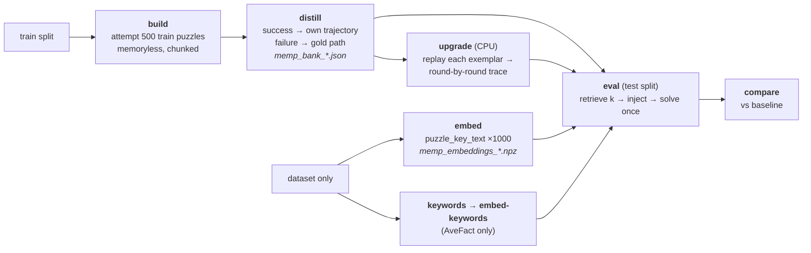

# Memp on SPaRC — setup and results

Memp (Fang et al., Findings of ACL 2026) applied to the SPaRC spatial-reasoning
benchmark, over three models, with a retrieved-vs-random ablation and a set of
build-policy replications. Source data: `results/json/memp_*`, `memp_bank_*`,
`memp_eval_*`; baselines are each model's Reflexion trial 1
(`results/json/reflexion_root_*`).

**Headline:** the original build — a distilled script plus a one-line action
exemplar — reproduces a weak, inconsistent effect: it helps the strongest model only
slightly, hurts a mid-size model significantly, and a *random* memory performs the same
as a *retrieved* one. Storing the winning trajectory **verbatim** instead of compressing
it to an action list turns that weak effect into the strongest result in the campaign
(+32 puzzles, p = 0.0001).

Two follow-up campaigns pin down why, and both cut against the obvious explanation.
(1) The distilled scripts really are frequently wrong about SPaRC's rules — the cause
was a prompt defect, the distiller was never shown the rulebook — but repairing it
(banks 99.8–100% rule-correct) moved accuracy by +4 on the best model, p = 0.71, and by
exactly 0 on the mid-size one. Rule-correctness was never the binding constraint (§3.9).
(2) A *randomly chosen* correct trajectory recovers two-thirds of the full gain (+22 of
+32) by the same mechanism, so what the method delivers here is closer to few-shot
prompting with a verified worked example than to retrieval-based memory (§3.10).

The mechanism that survives: the trajectory suppresses **dead-ends** (227→156), which are
the larger failure pool; the script moves **rule compliance** (wrong-solutions −23) and
nothing else, and in combination the trajectory dominates.

## 0. All runs at a glance

Every Memp arm run on SPaRC, generated from the result files by `scripts/memp_report.py` (re-run it after adding an arm; the numbers below are not maintained by hand). All arms: 500 test puzzles, one attempt each, seed 0, `temperature 0.6`. `v1` = the original banks; `v2` = banks rebuilt with the rulebook in the distillation prompt (§3.9). Baselines are each actor's Reflexion trial 1.

### Success rate

| Actor | Arm | Solved /500 | Accuracy | vs baseline |
|---|---|---|---|---|
| Qwen3-0.6B | baseline (memoryless) | 14 | 2.8% | — |
|  | retrieved k=3, script (v1) | 14 | 2.8% | +0, p=1.0000 |
|  | random k=3, script (v1) | 12 | 2.4% | -2, p=0.7905 |
|  | retrieved k=3, script (v2) | 19 | 3.8% | +5, p=0.4244 |
|  | transfer: 32B bank (v1) | 18 | 3.6% | +4, p=0.5413 |
|  | transfer: gpt-oss bank (v1) | 16 | 3.2% | +2, p=0.8388 |
|  | transfer: gpt-oss bank (v2) | 17 | 3.4% | +3, p=0.6776 |
| Qwen3-32B | baseline (memoryless) | 55 | 11.0% | — |
|  | retrieved k=3, script (v1) | 40 | 8.0% | **-15, p=0.0357** |
|  | random k=3, script (v1) | 33 | 6.6% | **-22, p=0.0007** |
|  | retrieved k=3, script (v2) | 40 | 8.0% | **-15, p=0.0357** |
|  | transfer: gpt-oss bank (v2) | 35 | 7.0% | **-20, p=0.0022** |
| gpt-oss-120b | baseline (memoryless) | 70 | 14.0% | — |
|  | retrieved k=3, script (v1) | 86 | 17.2% | +16, p=0.0599 |
|  | random k=3, script (v1) | 87 | 17.4% | **+17, p=0.0464** |
|  | retrieved k=3, script (v2) | 90 | 18.0% | **+20, p=0.0225** |
|  | agent-only bank, script (v1) | 80 | 16.0% | +10, p=0.2288 |
|  | agent-only bank, script (v2) | 90 | 18.0% | **+20, p=0.0119** |
|  | retrieved k=10, script (v1) | 89 | 17.8% | **+19, p=0.0226** |
|  | AveFact keys, script (v1) | 94 | 18.8% | **+24, p=0.0056** |
|  | retrieved, TRAJECTORY | 102 | 20.4% | **+32, p=0.0001** |
|  | random, TRAJECTORY | 92 | 18.4% | **+22, p=0.0046** |
|  | retrieved, PROCEDURALIZATION (v1) | 103 | 20.6% | **+33, p=0.0001** |
|  | retrieved, PROCEDURALIZATION (v2) | 105 | 21.0% | **+35, p=0.0000** |

Every arm, every actor, over the identical 500 test puzzles at seed 0. Bold = p < 0.05 on an exact McNemar against that actor's own memoryless baseline. The pattern that runs through the whole campaign is visible here: memory is significantly *harmful* on Qwen3-32B in every configuration, does nothing measurable on Qwen3-0.6B, and helps only gpt-oss-120b — where the two trajectory-bearing arms are far ahead of everything else.

### Success by difficulty

Accuracy within each SPaRC difficulty band (n = 86 / 118 / 121 / 86 / 89).

| Actor | Arm | d1 | d2 | d3 | d4 | d5 |
|---|---|---|---|---|---|---|
| Qwen3-0.6B | baseline (memoryless) | 4.7% | 5.9% | 2.5% | 0.0% | 0.0% |
|  | retrieved k=3, script (v1) | 8.1% | 2.5% | 3.3% | 0.0% | 0.0% |
|  | random k=3, script (v1) | 4.7% | 3.4% | 2.5% | 1.2% | 0.0% |
|  | retrieved k=3, script (v2) | 8.1% | 5.1% | 3.3% | 2.3% | 0.0% |
|  | transfer: 32B bank (v1) | 9.3% | 5.1% | 3.3% | 0.0% | 0.0% |
|  | transfer: gpt-oss bank (v1) | 8.1% | 5.1% | 2.5% | 0.0% | 0.0% |
|  | transfer: gpt-oss bank (v2) | 14.0% | 2.5% | 1.7% | 0.0% | 0.0% |
| Qwen3-32B | baseline (memoryless) | 32.6% | 13.6% | 6.6% | 3.5% | 0.0% |
|  | retrieved k=3, script (v1) | 22.1% | 11.0% | 5.0% | 2.3% | 0.0% |
|  | random k=3, script (v1) | 23.3% | 7.6% | 3.3% | 0.0% | 0.0% |
|  | retrieved k=3, script (v2) | 25.6% | 11.0% | 3.3% | 1.2% | 0.0% |
|  | transfer: gpt-oss bank (v2) | 24.4% | 5.9% | 5.0% | 1.2% | 0.0% |
| gpt-oss-120b | baseline (memoryless) | 38.4% | 17.8% | 9.9% | 3.5% | 1.1% |
|  | retrieved k=3, script (v1) | 51.2% | 21.2% | 9.9% | 5.8% | 0.0% |
|  | random k=3, script (v1) | 50.0% | 27.1% | 9.1% | 0.0% | 1.1% |
|  | retrieved k=3, script (v2) | 51.2% | 27.1% | 7.4% | 3.5% | 2.2% |
|  | agent-only bank, script (v1) | 44.2% | 18.6% | 12.4% | 4.7% | 1.1% |
|  | agent-only bank, script (v2) | 52.3% | 26.3% | 9.1% | 2.3% | 1.1% |
|  | retrieved k=10, script (v1) | 52.3% | 21.2% | 12.4% | 4.7% | 0.0% |
|  | AveFact keys, script (v1) | 57.0% | 23.7% | 11.6% | 2.3% | 1.1% |
|  | retrieved, TRAJECTORY | 59.3% | 28.8% | 12.4% | 2.3% | 0.0% |
|  | random, TRAJECTORY | 61.6% | 24.6% | 5.8% | 3.5% | 0.0% |
|  | retrieved, PROCEDURALIZATION (v1) | 57.0% | 31.4% | 11.6% | 3.5% | 0.0% |
|  | retrieved, PROCEDURALIZATION (v2) | 59.3% | 28.0% | 14.9% | 2.3% | 1.1% |

Gains concentrate almost entirely in bands 1-2 and are gone by band 4. Nothing in this campaign moved difficulty 5 (n=89) off the floor for any actor. Qwen3-32B loses ground at *every* band, so its harm is pervasive rather than concentrated. gpt-oss's best arms roughly halve the difficulty-1 gap to human performance while leaving 4-5 untouched — memory converts puzzles already near the model's reach, not hard ones.

### Failure modes

Terminal reason for all 500 episodes. `format-failure` = never produced a parseable move; `error` = a transient serving failure, excluded from reflection but still counted as an attempt.

| Actor | Arm | Solved | Wrong-sol | Dead-end | Format-fail | Error |
|---|---|---|---|---|---|---|
| Qwen3-0.6B | baseline (memoryless) | 14 | 176 | 303 | 7 | 0 |
|  | retrieved k=3, script (v1) | 14 | 187 | 293 | 6 | 0 |
|  | random k=3, script (v1) | 12 | 187 | 298 | 3 | 0 |
|  | retrieved k=3, script (v2) | 19 | 165 | 309 | 7 | 0 |
|  | transfer: 32B bank (v1) | 18 | 162 | 314 | 6 | 0 |
|  | transfer: gpt-oss bank (v1) | 16 | 191 | 284 | 9 | 0 |
|  | transfer: gpt-oss bank (v2) | 17 | 173 | 306 | 4 | 0 |
| Qwen3-32B | baseline (memoryless) | 55 | 210 | 235 | 0 | 0 |
|  | retrieved k=3, script (v1) | 40 | 179 | 280 | 0 | 1 |
|  | random k=3, script (v1) | 33 | 196 | 270 | 0 | 1 |
|  | retrieved k=3, script (v2) | 40 | 160 | 300 | 0 | 0 |
|  | transfer: gpt-oss bank (v2) | 35 | 173 | 292 | 0 | 0 |
| gpt-oss-120b | baseline (memoryless) | 70 | 203 | 227 | 0 | 0 |
|  | retrieved k=3, script (v1) | 86 | 192 | 222 | 0 | 0 |
|  | random k=3, script (v1) | 87 | 194 | 219 | 0 | 0 |
|  | retrieved k=3, script (v2) | 90 | 180 | 229 | 1 | 0 |
|  | agent-only bank, script (v1) | 80 | 205 | 215 | 0 | 0 |
|  | agent-only bank, script (v2) | 90 | 180 | 230 | 0 | 0 |
|  | retrieved k=10, script (v1) | 89 | 176 | 235 | 0 | 0 |
|  | AveFact keys, script (v1) | 94 | 196 | 210 | 0 | 0 |
|  | retrieved, TRAJECTORY | 102 | 240 | 156 | 2 | 0 |
|  | random, TRAJECTORY | 92 | 242 | 164 | 2 | 0 |
|  | retrieved, PROCEDURALIZATION (v1) | 103 | 215 | 181 | 1 | 0 |
|  | retrieved, PROCEDURALIZATION (v2) | 105 | 225 | 166 | 4 | 0 |

The single most informative table in the document. Read the trajectory arms against the script arms on gpt-oss: **the trajectory trades wrong-solutions for dead-ends** (203→240 wrong, 227→156 dead) while the rule-corrected script does the exact opposite (203→180 wrong, 227→229 dead). They fix different failure modes, and because dead-ends are the larger pool, only the trajectory shows up in the accuracy column. Format-failures are negligible everywhere except Qwen3-0.6B, and `error` is ~0 throughout, so no arm is flattered by crashes.

### Token cost and efficiency

Prompt + completion + retry tokens over all 500 episodes. **Tokens/solve** is the efficiency figure: an arm that solves more puzzles can still be cheaper per solved puzzle.

| Actor | Arm | Total | ktok/puzzle | Solved | Mtok/solve | vs baseline |
|---|---|---|---|---|---|---|
| Qwen3-0.6B | baseline (memoryless) | 45.7M | 91.3 | 14 | 3.261 | — |
|  | retrieved k=3, script (v1) | 35.1M | 70.2 | 14 | 2.507 | -23% |
|  | random k=3, script (v1) | 35.7M | 71.4 | 12 | 2.976 | -9% |
|  | retrieved k=3, script (v2) | 34.1M | 68.2 | 19 | 1.795 | -45% |
|  | transfer: 32B bank (v1) | 42.4M | 84.8 | 18 | 2.355 | -28% |
|  | transfer: gpt-oss bank (v1) | 43.0M | 86.0 | 16 | 2.689 | -18% |
|  | transfer: gpt-oss bank (v2) | 39.1M | 78.3 | 17 | 2.302 | -29% |
| Qwen3-32B | baseline (memoryless) | 37.5M | 75.0 | 55 | 0.682 | — |
|  | retrieved k=3, script (v1) | 45.2M | 90.5 | 40 | 1.131 | +66% |
|  | random k=3, script (v1) | 45.9M | 91.7 | 33 | 1.390 | +104% |
|  | retrieved k=3, script (v2) | 46.5M | 93.0 | 40 | 1.163 | +70% |
|  | transfer: gpt-oss bank (v2) | 45.9M | 91.8 | 35 | 1.311 | +92% |
| gpt-oss-120b | baseline (memoryless) | 27.7M | 55.5 | 70 | 0.396 | — |
|  | retrieved k=3, script (v1) | 45.7M | 91.5 | 86 | 0.532 | +34% |
|  | random k=3, script (v1) | 45.4M | 90.8 | 87 | 0.522 | +32% |
|  | retrieved k=3, script (v2) | 46.3M | 92.6 | 90 | 0.514 | +30% |
|  | agent-only bank, script (v1) | 42.4M | 84.9 | 80 | 0.531 | +34% |
|  | agent-only bank, script (v2) | 44.9M | 89.8 | 90 | 0.499 | +26% |
|  | retrieved k=10, script (v1) | 69.4M | 138.7 | 89 | 0.779 | +97% |
|  | AveFact keys, script (v1) | 47.3M | 94.5 | 94 | 0.503 | +27% |
|  | retrieved, TRAJECTORY | 62.6M | 125.2 | 102 | 0.614 | +55% |
|  | random, TRAJECTORY | 66.0M | 132.0 | 92 | 0.717 | +81% |
|  | retrieved, PROCEDURALIZATION (v1) | 74.5M | 148.9 | 103 | 0.723 | +82% |
|  | retrieved, PROCEDURALIZATION (v2) | 75.5M | 150.9 | 105 | 0.719 | +81% |

Note the sign flip. On **Qwen3-0.6B memory is cheaper than the baseline per solve** (−23% to −45%): a 0.6B model with no memory flails for 18.6 steps before dying, and any injected block shortens that. On the two larger actors memory always costs more per solve. Within gpt-oss the ranking is not the accuracy ranking — **agent-only v2 (+26%) and AveFact (+27%) are the most efficient memory arms**, while the trajectory arms buy their extra puzzles at +55% to +82%, and k=10 is the worst deal in the campaign (+97% for 3 puzzles over k=3). Every injected block is paid for at every one of the ~17 steps in the episode, which is why block size dominates this table.

### Token breakdown: prompt vs completion

The same tokens as the previous table, split by kind. **tok/step** is prompt tokens divided by env steps — the clearest measure of what a memory block actually costs, since the block is re-sent on every step of the episode. `retry` is prompt+completion spent on replies that yielded no parseable move (tracked as one aggregate, not split further).

| Actor | Arm | Prompt | Completion | Retry | Prompt share | Prompt tok/step |
|---|---|---|---|---|---|---|
| Qwen3-0.6B | baseline (memoryless) | 20.9M | 20.2M | 4.55M | 46% | 2246 |
|  | retrieved k=3, script (v1) | 21.7M | 11.4M | 1.96M | 62% | 2889 |
|  | random k=3, script (v1) | 22.5M | 11.2M | 1.99M | 63% | 2883 |
|  | retrieved k=3, script (v2) | 21.6M | 10.6M | 1.91M | 63% | 2945 |
|  | transfer: 32B bank (v1) | 24.9M | 14.4M | 3.08M | 59% | 3101 |
|  | transfer: gpt-oss bank (v1) | 27.5M | 12.3M | 3.17M | 64% | 3358 |
|  | transfer: gpt-oss bank (v2) | 26.0M | 11.1M | 2.01M | 67% | 3211 |
| Qwen3-32B | baseline (memoryless) | 15.2M | 22.3M | 0.06M | 40% | 2026 |
|  | retrieved k=3, script (v1) | 22.2M | 23.0M | 0.01M | 49% | 2941 |
|  | random k=3, script (v1) | 22.7M | 23.2M | 0.00M | 49% | 2919 |
|  | retrieved k=3, script (v2) | 23.1M | 23.4M | 0.06M | 50% | 2989 |
|  | transfer: gpt-oss bank (v2) | 23.2M | 22.6M | 0.09M | 51% | 3076 |
| gpt-oss-120b | baseline (memoryless) | 16.7M | 10.7M | 0.29M | 60% | 2090 |
|  | retrieved k=3, script (v1) | 27.6M | 17.2M | 0.96M | 60% | 3229 |
|  | random k=3, script (v1) | 27.3M | 17.3M | 0.82M | 60% | 3199 |
|  | retrieved k=3, script (v2) | 27.0M | 18.0M | 1.25M | 58% | 3143 |
|  | agent-only bank, script (v1) | 25.6M | 16.2M | 0.71M | 60% | 3085 |
|  | agent-only bank, script (v2) | 26.1M | 17.8M | 0.96M | 58% | 3066 |
|  | retrieved k=10, script (v1) | 50.2M | 18.2M | 1.02M | 72% | 5758 |
|  | AveFact keys, script (v1) | 28.2M | 18.0M | 1.03M | 60% | 3219 |
|  | retrieved, TRAJECTORY | 40.0M | 20.6M | 1.98M | 64% | 4696 |
|  | random, TRAJECTORY | 39.6M | 23.3M | 3.07M | 60% | 4630 |
|  | retrieved, PROCEDURALIZATION (v1) | 48.6M | 23.1M | 2.72M | 65% | 5435 |
|  | retrieved, PROCEDURALIZATION (v2) | 47.8M | 24.2M | 3.49M | 63% | 5382 |

The `Prompt tok/step` column is a direct readout of injected block size, since the block is re-sent at every step: gpt-oss goes 2090 (no memory) → ~3150-3230 (script, ≈1.1k of block) → 4696 (trajectory, ≈2.6k) → 5382 (proceduralization, ≈3.3k) → 5758 (k=10, ≈3.7k). That single column explains the whole cost ordering in the previous table.

Three things worth noting:

- **Prompt dominates everywhere** (46-72% of all tokens), so memory cost is paid on input, not on the model thinking longer.
- **Qwen3-0.6B's efficiency gain is a completion effect.** Its completion tokens roughly *halve* with memory (20.2M → ~11M) and its retry tokens drop from 4.55M to ~2M, while prompt barely moves. The memoryless 0.6B was burning its budget flailing and re-trying unparseable replies; any block cuts that short. This is the one place in the campaign where memory buys efficiency rather than accuracy.
- **Retry tokens scale with block size on gpt-oss** — 0.29M at baseline, 0.96-1.25M for script arms, 1.98-3.49M for the trajectory arms. That tracks the `format-failure` counts in the failure-modes table (0 → 1 → 2-4): larger injected blocks measurably provoke more unparseable replies, and those tokens are counted here rather than hidden.

### Steps in the environment

Env steps per episode (`max_steps=100`). Split by outcome: a solved episode's step count is essentially the path length, while a failed one shows how long the agent kept moving before dying.

| Actor | Arm | Mean (all) | Mean (solved) | Mean (failed) |
|---|---|---|---|---|
| Qwen3-0.6B | baseline (memoryless) | 18.6 | 18.2 | 18.6 |
|  | retrieved k=3, script (v1) | 15.0 | 12.1 | 15.1 |
|  | random k=3, script (v1) | 15.6 | 12.4 | 15.7 |
|  | retrieved k=3, script (v2) | 14.6 | 14.3 | 14.7 |
|  | transfer: 32B bank (v1) | 16.0 | 12.8 | 16.2 |
|  | transfer: gpt-oss bank (v1) | 16.4 | 17.1 | 16.4 |
|  | transfer: gpt-oss bank (v2) | 16.2 | 14.3 | 16.3 |
| Qwen3-32B | baseline (memoryless) | 15.0 | 12.2 | 15.3 |
|  | retrieved k=3, script (v1) | 15.1 | 12.1 | 15.4 |
|  | random k=3, script (v1) | 15.6 | 12.3 | 15.8 |
|  | retrieved k=3, script (v2) | 15.4 | 11.7 | 15.8 |
|  | transfer: gpt-oss bank (v2) | 15.1 | 11.4 | 15.4 |
| gpt-oss-120b | baseline (memoryless) | 16.0 | 12.8 | 16.5 |
|  | retrieved k=3, script (v1) | 17.1 | 13.7 | 17.8 |
|  | random k=3, script (v1) | 17.1 | 14.2 | 17.7 |
|  | retrieved k=3, script (v2) | 17.2 | 15.0 | 17.7 |
|  | agent-only bank, script (v1) | 16.6 | 14.3 | 17.0 |
|  | agent-only bank, script (v2) | 17.0 | 14.8 | 17.5 |
|  | retrieved k=10, script (v1) | 17.4 | 14.4 | 18.1 |
|  | AveFact keys, script (v1) | 17.5 | 14.1 | 18.3 |
|  | retrieved, TRAJECTORY | 17.0 | 14.4 | 17.7 |
|  | random, TRAJECTORY | 17.1 | 14.2 | 17.8 |
|  | retrieved, PROCEDURALIZATION (v1) | 17.9 | 14.5 | 18.8 |
|  | retrieved, PROCEDURALIZATION (v2) | 17.8 | 15.0 | 18.5 |

Remarkably flat: 15-18 steps per episode almost everywhere, well under the `max_steps=100` cap, so **no arm is failing by running out of budget** — episodes end because the agent submits a wrong path or paints itself into a corner. Solved episodes are consistently shorter than failed ones (~14 vs ~18 on gpt-oss), i.e. the winning line is usually direct. The one real movement is Qwen3-0.6B's baseline at 18.6 steps dropping to ~15 with memory, which is the same effect visible in its token column.

---

## 1. The pipeline

Each phase writes a file the next one reads, so any stage can be re-run without
repeating the ones before it.



| Phase | Runs on | Reads → writes |
|---|---|---|
| `build` | chat model | dataset → `memp_build_train_<tag>.json` |
| `distill` | chat model | build file → `memp_bank_<tag>.json` |
| `upgrade` | **login node, no GPU** | bank → `memp_bank_<tag>_traj.json` |
| `embed` | embedding model, 1 GPU | dataset → `memp_embeddings_<tag>.npz` + `.meta.json` |
| `keywords` | chat model | dataset → `memp_keywords_<tag>.json` |
| `embed-keywords` | embedding model, 1 GPU | keywords → `memp_keywords_<tag>.npz` |
| `eval` | chat model | bank + vectors → `memp_eval_<arm>_<tag>.json` |
| `compare` | login node | 3 result files → `results/txt/memp_vs_baseline_<tag>.txt` |

**Why `embed` is decoupled from the bank:** `puzzle_key_text(record)` is deterministic
from the dataset alone, and a bank entry's vector is just the embedding of its source
puzzle's key text. So all 500 train keys and 500 test queries are computed once, in a
~11-minute 1-GPU job that can run in parallel with build/distill — and every later
eval needs only the chat model. vLLM serves one model per process, so this is what
keeps any single job from needing two.

**Why `upgrade` exists:** the paper's `Trajectory` condition stores the run verbatim,
round by round. Our bank stored only a compact action list. `upgrade` replays each
entry's own exemplar through a real env and attaches the resulting trace. Doing it for
the *whole* bank rather than only the agent-solved entries keeps granularity from being
confounded with bank size (500 vs 71 entries). Verified: 500/500 entries upgraded, and
all 500 replays reached a solved state, so every stored exemplar is a genuine winning
line.

---

## 2. What is held constant in every arm

This is what makes the arms comparable, and it is the part not to touch.

- **500 test puzzles, one attempt each.** No retry. Cumulative accuracy cannot drift
  upward the way it does in Reflexion, so there is no `lift ≥ 0` artifact and no
  control arm is needed — but memory can also *hurt*, which makes it a genuine
  two-sided test.
- **Sampling:** seed 0, `temperature 0.6`, `top_p 0.95`, `top_k 20`, `max_tokens 12288`
  — the Qwen3 thinking-mode defaults, used for gpt-oss too so the models stay
  config-matched with their own baselines.
- **Baseline:** each model's Reflexion trial 1 — the memoryless pass over the same 500
  puzzles at the same seed and the same code. `--phase compare` accepts those root
  files directly, so no separate baseline run is needed.
- **Injection point:** the block is appended *after* the full system prompt, exactly as
  Reflexion's is. The ~145 lines before the per-puzzle polyshapes stay byte-identical,
  preserving the shared KV prefix for `--enable-prefix-caching`.
- **Block format:** every arm renders the block identically. Similarity scores are
  logged in the results but never shown to the model, so the retrieval arms differ only
  in *which* entries appear, never in how they are laid out.
- **Retrieval determinism:** ties break on entry id, and the random arm is seeded per
  puzzle (`f"{seed}:{pid}"`), so a resumed job injects byte-identical blocks.

---

## 3. Results

### 3.1 The original campaign: does memory help at all?

Baseline, a bank of 500 script+exemplar entries retrieved by cosine similarity (k=3),
and the same bank sampled at random (k=3) — over all three models.

| Model | Baseline | Random k=3 | Retrieved k=3 | retrieved vs base | random vs base | retrieved vs random |
|---|---|---|---|---|---|---|
| Qwen3-0.6B | 14/500 (2.8%) | 12/500 (2.4%) | 14/500 (2.8%) | p=1.000 | p=0.791 | p=0.791 |
| Qwen3-32B | 55/500 (11.0%) | 33/500 (6.6%) | 40/500 (8.0%) | **p=0.036** | **p=0.0007** | p=0.360 |
| gpt-oss-120b | 70/500 (14.0%) | **87/500 (17.4%)** | 86/500 (17.2%) | p=0.060 | p=0.046 | p=1.000 |

Three findings, none of them the paper's:

1. **Memory hurts on Qwen3-32B**, significantly (p = 0.036 for the real retriever,
   p = 0.0007 for random). This is the single strongest effect in the original
   campaign, and it points the wrong way.
2. **Memory helps gpt-oss-120b only marginally** (p = 0.060, not significant at α=0.05).
3. **In every model, retrieved and random are statistically indistinguishable**
   (p ≥ 0.36 in all three cases). On gpt-oss the random arm even scores one puzzle
   *higher* than the real retriever. Whatever effect memory has, it does not come from
   retrieving the *right* memory.

### 3.2 Per-difficulty

The original three arms only; §0 has the same breakdown for every arm in the campaign.

SPaRC difficulty 1–5, n = 86 / 118 / 121 / 86 / 89.

| Model | Diff | Baseline | Random | Retrieved |
|---|---|---|---|---|
| Qwen3-0.6B | 1 | 4.7% | 4.7% | **8.1%** |
| | 2 | **5.9%** | 3.4% | 2.5% |
| | 3 | 2.5% | 2.5% | 3.3% |
| | 4 | 0.0% | 1.2% | 0.0% |
| | 5 | 0.0% | 0.0% | 0.0% |
| Qwen3-32B | 1 | **32.6%** | 23.5% | 22.4% |
| | 2 | **13.6%** | 7.6% | 11.0% |
| | 3 | **6.6%** | 3.3% | 5.0% |
| | 4 | **3.5%** | 0.0% | 2.3% |
| | 5 | 0.0% | 0.0% | 0.0% |
| gpt-oss-120b | 1 | 38.4% | 50.0% | **51.2%** |
| | 2 | 17.8% | **27.1%** | 21.2% |
| | 3 | 9.9% | 9.1% | 9.9% |
| | 4 | 3.5% | 0.0% | **5.8%** |
| | 5 | **1.1%** | 1.1% | 0.0% |

Qwen3-32B loses ground at *every* difficulty except 5 (where all arms are at floor);
memory's harm is not concentrated in one band, it is pervasive. gpt-oss's gain sits at
difficulty 1–2 and is gone by difficulty 3 — memory converts puzzles already near the
model's reach, not hard ones.

### 3.3 Failure modes: what memory actually changes

The original three arms only; §0 has the full terminal-reason breakdown for every arm.

| Model | Arm | Solved | Wrong-solution | Dead-end |
|---|---|---|---|---|
| Qwen3-0.6B | baseline | 14 | 176 | 303 |
| | random | 12 | 187 | 298 |
| | retrieved | 14 | 187 | 293 |
| Qwen3-32B | baseline | 55 | 210 | 235 |
| | random | 33 | 196 | 270 |
| | retrieved | 40 | 179 | 280 |
| gpt-oss-120b | baseline | 70 | 203 | 227 |
| | random | 87 | 194 | 219 |
| | retrieved | 86 | 192 | 222 |

On Qwen3-32B, memory trades wrong-solutions for dead-ends (210→179/196, but
235→270/280+35) and the trade is a net loss: fewer invalid submissions, far more
stalls, and solved count drops by a third. On gpt-oss both failure modes shrink a
little and the freed attempts become solves — the same trade Reflexion showed, but at
much smaller magnitude. §3.5 attributes that to the injected content often being wrong;
§3.9 tests that attribution directly and refutes it, and gives the mechanism instead
(the script moves rule compliance, not navigation, and navigation is the larger pool).

### 3.4 Why relevance doesn't matter: retrieval was not the problem

The retrieved and random arms are matched on bank, k, and block format — they differ
only in *which* three entries appear. Measuring that difference directly (gpt-oss,
rule types parsed from each puzzle's canonical key text):

| | Retrieved | Random |
|---|---|---|
| Share matching the test puzzle's **exact rule set** | **65.2%** | 2.4% |
| Mean Jaccard overlap of rule types | **0.903** | 0.419 |
| Mean difficulty distance from the test puzzle | **0.685** | 1.556 |

Retrieval hit the exact rule combination 27× more often than chance, and it did not
matter (§3.1: 86 vs 87 solved). Relevance was achieved and changed nothing — so the
ceiling on this method is not in the retriever.

### 3.5 The memory itself is often wrong

> Originally titled "Why: the memory itself is often wrong". It measures a real defect,
> but the causal claim in the title did not survive testing — §3.9 repairs the defect and
> shows accuracy barely moves. Read this section as a measurement, not an explanation.

Reading the bank shows what the retrieved content actually contains. Every train puzzle with a square or
star rule was checked for whether its distilled script frames it correctly — SPaRC's
actual rule is a **region/colour constraint** (same-colour squares must share a
region, the path goes *around* rule cells) — against the common error of describing it
as a cell to be **visited** (that is the triangle rule).

| Bank | Frames it as a region/colour rule | Tells the agent to step on the cell (wrong) |
|---|---|---|
| Qwen3-0.6B | 99.6% | 0.0% |
| Qwen3-32B | 32.8% | 10.2% |
| gpt-oss-120b | 53.0% | **50.6%** |

gpt-oss's bank — the one that did best — is still wrong about the rule half the time,
and 61% of its injected blocks assert *both* "squares are walls" and "visit the
squares" in the same prompt. Qwen3-0.6B's near-perfect score is not comprehension: 110
of its 500 scripts are near-verbatim copies of the single few-shot example in the
distillation prompt (0 such copies in the other two banks), so its bank carries almost
no puzzle-specific information — consistent with an arm that moved accuracy by exactly
zero.

### 3.6 The replication arms: granularity is what mattered

First, what the three build policies actually put in the prompt. Same bank entry,
rendered three ways — `format_procedures(entries, granularity=...)`:

**Script (the original build)** — an LLM-written paragraph plus a one-line move
summary. Nothing here is checkable against the puzzle it came from:

```
Procedure 1:
Applies to: path-finding puzzles with impassable gap cells
1. Find a gap-free row or column that contains both start and end - this is a
   straight corridor.
2. If it exists, follow it directly; any side step wastes cells and may create
   dead-ends.
3. When blocked, locate the nearest gap-free segment reachable with a single
   orthogonal turn and make an L-shaped detour...
Example (2x4 grid, start (4,0) -> end (1,0), 3 moves: 2 2 2; 0=right,1=up,2=left,3=down)
  its grid had: gap x4
```

**Trajectory (new)** — no script at all. The starting grid, the move-by-move log, and
the final grid with the path drawn on it, mechanically produced by replaying the
entry's own solution through the real environment (`replay_path`). It cannot misstate
a rule because it is not a claim about the rule, it is a verified transcript:

```
Procedure 1:
  Its starting grid:
  ['+', 'E', '+', '+', 'S']
  ['+', 'N', 'G', 'N', '+']
  ['+', 'G', '+', 'G', '+']
  ...
  The solution, move by move (0=right, 1=up, 2=left, 3=down):
  move 0: left -> path head at [3, 0]
  move 1: left -> path head at [2, 0]
  move 2: left -> path head at [1, 0]
  Its final grid, with the solution path drawn (V=visited, L=end):
  ['+', 'L', 'V', 'V', 'V']
  ['+', 'N', 'G', 'N', '+']
  ...
```

**Proceduralization (new)** — both stapled together, the paper's official winning
condition: the script paragraph *and* the full trajectory. Largest block of the three
(~408 tokens here vs ~254 for script-only on this entry).

All on gpt-oss-120b, the model where memory showed the clearest (if marginal) benefit.
Reference points: memoryless baseline 70/500, the original script-granularity arm
86/500.

| Arm | Solved | Acc | Wrong-sol | Dead-end | ktok/puzzle | vs baseline |
|---|---|---|---|---|---|---|
| baseline | 70 | 14.0% | 203 | 227 | 21.5 | — |
| script k=3 (original) | 86 | 17.2% | 192 | 222 | 34.4 | p=0.060 |
| random k=3 | 87 | 17.4% | 194 | 219 | 34.6 | p=0.046 |
| **trajectory** | **102** | **20.4%** | 240 | **156** | 41.2 | **p=0.0001** |
| **proceduralization** | **103** | **20.6%** | 215 | 181 | 46.3 | **p=0.0001** |
| k = 10 (script) | 89 | 17.8% | 176 | 235 | 36.4 | p=0.023 |
| agent-only bank (71 entries) | 80 | 16.0% | 205 | 215 | 32.4 | p=0.229 |
| AveFact keys (script) | 94 | 18.8% | 196 | 210 | 36.0 | p=0.0056 |

**Granularity is the whole story.** Storing the run verbatim, round by round, turns
Memp from a marginal effect into the strongest result in the campaign: +32 puzzles
over the memoryless baseline. It works by a specific, legible mechanism — dead-ends
fall sharply (227→156/181) because the model now has a concrete worked example of how
to keep navigating without stalling. Wrong-solutions *rise* (203→240/215): a concrete
trace teaches navigation, not rules, so it does not reduce rule violations at all.

**The script contributes nothing on top of the trajectory.** Proceduralization beats
Trajectory by one puzzle (p = 1.00). This diverges from the paper, where
Proceduralization clearly wins.

> **Superseded explanation.** This section originally attributed that to §3.5: the
> LLM-written abstraction is often wrong, the mechanically-extracted trace is correct by
> construction. §3.9 tested that explanation by making the script rule-correct and
> **refuted it** — a rule-correct script adds nothing on top of the trajectory either
> (103 → 105, p = 0.89). The conclusion survives on stronger evidence, but the reason is
> not rule-correctness. See §3.9.

On SPaRC the concrete example carries the entire effect.

**Neither more retrieval nor better retrieval helps at script granularity.** k=10 adds
nothing over k=3 (89 vs 86, +3, not significant against script k=3). AveFact — the
paper's best key-construction strategy — reaches 94/500, its strongest script-only
result and the second arm (after the trajectory pair) to clear p<0.05 against baseline
on its own, but it is still statistically indistinguishable from plain cosine
retrieval (p = 0.428) or from random sampling (p = 0.477). More of an inert signal, or
a better-ranked inert signal, is still inert.

**The successes-only bank does not help.** 80/500 (−6 vs the full bank), which settles
the agent-vs-gold provenance question in the negative — restricting the bank to
self-generated procedures does not reproduce the association visible in a raw
per-entry breakdown of the original campaign. Caveat: this arm changes provenance
*and* bank size (500→71) at once, so it is not a clean single-factor test.

Trajectory and proceduralization are also significantly better than the agent-only
bank on their own terms (p=0.0071 and p=0.0044 respectively) — the strongest
pairwise contrasts in the whole matrix after "vs baseline."

### 3.7 Transfer: does a stronger model's memory help a weaker one?

Qwen3-0.6B as the actor, evaluated against its own bank and against gpt-oss-120b's and
Qwen3-32B's — all at script granularity.

| Bank | Solved | Wrong-sol | Dead-end | vs 0.6B baseline (14) | vs 0.6B own bank (14) |
|---|---|---|---|---|---|
| 0.6B baseline | 14 | 176 | 303 | — | — |
| 0.6B's own bank | 14 | 187 | 293 | p=1.000 | — |
| gpt-oss-120b's bank | 16 | 191 | 284 | p=0.839 | p=0.824 |
| Qwen3-32B's bank | 18 | 162 | 314 | p=0.541 | p=0.541 |

The paper's transfer claim (its Figure 5a: a 14B model gains 5 points and 1.6 fewer
steps from GPT-4o's memory) **does not replicate** — neither donor bank moves
Qwen3-0.6B's accuracy by a significant margin. This was run at script granularity, so
it transfers precisely the component shown in §3.5–3.6 to carry no signal; a transfer
test using trajectory-granularity banks has not yet been run and is the fair version
of this comparison.

### 3.8 Bank construction

| Model | Train solved | Build tokens | Bank entries | Agent / gold | Distill tokens |
|---|---|---|---|---|---|
| Qwen3-0.6B | 9/500 (1.8%) | 39.7M | 500 | 9 / 491 | 0.79M |
| Qwen3-32B | 41/500 (8.2%) | 37.9M | 500 | 41 / 459 | 0.98M |
| gpt-oss-120b | 71/500 (14.2%) | 25.1M | 500 | 71 / 429 | 0.84M |

Zero empty or failed distillations across all three banks. Every bank is
overwhelmingly gold-path hindsight (86–98% of entries), because train-split accuracy
is low for all three models — this is a real departure from the paper's build-from-
success-only design, addressed directly by the agent-only ablation in §3.6.

### 3.9 The v2 campaign: giving the distiller the rules

§3.5 measured that the banks misstate SPaRC's rules; it did not explain why. The cause
was in the prompt. Neither `memp_distill_trajectory_prompt` nor
`memp_distill_gold_prompt` ever contained the rulebook — they showed the model cell
labels and a move sequence and asked *why this path is correct*, while the "Detailed
Solving Rules" block the actor reads lived only in `sparc_system_prompt`. The distiller
had to reverse-engineer the mechanics from labels, and it reliably guessed a
Hamiltonian-path model: squares/stars/polys as cells to "visit", and the key text's
census line (`rules: square x3`, i.e. how many square *cells* exist) as a per-cell visit
count.

**The fix.** `sparc_system_prompt` was split into `sparc_rules(polyshapes)` + the I/O
contract, and `distill_rules_preamble()` now prepends the verbatim rules to every prompt
that *writes* a procedure (both distil variants and the revise step). The I/O contract is
deliberately excluded — a distiller told to end with `Final: <digit>` would answer a
procedure request with a move. The actor's own prompt is unchanged, byte for byte, so
every number in §3.1–3.8 stays comparable. `scripts/audit_bank.py` makes §3.5's ad-hoc
measurement reproducible; the two campaigns below are scored under one definition.

**Manipulation check.** The intervention worked, and it is not a lexical artifact —
spot-reading confirms entries that previously invented "stars must turn on entry and
exit" now state the actual pairing rule.

| Bank | region-framed ✓ | "visit the square" ✗ | census-as-count ✗ | few-shot copies |
|---|---|---|---|---|
| Qwen3-0.6B | 99.8 → 98.8 | 1.2 → 1.2 | 0.4 → 0.4 | 194 → **342** |
| Qwen3-32B | 31.7 → **100.0** | 62.0 → **5.1** | 3.8 → 9.2 | 0 → 0 |
| gpt-oss-120b | 50.7 → **99.8** | 71.8 → **10.2** | 25.0 → **4.6** | 0 → 0 |

Qwen3-0.6B is the exception that proves §3.5's reading of it: its 98.8% is not
comprehension but copying, and the longer prompt made that *worse* — 342/500 of its
scripts are now near-verbatim copies of the few-shot example.

**It did not rescue the method.** All arms k=3, script, retrieved, full test split;
build files and embeddings reused unchanged, so the distillation prompt is the only
thing that moved.

| Actor / bank | baseline | v1 | v2 | v1 → v2 |
|---|---|---|---|---|
| gpt-oss, own bank | 70 | 86 (p=0.060) | **90** (p=0.0225) | +4, p=0.71 |
| gpt-oss, agent-only (71 entries) | 70 | 80 (p=0.229) | **90** (p=0.0119) | +10, p=0.27 |
| Qwen3-32B, own bank | 55 | 40 (p=0.036) | **40** (p=0.036) | **0**, p=1.00 |
| Qwen3-32B, gpt-oss bank | 55 | — | **35** (p=0.0022) | — |
| Qwen3-0.6B, own bank | 14 | 14 | **19** (p=0.42) | +5, p=0.40 |
| Qwen3-0.6B, gpt-oss bank | 14 | 16 | **17** (p=0.68) | +1, p=1.00 |

Qwen3-32B is the decisive case: its bank went from 31.7% to 100% rule-correct and it
solved *exactly* 40 puzzles both times, still significantly worse than memoryless. A
rule-correct donor bank makes it worse still (35/500, p=0.0022) — transfer remains
non-replicating, and now significantly harmful.

**What the fix did change is legible, and it is not accuracy.** Failure modes on
gpt-oss, Δ against the 70/500 memoryless baseline:

| Arm | Solved | Wrong-sol | Dead-end | Δwrong | Δdead |
|---|---|---|---|---|---|
| baseline | 70 | 203 | 227 | — | — |
| script v1 (rule-wrong) | 86 | 192 | 222 | −11 | −5 |
| script v2 (rule-correct) | 90 | 180 | 229 | **−23** | +2 |
| trajectory | 102 | 240 | 156 | +37 | **−71** |
| proceduralization v1 (rule-wrong script) | 103 | 215 | 181 | +12 | −46 |
| proceduralization v2 (rule-correct script) | **105** | 225 | 166 | +22 | −61 |

The two components fix **different failure modes**. A rule-correct script buys rule
compliance and nothing on navigation (wrong −23, dead +2); the trajectory buys
navigation and *costs* rule compliance (wrong +37, dead −71). Making the bank more
rule-correct doubled the rule-compliance benefit exactly as one would predict
(−11 → −23) — it simply does not convert into solves, because dead-ends are the larger
failure pool and the script does nothing about them. The same mechanism explains
Qwen3-32B's harm, previously unexplained: memory makes it markedly more rule-careful
(wrong −50) and markedly more prone to stalling (dead +65), for a net −15.

**And the components do not compose.** Proceduralization v2 is the strongest arm in the
campaign at 105/500 (p < 0.0001 vs baseline) but is statistically indistinguishable from
both of its neighbours:

| Contrast | Net | p |
|---|---|---|
| proc-v2 vs proc-v1 | +2 | 0.89 |
| proc-v2 vs trajectory alone | +3 | 0.80 |
| proc-v2 vs script-v2 | +15 | 0.11 |

The prediction going in was that a rule-correct script would push wrong-solutions below
proc-v1's 215 while the trajectory held dead-ends near 181. Wrong-solutions went *up*, to
225, and dead-ends fell to 166 — proc-v2's profile shifted **toward** the pure-trajectory
shape. In context together, the trajectory dominates and the script's rule-compliance
contribution disappears. This is a clean single-factor test: `rerun_memp_v2.sh verify`
confirms the v1 and v2 trajectory banks carry **500/500 identical trajectories and 0/500
identical scripts**, so the script is provably the only difference between the two
proceduralization arms.

**Cost.** The rulebook roughly triples distillation prompt tokens (0.40M → 1.11M per
model); completion tokens rise 20–75%. Negligible against eval.

### 3.10 The random-trajectory control: is this memory, or few-shot prompting?

§3.9 leaves one question open, and it is the one that decides what the method *is*. The
trajectory carries the whole effect — but does it need to be the trajectory of a
*similar* puzzle, or would any correct worked example do? §3.4 asked this at script
granularity and found retrieved ≈ random, but script is inert, so that test could not
have detected a retrieval effect had one existed. Run properly, at the granularity where
the effect actually lives (gpt-oss, k=3, same `_traj` bank as the retrieved run, so the
arm is the only difference):

| Arm | Solved | Wrong-sol | Dead-end | vs baseline |
|---|---|---|---|---|
| baseline | 70 | 203 | 227 | — |
| trajectory, **retrieved** | 102 | 240 | 156 | +32, p=0.0001 |
| trajectory, **random** | 92 | 242 | 164 | +22, p=0.0046 |

**Retrieved vs random: net +10 for retrieved (31 vs 21 discordant), McNemar p = 0.21.**

Read carefully, this says two things:

1. **Most of the effect does not require relevance.** A randomly drawn trajectory
   recovers +22 of the +32 — roughly two-thirds — and does so by the *same* mechanism:
   dead-ends fall to 164 against retrieved's 156, and wrong-solutions are identical
   within noise (242 vs 240). Whatever the worked example teaches about not painting
   yourself into a corner, it transfers from an unrelated puzzle nearly as well as from a
   similar one. To that extent Memp on SPaRC behaves like few-shot prompting with a
   verified example rather than like retrieval-based memory.
2. **Relevance is not nothing, but this run cannot establish it.** +10 puzzles is the
   largest retrieved-over-random margin anywhere in the campaign (at script granularity
   it was +1 the *wrong* way), and it points in the direction the method predicts. It
   simply does not clear significance on 52 discordant pairs. This is an underpowered
   negative, not a demonstrated null — distinguishing a true +10 from noise here needs
   more seeds, not a different arm.

The honest summary for the thesis: **the presence of a correct worked trajectory is
doing the work; matching it to the puzzle adds at most a modest increment that this
design cannot resolve.**

---

## 4. Cost and efficiency

### GPU time

| Phase | GPU-hours |
|---|---|
| Shared embedding job | 0.2 |
| Qwen3-0.6B (build, distill, 2 evals) | 6.2 |
| Qwen3-32B (build, distill, 2 evals) | 53.1 |
| gpt-oss-120b (build, distill, 2 evals) | 26.7 |
| Replication arms (9 jobs, gpt-oss + 2×Qwen3-0.6B transfer) | 65.8 |
| **Total** | **152.0** |

Qwen3-32B is the most expensive single model despite not being the largest — it is the
slowest thinker per puzzle among the three and needs two GPUs for its context.

### Token efficiency

**Superseded by §0**, which covers all three actors and every arm. This section
originally tabulated the gpt-oss arms only, and counted prompt + completion but *not*
`retry_tokens` (tokens spent on replies that yielded no parseable move). §0 includes
them, per the accounting rule in §2 — a method that provokes more format-failures must
not look artificially cheap — so its totals run ~1% higher than the figures that used to
sit here (baseline 27.7M vs 27.4M).

The readings that survive, now measured over all arms:

- **AveFact and the v2 agent-only bank are the most efficient memory arms on gpt-oss**
  (+27% and +26% per solve over baseline) — compact script-only blocks bought at a
  respectable hit rate.
- **The trajectory arms buy their extra puzzles at a real price**: +55% (trajectory) to
  +81% (proceduralization) per solve, because every injected block now carries a full
  move-by-move trace and is re-sent at each of the ~17 steps in the episode.
- **k=10 is the worst deal in the campaign**: +97% per solve for 3 puzzles over k=3.
- **On Qwen3-0.6B the sign flips** — memory is *cheaper* per solve than the baseline
  (−23% to −45%), because the memoryless 0.6B flails for 18.6 steps before dying and any
  injected block shortens the episode.

### Multiple-comparisons correction

Thirteen "does memory help" tests were run across the two campaigns (three models ×
original arms, plus the gpt-oss replication arms, plus transfer). Under Holm-Bonferroni
correction (α = 0.05, family of 13):

| Rank | Test | p | Survives Holm? |
|---|---|---|---|
| 1 | gpt-oss trajectory vs baseline | 0.0001 | **yes** |
| 2 | gpt-oss proceduralization vs baseline | 0.0001 | **yes** |
| 3 | Qwen3-32B random vs baseline | 0.0007 | **yes** |
| 4 | gpt-oss AveFact vs baseline | 0.0056 | no (threshold 0.0050) |
| 5 | gpt-oss k=10 vs baseline | 0.0226 | no |
| 6 | Qwen3-32B retrieved vs baseline | 0.0357 | no |
| 7 | gpt-oss random k=3 vs baseline | 0.0464 | no |
| 8 | gpt-oss script k=3 vs baseline | 0.0599 | no |
| — | (5 further tests, all p > 0.2) | | no |

Only three results survive correction: gpt-oss's two trajectory-granularity gains, and
Qwen3-32B's harm from random memory. Everything built on the original script-only
build — the entire first campaign — is not distinguishable from chance once corrected
for how many comparisons were run.

---

## 5. Conclusions

1. **The original build (script + compact exemplar) is a weak, inconsistent method on
   SPaRC.** It helps gpt-oss-120b marginally (not significant), hurts Qwen3-32B
   significantly, and does nothing measurable for Qwen3-0.6B.
2. **Retrieval quality is not the bottleneck.** Across every configuration tested —
   cosine similarity, random sampling, AveFact keyword matching, k=3 vs k=10 — no
   retrieval policy ever significantly beat any other. The retriever reliably finds
   the exact rule-matched procedure (65% vs 2% for random) and it does not matter.
   At trajectory granularity, where the effect actually lives, relevance buys a
   directional +10 (p = 0.21) — the one place retrieval looks like it might earn its
   keep, and the campaign cannot resolve it (§3.10).
3. **What Memp delivers on SPaRC is closer to few-shot prompting than to memory.** A
   *randomly chosen* correct trajectory recovers two-thirds of the full gain (+22 of
   +32) through the same dead-end-suppression mechanism. The valuable ingredient is a
   verified worked example in context; matching it to the task is a second-order effect.
4. **The content of the memory is frequently wrong** — 33–51% of entries in the two
   larger banks misstate SPaRC's square/star rule as a visit target rather than a region
   constraint — **but that is not why memory underperforms.** The cause was a prompt
   defect (the distiller was never shown the rulebook); fixing it made the banks
   99.8–100% rule-correct and moved accuracy by +4 on gpt-oss (p = 0.71) and by exactly
   0 on Qwen3-32B. Memory content being *correct* is necessary for nothing measured
   here. See §3.9.
5. **Granularity is the one intervention that produced a large, robust effect.**
   Replacing the compressed action-list exemplar with the verbatim round-by-round
   trajectory more than doubled the gain over baseline (+16 → +32 puzzles) and is the
   only change in this campaign that survives multiple-comparisons correction.
6. **The mechanism is legible and specific.** The trajectory helps by preventing
   dead-ends (227→156), not by teaching rules (wrong-solutions actually rise). The
   script does the opposite — a rule-correct one cuts wrong-solutions by 23 and moves
   dead-ends by +2 — and dead-ends are the larger failure pool, which is why only the
   trajectory shows up in the accuracy column. Put both in context and the trajectory
   dominates: the script's rule-compliance benefit vanishes (§3.9). The earlier claim
   that the trajectory wins *because* it cannot misstate a rule has been tested and
   refuted; it wins because it teaches navigation, and nothing else on offer does.
7. **The paper's transfer claim does not replicate** at script granularity — a
   stronger model's memory does not measurably help a weaker one on SPaRC, and on the
   rule-correct v2 banks it actively *hurts* Qwen3-32B (55 → 35, p = 0.0022). Never
   tested at trajectory granularity, which §3.6/§3.10 identify as the component that
   actually carries signal — the one open item that could still change this conclusion.
8. **It is not free.** The trajectory arms cost 14–33% more tokens per solve than the
   script arm, on top of that arm's own cost over the memoryless baseline.

### Threats to validity

- **Single seed, single attempt per puzzle**, so no variance estimate exists across
  repeats — several of the surviving results (e.g. AveFact just missing the Holm
  threshold) are close enough that a repeat run could move them across the line either
  way.
- **The rule-error rates (§3.5, §3.9) are a regex proxy**, not a hand-labelled audit;
  the direction is corroborated by direct reading of sampled entries, but a precise
  percentage would need manual annotation. `scripts/audit_bank.py` at least makes the
  proxy reproducible and applies one definition to both campaigns, so the *before/after*
  comparison is sound even where an absolute figure is not.
- **The agent-only ablation (§3.6) changes two factors at once** (provenance and bank
  size), so its negative result cannot be attributed to provenance alone. On the v2
  bank the two arms *tie* exactly (90 vs 90, wrong-solutions 180 in both), which is a
  cleaner statement than v1's loss but does not remove the confound.
- **The random-trajectory control is underpowered** (§3.10). Retrieved beats random by
  10 puzzles at trajectory granularity, the largest such margin in the campaign and in
  the predicted direction, but p = 0.21 over 52 discordant pairs. The run establishes
  that *most* of the effect survives randomisation; it does not establish that the
  remainder is zero. Resolving a true +10 needs repeated seeds, which no arm in this
  campaign has.
- **The three Update-stage arms (Vanilla, Validation, Adjustment) are implemented but
  not yet run.** Adjustment was motivated as the only mechanism that could repair a
  rule-wrong procedure once identified — but §3.9 removes rule-wrongness at the source
  and shows it was not the binding constraint, so this is now paper-completeness rather
  than a live hypothesis.
- **Transfer was tested at script granularity only** (§3.7), which §3.6 shows to be
  the inert component; a trajectory-granularity transfer test has not been run.
