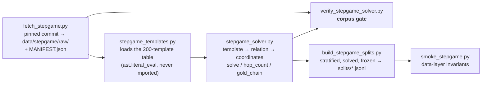

# StepGame — setup, design and plan

The second benchmark. SPaRC is an interactive grid MDP; StepGame is single-turn
text QA, so this document is as much about **generalising the harness** as about
the benchmark itself. Per the thesis proposal the agent "answers in a single turn
on StepGame and LogicGame", which means the seam built here is the one LogicGame
reuses.

Read `docs/architecture.md` first: everything below is expressed as a delta on
the baseline / Reflexion / MemP / MemoryBank design already running on SPaRC.

---

## 0. All runs at a glance

Every StepGame arm run so far, generated from the result files by
`scripts/stepgame_report.py` (re-run it after adding an arm; **the numbers below
are not maintained by hand**). Same shape as `docs/memp.md` §0 and
`docs/reflexion_results.md` §0 so the benchmarks can be read side by side, with
three StepGame-specific changes: there is no `steps` table (every episode is one
call), its slot is taken by a **by-hops** table (§2.2 — *k* is the story length,
the hop count is the reasoning depth), and `dead-end` is not a failure mode here.

All arms: the frozen 1000-item k-stratified clean test split, **one attempt each**,
seed 0, `temperature 0.6`, `top_p 0.95`, `top_k 20`. Baselines are each actor's
Reflexion trial 1. **gpt-oss-120b is absent by design** — it is at ceiling and
prompt-invariant on clean StepGame (§6 risk 1), so it was dropped rather than run.

> **Read every number here against §3.2's protocol box.** These arms run on
> `upstream-header`, which omits the reference-frame convention, and >50% of the
> distilled bank entries supply it. Part of the uniform gain below is memory
> repairing the prompt. The `ours`-protocol control that would separate the two
> has not been run.

**The headline is the flatness.** For Qwen3-32B, 10 memory arms span 0.867–0.901
— a 3.4pp range, *inside* the ~4pp replicate noise floor — against a 0.733
baseline. Retrieval relevance is null (MemP retrieved vs random p = 0.617;
MemoryBank p = 0.852), the two methods are indistinguishable from each other
(p = 0.712), and contrastive polarity changes nothing. The only manipulation that
moves anything is `fixed` (one procedure instead of three), and it moves *down*
(0.867, p = 0.013 vs retrieved) — so quantity helps slightly and **relevance not
at all**. Reflexion, the one method whose memory carries no gold-derived
procedure, is the only one that *hurts*.

### Success rate

**vs baseline** is the net items gained over that actor's own memoryless baseline (Reflexion trial 1) on the identical 1000 items. **Bold** = clears p < 0.05 on a paired exact McNemar.

| Actor | Arm | Solved /1000 | Accuracy | vs baseline |
|---|---|---|---|---|
| Qwen3-0.6B | baseline (memoryless) | 246 | 24.6% | — |
|  | MemP retrieved k=3, trajectory | 310 | 31.0% | **+64** |
|  | MemP random k=3, trajectory | 287 | 28.7% | **+41** |
|  | MemP fixed (same 3 entries, every item) | 267 | 26.7% | +21 |
|  | MemoryBank retrieved k=3 | 308 | 30.8% | **+62** |
|  | MemoryBank random k=3 | 298 | 29.8% | **+52** |
| Qwen3-32B | baseline (memoryless) | 733 | 73.3% | — |
|  | MemP retrieved k=3, trajectory | 895 | 89.5% | **+162** |
|  | MemP random k=3, trajectory | 901 | 90.1% | **+168** |
|  | MemP fixed (same 3 entries, every item) | 867 | 86.7% | **+134** |
|  | MemoryBank retrieved k=3 | 900 | 90.0% | **+167** |
|  | MemoryBank random k=3 | 897 | 89.7% | **+164** |
|  | Contrastive positive-only, retrieved | 871 | 87.1% | **+138** |
|  | Contrastive avoid, retrieved | 879 | 87.9% | **+146** |
|  | Contrastive avoid, random | 883 | 88.3% | **+150** |
|  | Contrastive avoid, balanced | 885 | 88.5% | **+152** |
|  | Contrastive hindsight, retrieved | 889 | 88.9% | **+156** |

### Success by *k* (story length)

Accuracy within each band, as a percentage. 100 items per band, so a rate and a count coincide numerically here — the unit is on every cell to keep that unambiguous. Note *k* is the story length, not the reasoning depth — see §2.2.

| Actor | Arm | k1 | k2 | k3 | k4 | k5 | k6 | k7 | k8 | k9 | k10 |
|---|---|---|---|---|---|---|---|---|---|---|---|
| Qwen3-0.6B | baseline (memoryless) | 54% | 27% | 26% | 32% | 20% | 15% | 16% | 19% | 22% | 15% |
|  | MemP retrieved k=3, trajectory | 70% | 44% | 28% | 33% | 24% | 20% | 22% | 23% | 24% | 22% |
|  | MemP random k=3, trajectory | 56% | 30% | 28% | 31% | 25% | 20% | 24% | 28% | 23% | 22% |
|  | MemP fixed (same 3 entries, every item) | 59% | 30% | 21% | 35% | 21% | 16% | 29% | 24% | 16% | 16% |
|  | MemoryBank retrieved k=3 | 68% | 40% | 31% | 32% | 22% | 23% | 23% | 26% | 22% | 21% |
|  | MemoryBank random k=3 | 59% | 43% | 26% | 28% | 28% | 22% | 30% | 23% | 23% | 16% |
| Qwen3-32B | baseline (memoryless) | 96% | 78% | 81% | 80% | 71% | 69% | 71% | 64% | 59% | 64% |
|  | MemP retrieved k=3, trajectory | 98% | 95% | 91% | 89% | 90% | 88% | 91% | 87% | 84% | 82% |
|  | MemP random k=3, trajectory | 100% | 94% | 93% | 88% | 85% | 92% | 91% | 87% | 88% | 83% |
|  | MemP fixed (same 3 entries, every item) | 99% | 89% | 91% | 83% | 88% | 87% | 89% | 78% | 86% | 77% |
|  | MemoryBank retrieved k=3 | 99% | 93% | 92% | 90% | 91% | 92% | 93% | 85% | 83% | 82% |
|  | MemoryBank random k=3 | 100% | 94% | 91% | 89% | 90% | 92% | 91% | 85% | 84% | 81% |
|  | Contrastive positive-only, retrieved | 100% | 94% | 94% | 87% | 85% | 87% | 88% | 81% | 77% | 78% |
|  | Contrastive avoid, retrieved | 100% | 91% | 93% | 86% | 86% | 86% | 89% | 86% | 80% | 82% |
|  | Contrastive avoid, random | 100% | 93% | 96% | 86% | 87% | 87% | 83% | 84% | 87% | 80% |
|  | Contrastive avoid, balanced | 99% | 92% | 94% | 89% | 85% | 92% | 83% | 89% | 81% | 81% |
|  | Contrastive hindsight, retrieved | 100% | 92% | 94% | 85% | 89% | 89% | 84% | 90% | 87% | 79% |

### Success by true hop count (reasoning depth)

The honest difficulty axis. Bucket sizes are uneven on the k-stratified split (406 items at h=1, 4 at h=10), so the last two columns aggregate the band that actually carries the difficulty signal.

| Actor | Arm | h1 | h2 | h3 | h4 | h5 | h6+ | **h≤3** | **h≥4** |
|---|---|---|---|---|---|---|---|---|---|
| Qwen3-0.6B | baseline (memoryless) | 45% | 14% | 10% | 11% | 5% | 6% | 30% | 8% |
|  | MemP retrieved k=3, trajectory | 56% | 17% | 14% | 12% | 15% | 6% | 37% | 11% |
|  | MemP random k=3, trajectory | 49% | 15% | 16% | 16% | 13% | 12% | 33% | 14% |
|  | MemP fixed (same 3 entries, every item) | 49% | 12% | 12% | 15% | 7% | 7% | 32% | 10% |
|  | MemoryBank retrieved k=3 | 54% | 16% | 18% | 20% | 8% | 8% | 36% | 13% |
|  | MemoryBank random k=3 | 51% | 18% | 19% | 12% | 8% | 8% | 36% | 10% |
| Qwen3-32B | baseline (memoryless) | 94% | 63% | 66% | 58% | 56% | 42% | 80% | 52% |
|  | MemP retrieved k=3, trajectory | 98% | 85% | 90% | 88% | 70% | 79% | 92% | 80% |
|  | MemP random k=3, trajectory | 99% | 85% | 89% | 81% | 84% | 79% | 93% | 81% |
|  | MemP fixed (same 3 entries, every item) | 98% | 76% | 89% | 77% | 82% | 75% | 90% | 78% |
|  | MemoryBank retrieved k=3 | 97% | 85% | 90% | 84% | 77% | 86% | 92% | 83% |
|  | MemoryBank random k=3 | 98% | 84% | 91% | 80% | 87% | 76% | 93% | 81% |
|  | Contrastive positive-only, retrieved | 98% | 78% | 90% | 78% | 75% | 74% | 91% | 76% |
|  | Contrastive avoid, retrieved | 97% | 77% | 91% | 87% | 75% | 77% | 90% | 81% |
|  | Contrastive avoid, random | 98% | 78% | 87% | 85% | 80% | 80% | 90% | 82% |
|  | Contrastive avoid, balanced | 99% | 82% | 85% | 82% | 74% | 82% | 91% | 80% |
|  | Contrastive hindsight, retrieved | 99% | 78% | 90% | 84% | 85% | 80% | 91% | 83% |

### Failure modes

Terminal reason for all 1000 episodes. `format-failure` = never produced a parseable label after the retries, and is counted separately from a wrong answer on purpose: with nine labels and a ~11% chance floor, folding unparseable replies into the accuracy would hide them.

| Actor | Arm | Solved | Wrong-answer | Format-fail | Error |
|---|---|---|---|---|---|
| Qwen3-0.6B | baseline (memoryless) | 246 | 754 | 0 | 0 |
|  | MemP retrieved k=3, trajectory | 310 | 690 | 0 | 0 |
|  | MemP random k=3, trajectory | 287 | 713 | 0 | 0 |
|  | MemP fixed (same 3 entries, every item) | 267 | 732 | 1 | 0 |
|  | MemoryBank retrieved k=3 | 308 | 692 | 0 | 0 |
|  | MemoryBank random k=3 | 298 | 702 | 0 | 0 |
| Qwen3-32B | baseline (memoryless) | 733 | 267 | 0 | 0 |
|  | MemP retrieved k=3, trajectory | 895 | 105 | 0 | 0 |
|  | MemP random k=3, trajectory | 901 | 99 | 0 | 0 |
|  | MemP fixed (same 3 entries, every item) | 867 | 133 | 0 | 0 |
|  | MemoryBank retrieved k=3 | 900 | 100 | 0 | 0 |
|  | MemoryBank random k=3 | 897 | 103 | 0 | 0 |
|  | Contrastive positive-only, retrieved | 871 | 129 | 0 | 0 |
|  | Contrastive avoid, retrieved | 879 | 121 | 0 | 0 |
|  | Contrastive avoid, random | 883 | 117 | 0 | 0 |
|  | Contrastive avoid, balanced | 885 | 115 | 0 | 0 |
|  | Contrastive hindsight, retrieved | 889 | 111 | 0 | 0 |

### Token cost and efficiency

Prompt + completion + retry over all 1000 episodes. **ktok/solve** is the efficiency figure: an arm that solves more items can still be dearer per solved item, and on a one-call benchmark that is the only cost that matters.

| Actor | Arm | Total | ktok/item | Solved | ktok/solve | vs baseline |
|---|---|---|---|---|---|---|
| Qwen3-0.6B | baseline (memoryless) | 1.67M | 1.7 | 246 | 6.8 | — |
|  | MemP retrieved k=3, trajectory | 2.80M | 2.8 | 310 | 9.0 | +33% |
|  | MemP random k=3, trajectory | 2.87M | 2.9 | 287 | 10.0 | +47% |
|  | MemP fixed (same 3 entries, every item) | 2.62M | 2.6 | 267 | 9.8 | +44% |
|  | MemoryBank retrieved k=3 | 3.01M | 3.0 | 308 | 9.8 | +43% |
|  | MemoryBank random k=3 | 3.07M | 3.1 | 298 | 10.3 | +52% |
| Qwen3-32B | baseline (memoryless) | 2.32M | 2.3 | 733 | 3.2 | — |
|  | MemP retrieved k=3, trajectory | 3.19M | 3.2 | 895 | 3.6 | +12% |
|  | MemP random k=3, trajectory | 3.37M | 3.4 | 901 | 3.7 | +18% |
|  | MemP fixed (same 3 entries, every item) | 3.14M | 3.1 | 867 | 3.6 | +14% |
|  | MemoryBank retrieved k=3 | 3.60M | 3.6 | 900 | 4.0 | +26% |
|  | MemoryBank random k=3 | 3.67M | 3.7 | 897 | 4.1 | +29% |
|  | Contrastive positive-only, retrieved | 3.13M | 3.1 | 871 | 3.6 | +14% |
|  | Contrastive avoid, retrieved | 3.35M | 3.4 | 879 | 3.8 | +20% |
|  | Contrastive avoid, random | 3.31M | 3.3 | 883 | 3.7 | +18% |
|  | Contrastive avoid, balanced | 3.39M | 3.4 | 885 | 3.8 | +21% |
|  | Contrastive hindsight, retrieved | 3.33M | 3.3 | 889 | 3.7 | +18% |

### Token breakdown: prompt vs completion

The same tokens split by kind. On a single-turn benchmark the memory block is sent exactly once per item, so **prompt tok/item** is the direct price of the block — unlike SPaRC, where it was re-sent on every step. `retry` is prompt+completion spent on replies that yielded no parseable label.

| Actor | Arm | Prompt | Completion | Retry | Prompt share | Prompt tok/item |
|---|---|---|---|---|---|---|
| Qwen3-0.6B | baseline (memoryless) | 0.31M | 1.34M | 0.03M | 18% | 306 |
|  | MemP retrieved k=3, trajectory | 1.34M | 1.45M | 0.01M | 48% | 1337 |
|  | MemP random k=3, trajectory | 1.40M | 1.45M | 0.02M | 49% | 1403 |
|  | MemP fixed (same 3 entries, every item) | 1.00M | 1.59M | 0.03M | 38% | 1001 |
|  | MemoryBank retrieved k=3 | 1.56M | 1.42M | 0.02M | 52% | 1560 |
|  | MemoryBank random k=3 | 1.63M | 1.43M | 0.02M | 53% | 1631 |
| Qwen3-32B | baseline (memoryless) | 0.30M | 1.95M | 0.06M | 13% | 305 |
|  | MemP retrieved k=3, trajectory | 1.33M | 1.85M | 0.00M | 42% | 1333 |
|  | MemP random k=3, trajectory | 1.40M | 1.93M | 0.04M | 41% | 1399 |
|  | MemP fixed (same 3 entries, every item) | 0.99M | 2.14M | 0.01M | 32% | 992 |
|  | MemoryBank retrieved k=3 | 1.68M | 1.89M | 0.03M | 47% | 1683 |
|  | MemoryBank random k=3 | 1.75M | 1.92M | 0.00M | 48% | 1750 |
|  | Contrastive positive-only, retrieved | 0.91M | 2.19M | 0.03M | 29% | 912 |
|  | Contrastive avoid, retrieved | 1.10M | 2.23M | 0.03M | 33% | 1096 |
|  | Contrastive avoid, random | 1.10M | 2.20M | 0.01M | 33% | 1097 |
|  | Contrastive avoid, balanced | 1.10M | 2.23M | 0.05M | 32% | 1099 |
|  | Contrastive hindsight, retrieved | 1.11M | 2.18M | 0.04M | 33% | 1111 |

---

### Reflexion (episodic) — its own tables

Reflexion is a *retry* method, so none of its numbers belong in the tables above: a checkpoint's accuracy is "solved at least once by trial T" and its tokens are cumulative over trials 1..T — the price of reaching that checkpoint, not the cost of one attempt. The same views are therefore repeated here over `T1` (the shared memoryless baseline), `@T2` (after a single reflection) and `@T10` (the end state).

Both arms start from the identical trial-1 pass and retry the same unsolved items at the same per-trial seeds, so **Reflexion's effect is the memory-minus-control delta at a given checkpoint**, never either curve on its own — each arm's number rises with the trial index whether or not memory helps.

#### Reflexion: memory vs control (10 trials)

Kept out of the tables above because it is a *retry* method: the figure is cumulative over trials, so it is not comparable with a one-attempt arm. Both arms share trial 1 and retry the same unsolved items at the same per-trial seeds, so Reflexion's effect is the memory-minus-control delta, not either curve on its own.

Checkpoints follow `docs/reflexion_results.md`. **T1 is the memoryless baseline** — both arms are the identical trial-1 pass, so its delta is 0 by construction and it is here as the anchor the other rows move from. **T2 is the state after a single reflection**, which isolates the first and usually largest effect; T10 is the end state. **Bold** delta = clears p < 0.05 on a paired exact McNemar between the two arms at that checkpoint.

| Actor | Checkpoint | Control | Memory | Delta | Memory alone won | Control alone won |
|---|---|---|---|---|---|---|
| Qwen3-0.6B | T1 (baseline, shared) | 246 | 246 | +0.0pp | 0 | 0 |
|  | T2 (one reflection) | 367 | 345 | -2.2pp | 49 | 71 |
|  | T10 (final) | 576 | 553 | -2.3pp | 72 | 95 |
| Qwen3-32B | T1 (baseline, shared) | 733 | 733 | +0.0pp | 0 | 0 |
|  | T2 (one reflection) | 876 | 874 | -0.2pp | 39 | 41 |
|  | T10 (final) | 963 | 940 | **-2.3pp** | 12 | 35 |

#### Reflexion — Success rate

**vs baseline** is the net items gained over that actor's own memoryless baseline (Reflexion trial 1) on the identical 1000 items. **Bold** = clears p < 0.05 on a paired exact McNemar.

| Actor | Arm | Solved /1000 | Accuracy | vs baseline |
|---|---|---|---|---|
| Qwen3-0.6B | baseline (memoryless) = T1 | 246 | 24.6% | — |
|  | Reflexion memory @T2 | 345 | 34.5% | **+99** |
|  | Reflexion control @T2 | 367 | 36.7% | **+121** |
|  | Reflexion memory @T10 | 553 | 55.3% | **+307** |
|  | Reflexion control @T10 | 576 | 57.6% | **+330** |
| Qwen3-32B | baseline (memoryless) = T1 | 733 | 73.3% | — |
|  | Reflexion memory @T2 | 874 | 87.4% | **+141** |
|  | Reflexion control @T2 | 876 | 87.6% | **+143** |
|  | Reflexion memory @T10 | 940 | 94.0% | **+207** |
|  | Reflexion control @T10 | 963 | 96.3% | **+230** |

#### Reflexion — Success by *k* (story length)

Accuracy within each band, as a percentage. 100 items per band, so a rate and a count coincide numerically here — the unit is on every cell to keep that unambiguous. Note *k* is the story length, not the reasoning depth — see §2.2.

| Actor | Arm | k1 | k2 | k3 | k4 | k5 | k6 | k7 | k8 | k9 | k10 |
|---|---|---|---|---|---|---|---|---|---|---|---|
| Qwen3-0.6B | baseline (memoryless) = T1 | 54% | 27% | 26% | 32% | 20% | 15% | 16% | 19% | 22% | 15% |
|  | Reflexion memory @T2 | 67% | 45% | 40% | 36% | 29% | 25% | 25% | 29% | 25% | 24% |
|  | Reflexion control @T2 | 71% | 42% | 37% | 41% | 34% | 29% | 29% | 32% | 29% | 23% |
|  | Reflexion memory @T10 | 83% | 64% | 56% | 59% | 48% | 47% | 53% | 52% | 45% | 46% |
|  | Reflexion control @T10 | 87% | 73% | 58% | 56% | 57% | 53% | 50% | 53% | 42% | 47% |
| Qwen3-32B | baseline (memoryless) = T1 | 96% | 78% | 81% | 80% | 71% | 69% | 71% | 64% | 59% | 64% |
|  | Reflexion memory @T2 | 100% | 92% | 92% | 88% | 87% | 84% | 85% | 83% | 80% | 83% |
|  | Reflexion control @T2 | 100% | 90% | 89% | 93% | 87% | 85% | 87% | 83% | 79% | 83% |
|  | Reflexion memory @T10 | 100% | 95% | 94% | 89% | 95% | 95% | 94% | 95% | 90% | 93% |
|  | Reflexion control @T10 | 100% | 95% | 95% | 94% | 98% | 98% | 98% | 97% | 94% | 94% |

#### Reflexion — Success by true hop count (reasoning depth)

The honest difficulty axis. Bucket sizes are uneven on the k-stratified split (406 items at h=1, 4 at h=10), so the last two columns aggregate the band that actually carries the difficulty signal.

| Actor | Arm | h1 | h2 | h3 | h4 | h5 | h6+ | **h≤3** | **h≥4** |
|---|---|---|---|---|---|---|---|---|---|
| Qwen3-0.6B | baseline (memoryless) = T1 | 45% | 14% | 10% | 11% | 5% | 6% | 30% | 8% |
|  | Reflexion memory @T2 | 59% | 21% | 21% | 19% | 7% | 13% | 41% | 14% |
|  | Reflexion control @T2 | 61% | 21% | 24% | 23% | 11% | 13% | 43% | 17% |
|  | Reflexion memory @T10 | 78% | 39% | 44% | 44% | 36% | 35% | 60% | 39% |
|  | Reflexion control @T10 | 79% | 45% | 46% | 37% | 41% | 39% | 63% | 39% |
| Qwen3-32B | baseline (memoryless) = T1 | 94% | 63% | 66% | 58% | 56% | 42% | 80% | 52% |
|  | Reflexion memory @T2 | 100% | 77% | 87% | 78% | 72% | 77% | 91% | 76% |
|  | Reflexion control @T2 | 99% | 76% | 89% | 79% | 79% | 77% | 90% | 78% |
|  | Reflexion memory @T10 | 100% | 87% | 94% | 90% | 93% | 89% | 95% | 91% |
|  | Reflexion control @T10 | 100% | 90% | 98% | 96% | 97% | 96% | 96% | 96% |

#### Reflexion — Failure modes

Terminal reason for all 1000 episodes. `format-failure` = never produced a parseable label after the retries, and is counted separately from a wrong answer on purpose: with nine labels and a ~11% chance floor, folding unparseable replies into the accuracy would hide them.

| Actor | Arm | Solved | Wrong-answer | Format-fail | Error |
|---|---|---|---|---|---|
| Qwen3-0.6B | baseline (memoryless) = T1 | 246 | 754 | 0 | 0 |
|  | Reflexion memory @T2 | 345 | 655 | 0 | 0 |
|  | Reflexion control @T2 | 367 | 633 | 0 | 0 |
|  | Reflexion memory @T10 | 553 | 447 | 0 | 0 |
|  | Reflexion control @T10 | 576 | 424 | 0 | 0 |
| Qwen3-32B | baseline (memoryless) = T1 | 733 | 267 | 0 | 0 |
|  | Reflexion memory @T2 | 874 | 126 | 0 | 0 |
|  | Reflexion control @T2 | 876 | 124 | 0 | 0 |
|  | Reflexion memory @T10 | 940 | 60 | 0 | 0 |
|  | Reflexion control @T10 | 963 | 37 | 0 | 0 |

#### Reflexion — Token cost and efficiency

Prompt + completion + retry over all 1000 episodes. **ktok/solve** is the efficiency figure: an arm that solves more items can still be dearer per solved item, and on a one-call benchmark that is the only cost that matters.

| Actor | Arm | Total | ktok/item | Solved | ktok/solve | vs baseline |
|---|---|---|---|---|---|---|
| Qwen3-0.6B | baseline (memoryless) = T1 | 1.67M | 1.7 | 246 | 6.8 | — |
|  | Reflexion memory @T2 | 3.32M | 3.3 | 345 | 9.6 | +41% |
|  | Reflexion control @T2 | 3.12M | 3.1 | 367 | 8.5 | +25% |
|  | Reflexion memory @T10 | 14.29M | 14.3 | 553 | 25.8 | +280% |
|  | Reflexion control @T10 | 11.45M | 11.5 | 576 | 19.9 | +192% |
| Qwen3-32B | baseline (memoryless) = T1 | 2.32M | 2.3 | 733 | 3.2 | — |
|  | Reflexion memory @T2 | 3.65M | 3.6 | 874 | 4.2 | +32% |
|  | Reflexion control @T2 | 3.61M | 3.6 | 876 | 4.1 | +30% |
|  | Reflexion memory @T10 | 7.38M | 7.4 | 940 | 7.8 | +148% |
|  | Reflexion control @T10 | 6.27M | 6.3 | 963 | 6.5 | +106% |

#### Reflexion — Token breakdown: prompt vs completion

The same tokens split by kind. On a single-turn benchmark the memory block is sent exactly once per item, so **prompt tok/item** is the direct price of the block — unlike SPaRC, where it was re-sent on every step. `retry` is prompt+completion spent on replies that yielded no parseable label.

| Actor | Arm | Prompt | Completion | Retry | Prompt share | Prompt tok/item |
|---|---|---|---|---|---|---|
| Qwen3-0.6B | baseline (memoryless) = T1 | 0.31M | 1.34M | 0.03M | 18% | 306 |
|  | Reflexion memory @T2 | 0.82M | 2.44M | 0.05M | 25% | 824 |
|  | Reflexion control @T2 | 0.70M | 2.36M | 0.05M | 23% | 703 |
|  | Reflexion memory @T10 | 4.76M | 9.32M | 0.21M | 33% | 4758 |
|  | Reflexion control @T10 | 2.87M | 8.39M | 0.19M | 25% | 2868 |
| Qwen3-32B | baseline (memoryless) = T1 | 0.30M | 1.95M | 0.06M | 13% | 305 |
|  | Reflexion memory @T2 | 0.50M | 3.08M | 0.08M | 14% | 496 |
|  | Reflexion control @T2 | 0.45M | 3.09M | 0.08M | 12% | 447 |
|  | Reflexion memory @T10 | 1.30M | 5.95M | 0.13M | 18% | 1299 |
|  | Reflexion control @T10 | 0.73M | 5.46M | 0.09M | 12% | 726 |

---

## 1. The benchmark

StepGame (Shi, Zhang & Lipani, AAAI-22) gives a **story** of *k* sentences
describing spatial relations among *k+1* entities in a chain, and asks the
relative position of two of them. The answer is one of **nine labels** —
`above below left right upper-left upper-right lower-left lower-right overlap`.
A `noise` variant adds distractor sentences (disconnected, irrelevant, supporting).

Why it is a good second benchmark here: it is spatial and multi-hop like SPaRC,
but **symbolic and single-turn**, which is exactly the "abstract text-based spatial
reasoning" transfer question the proposal poses. It also has a *train* split, so
the two cross-task methods (MemP, MemoryBank) keep the build/eval structure they
have on SPaRC.

### 1.1 We use the rectified corpus, not the original

Li, Hogg & Cohn (AAAI-24) found **14 of the 214 crowdsourced templates express a
different relation than the label they were generated under**. The corruption is
not uniform — it compounds with *k*, from 7.6% of clean *k*=1 instances to 54.3%
at *k*=10, and 74.2% of noisy *k*=10. On the original data a model is graded
against wrong answers precisely where the benchmark claims to be hardest, so any
"accuracy falls with *k*" result is partly measuring label rot.

Their `correct.py` drops every instance built from an unfixable template. Those
filtered files are what `scripts/fetch_stepgame.py` mirrors.

**Not vendored, fetched.** The upstream repository publishes no LICENSE (verified:
`raw.githubusercontent.com/.../LICENSE` → 404), so redistributing its data or its
template table inside this repo would be a licensing claim we cannot make. We
fetch from a **pinned commit** (`1114cb58`) and record a SHA-256 manifest. Bumping
the pin invalidates every embedding and bank built from the old text, exactly like
changing a key-fn — so it is bumped deliberately, not tracked.

---

## 2. The data layer (built)



| Piece | File | Role |
|---|---|---|
| fetcher | `scripts/fetch_stepgame.py` | mirrors clean+noise × train+test × k=1–10 (164 MB, 41 files) from the pinned commit; SHA-256 manifest |
| template table | `envs/stepgame_templates.py` | loads upstream's `sentence_to_relation` dict with `ast.literal_eval` — never `import`s an unsigned downloaded file; patterns anchored `^…$` so one sentence is exactly one relation |
| solver | `envs/stepgame_solver.py` | `solve` (oracle), `hop_count`, `gold_chain` (hindsight trace), `verify` |
| benchmark module | `envs/stepgame.py` | `StepGameItem`, bAbI reader, `format_item`, `parse_answer`, `is_success`, retrieval keys |
| corpus gate | `scripts/verify_stepgame_solver.py` | exhaustive; exits non-zero on any wrong or undecodable item |
| splits | `scripts/build_stepgame_splits.py` | stratified sample, solved and annotated, frozen to JSONL |
| smoke | `scripts/smoke_stepgame.py` | seconds-long invariants; no GPU, no network |

### 2.1 The solver, and why it is load-bearing

A pure-Python reimplementation of Li et al.'s `Map + ASP`: map each sentence to a
relation with the rectified template table, chain the relations' unit offsets into
coordinates, read off the **sign** of the queried pair's displacement. Their
clingo dependency is dropped — once relations are extracted this is a
breadth-first walk over a graph with ≤ 18 nodes.

It is the oracle we report as an upper bound, the check that our nine label
strings mean what the corpus means by them, and — most load-bearing — **the source
of the gold reasoning chains MemP and MemoryBank distil bank entries from when the
agent itself failed a train item**. A solver that were 99% right would seed roughly
one bank entry in a hundred with a confidently wrong derivation and nothing
downstream would flag it. Hence a gate, not a report.

> **Gate result: 454,625 items — the entire rectified corpus, train and test,
> clean and noise, k=1–10 — 100.0000% correct, 0 undecodable, 0 template misses.**

**Parity with upstream's own extractor was checked directly**, not just inferred
from the gate. Their `gen_fact` applies every template *unanchored* with
`re.search`/`re.sub` and keeps the **last** one that matches; ours anchors each
pattern `^…$` and takes the **first**. Over 54,417 sentences sampled across
clean+noise × k=1–10 the two produce **byte-identical expansions on every one**,
and **no sentence is matched by more than one anchored template** — so the
anchoring is lossless, and the "first match" shortcut is not a behavioural change.
The offset table, the inverse-relation rule and the sign-reading answer rule were
read off their ASP encoding and match ours exactly (`top`↔`above`, `down`↔`below`,
`top_left`↔`upper-left`, …); `sentence_to_relation.py` on disk is byte-identical to
the pinned commit (sha256 `7a2d0e26…`).

The gate also re-derives Li et al.'s Table 2 removal percentages from the item
counts on disk and matches all twenty to two decimals. That is the check that we
are reading the *rectified* corpus: the unrectified files have the same names and
parse identically, and being shorter by exactly the published amount is the cheap
way to tell them apart.

A `gold_chain` looks like this — the StepGame analogue of SPaRC's gold solution
path, quoting the sentence behind each hop so a distractor-laden story still yields
a clean trace:

```
Question: where is X relative to G?
Anchor G at (0, 0).
Hop 1: "J is to the top-right of G." => J is upper-right of G => J = (0, 0) + (1, 1) = (1, 1)
Hop 2: "X is at the 6 o'clock position relative to J." => X is below of J => X = (1, 1) + (0, -1) = (1, 0)
X is at (1, 0) and G at (0, 0); the direction of (1, 0) is right.
Answer: right
```

Note the contrast with SPaRC: MemP's SPaRC distill prompt **bans coordinates** from
a procedure (there they were overfitting to one grid). Here the coordinate frame
*is* the method, so the StepGame prompt must invert that rule.

### 2.2 `k` is not the reasoning depth

StepGame builds a chain of *k* relations and then picks the two queried entities
**at random from that chain**, so the hops actually separating them is ≤ *k*. The
original paper says so in passing; nothing downstream of it appears to act on it.
Measured with the solver over the **whole clean test corpus** (66,517 items, not a
sample), against what uniform-random pair selection from a *k*-edge path predicts
— mean hops (*k*+2)/3, one-hop share 2/(*k*+1):

| file *k* | 1 | 2 | 3 | 4 | 5 | 6 | 7 | 8 | 9 | 10 |
|---|---|---|---|---|---|---|---|---|---|---|
| items | 9236 | 8497 | 7913 | 7361 | 6746 | 6234 | 5829 | 5280 | 4850 | 4571 |
| mean true hops | 1.00 | 1.33 | 1.66 | 1.99 | 2.32 | 2.67 | 3.02 | 3.34 | 3.60 | 3.99 |
| *predicted* (*k*+2)/3 | 1.00 | 1.33 | 1.67 | 2.00 | 2.33 | 2.67 | 3.00 | 3.33 | 3.67 | 4.00 |
| share solvable in 1 hop | 100% | 67% | 50% | 41% | 34% | 28% | 25% | 23% | 21% | 18% |
| *predicted* 2/(*k*+1) | 100% | 67% | 50% | 40% | 33% | 29% | 25% | 22% | 20% | 18% |

The two rows agree to within a rounding step at every *k*, which turns the paper's
passing remark into a measured fact: the queried pair really is drawn uniformly at
random from the chain, so *k* bounds the reasoning depth rather than setting it.

Only **15,385 of 66,517** items (23.1%) have `hops == k`, and 9,236 of those are
the trivial *k*=1 file; in our frozen 1000-item test split the figure is
**187 of 1000**. The *k*=10 file averages 4.0 true hops and 18% of it is one-hop.
So every published "accuracy at *k*=10" is accuracy over a mixture of depths, not a
depth — and a per-*k* difficulty breakdown, which the proposal asks for, would
inherit that.

The solver hands us the true hop count for free, so **both axes are available and
both are recorded on every item**. We keep two test splits:

| split | stratified by | n | why |
|---|---|---|---|
| `stepgame_clean_test_k1-10_n1000` | file *k*, 100 each | 1000 | the axis every published StepGame number uses; our results must be comparable to them |
| `stepgame_clean_test_byhops_k1-10_n900` | true hops, 100 each h=1–9 | 900 | the honest difficulty axis for "does memory help more as reasoning deepens?" |

`h=10` is excluded: the whole clean test corpus holds only 78 such items, which is
an underpowered bucket rather than a measurement.

### 2.3 Splits

| split | n | by *k* | by hops |
|---|---|---|---|
| `clean_train_k1-5_n500` | 500 | 100 each, k=1–5 | 288/125/55/26/6 |
| `clean_train_byhops_k1-5_n500` | 500 | 32/54/83/124/207 | 100 each, h=1–5 |
| `clean_test_k1-10_n1000` | 1000 | 100 each, k=1–10 | 406/233/125/91/61/38/23/14/5/4 |
| `clean_test_byhops_k1-10_n900` | 900 | 26…186 | 100 each, h=1–9 |

Frozen, seeded, solver-verified, committed (3 MB). Nothing downstream re-samples:
the baseline, both Reflexion arms and every MemP / MemoryBank eval must score the
**identical** items or the exact-McNemar tests are not paired at all.

Two sizing decisions:

- **Test = 1000.** Li et al. showed 30- and 100-item evaluations of the whole
  benchmark fluctuate enough to invert the ordering between hop levels, while 1000
  gives the clean monotone decay. 100 per bucket is that budget spread so every
  level is separately reportable. Same order as SPaRC's 500-puzzle split.
- **Train = 500**, exactly SPaRC's bank size, from k=1–5. The train/test asymmetry
  (built on k≤5, evaluated on k≤10) is the original StepGame generalization
  protocol and gives us something SPaRC could not: **does memory distilled from
  short chains transfer to chains longer than any it was built on?** Half the test
  set is out of the bank's range by construction.

The **hop-balanced train split exists because the k-stratified one is 58% one-hop**
items — a bank distilled from that is mostly worked examples of a task with no
chaining in it. Which of the two becomes the bank source is an ablation.

**No train/test contamination:** zero shared (story, question) pairs. Worth
checking rather than assuming — *k*=1 admits only ~10,400 distinct stories and the
original paper measured 1.09% leakage there.

---

## 3. The benchmark seam (built)

`src/memory_agents/benchmarks.py` is the seam. A `Benchmark` supplies the handful
of things that differ per task — which items exist, how to run a pass, how to
grade, the retrieval key, the exemplar and verbatim record, and every prompt that
mentions the task — and the four drivers ask it rather than importing SPaRC.

**`SparcBenchmark` forwards to the existing functions rather than reimplementing
them.** `run_sparc_suite_baseline`, `run_sparc_suite_memory_pass` and every string
in `prompts.py` are untouched; the SPaRC path is the same code it always was. That
is why the numbers in `docs/memp.md` and `docs/memorybank.md` stay citable.

| Coupling | Was | Now |
|---|---|---|
| `parse_action` imported from `envs.sparc` | module scope in `agents/base.py` | injected `parse_reply`, SPaRC default resolved lazily |
| gymnasium + `Spatial_Gym` + `datasets` | module scope in `harness/run.py` | inside the SPaRC functions — a StepGame job imports none of it |
| dataset / env / prompt | hardcoded in both suite fns | `Benchmark.run_baseline_suite` / `run_memory_pass` |
| SPaRC prompt calls | direct in 4 drivers | `Benchmark` methods |
| `Distiller` / `CaseDistiller` / `Reflector` | called `prompts.*` | take a `benchmark`; `None` keeps the SPaRC path |
| `summarize_results.py` | SPaRC-only wording | benchmark-aware labels + a `BY HOPS` section |

`summarize_results.py` needed one change after all: the arithmetic is
benchmark-agnostic but the *words* were not — printing "dead end, no legal move"
next to a StepGame format failure describes a failure mode that benchmark does not
have. It now labels the two flags per benchmark, adds a `BY HOPS` section, and
ranks "hardest solved" by hops rather than k (a k=10 item can be one hop). The
SPaRC report is unchanged: still 70/500, 227 truncated, 203 failed at exit.

`run_single_turn_suite` in `harness/run.py` is the new runner: no env pool (there
is no env), a plain semaphore, and the same `EpisodeResult`, token accounting,
format-retry loop and crash handling as the interactive path. LogicGame reuses it.

Episode shape: one `Transition`, `terminated=True` whenever an answer was
submitted, `truncated=True` only on a format failure, `difficulty` = *k*, and the
true hop count plus the gold/predicted labels on `EpisodeResult.extra` — which is
deliberately **not** read by `reflection_context()`.

### 3.1 The gate

`scripts/regress_sparc.py` compares both paths over real puzzles and requires
byte-identical output: system prompts, the reflection prompt, both MemP distill
prompts, both MemoryBank case prompts, all five injected-block granularities, the
key text, the exemplar builders, and the agent's default parser. **It passes.** So
does a real `--phase compare` over the existing gpt-oss-120b results, which
reproduces `docs/memp.md` §3.1 exactly (baseline 70/500, random 87/500).

`scripts/dryrun_stepgame.py` then runs *every phase of every arm* against a mock
model and mock embeddings — baseline, Reflexion root/memory/control/compare, MemP
build/distill/embed/upgrade/eval×3/compare, MemoryBank distill/eval×2/compare — in
about a minute, writing into a scratch directory rather than `results/`. It proves
the plumbing, not that memory helps.

### 3.2 Prompting

`stepgame_system_prompt()` is entirely constant — unlike SPaRC, which must
interpolate a per-puzzle polyshape table — so the whole prompt is a shared KV
prefix under `--enable-prefix-caching`, and only the user message varies.
Anything item-specific added to it would cost that prefix across the whole run.

**Zero-shot**, matching the SPaRC protocol, and because few-shot examples are
themselves injected memory: including them would put a hand-written memory in
*every* arm including the memoryless baseline.

The stated cost used to read "not directly comparable to Li et al.'s, which are
5- and 10-shot". That understated it, and in the wrong direction. Their actor
prompt (`prompts/baseline_clean1_10.txt`, read verbatim as one user message) is
**more** generous than ours on three axes, only one of which is the shot count:

| | Li et al. baseline | Li et al. CoT | ours |
|---|---|---|---|
| task statement + 9 labels | ✅ | ✅ | ✅ |
| **clock-face decoder** (12→above, 1–2→upper-right, …) | ✅ | ✅ | ❌ |
| **cardinal decoder** (north→above, …) | ✅ | ✅ | ❌ |
| **offset table for all 9 relations** | ❌ | ✅ | ❌ — actor never sees it |
| **worked examples** | 10 | 5 + reasoning traces | **0** |
| direction convention stated | ❌ *(shown by example)* | ❌ *(shown by example)* | ✅ |
| `overlap` explained | ❌ *(one example)* | ❌ *(one example)* | ✅ |
| "only sign matters, not distance" | ❌ | ✅ *(via offsets)* | ✅ |
| distractor warning | ❌ | ❌ | ✅ |

Measured on our 1000-item test split, **44% of items contain a clock-face
phrasing and 22% a cardinal one; 55% contain at least one** — so on more than
half the split their prompt supplies a lookup table for a surface form we make
the model decode unaided. Note also that `relations_preamble()` holds
essentially the same content as their CoT header, but we prepend it only to the
prompts that *write* a memory; their CoT actor gets it on every call.

This matters for reading the baseline: gpt-oss-120b's 994/1000 was scored under
the **leaner** protocol, which makes the genuine-capability reading stronger, not
weaker.

#### Calibration protocols

`--prompt-protocol` (env `PROMPT_PROTOCOL`) runs the *same frozen split, same
grader, same decoding params* under their prompt, so the two can be reported side
by side. `ours` stays the default everywhere.

| value | what it is | memoryless? |
|---|---|---|
| `ours` | our zero-shot rules paragraph — **the thesis protocol** | ✅ |
| `upstream-header` | their instruction paragraph only: clock + cardinal decoders, still zero-shot. Task specification, not a worked solution — so it remains a legitimate baseline, and it is the honest comparability fix | ✅ |
| `upstream` | their prompt entire, header + 10 worked examples. Matches their published protocol | ❌ **calibration only** |

`upstream` must never be wired into `refl-root`, `memp-build` or any control arm:
its exemplars are hand-written memory, so a "memoryless" baseline built on it is
not one. `smoke_stepgame.py` §6b asserts the default is `ours`, that all three
protocols share the identical `Final:` grading contract, and that the upstream
item renderer leaks no answer.

The prompt file is **fetched, not vendored**, from the same pinned commit as the
corpus — same no-LICENSE reason, and it guarantees the prompt and the stories it
describes can never drift apart. One deliberate deviation: our `Final: <label>`
contract is appended to every protocol, because theirs is a completion-style
prompt ending in `Answer:` that a chat-served reasoning model does not honour.
Holding the output contract fixed is also what makes the comparison clean — both
protocols are graded by byte-identical code.

    bash scripts/run_stepgame_campaign.sh calibrate         # 6 jobs
    bash scripts/run_stepgame_campaign.sh calibrate-report  # no GPU

#### Calibration result (2026-09-12): their prompt is *worse*, and we know why

Ran 2026-09-12, all three actors × three protocols, same 1000 items, **zero format
failures in all nine runs** — so every reply parsed and was graded, and the
differences below are real rather than a parsing artefact.

| actor | `ours` | `upstream-header` | `upstream` | h≥4: ours → upstream-header |
|---|---|---|---|---|
| gpt-oss-120b | 0.994 | 0.994 | 0.996 | 0.987 → 0.987 |
| Qwen3-32B | **0.828** | 0.690 | 0.687 | **0.750 → 0.449** |
| Qwen3-0.6B | **0.307** | 0.262 | 0.252 | 0.127 → 0.110 |

Paired exact McNemar against `ours`:

| actor | vs `upstream-header` | vs `upstream` |
|---|---|---|
| gpt-oss-120b | net ±0, p = 1 | net +2, p = 0.73 |
| Qwen3-32B | **net −138, p = 9.4e−22** | net −141, p = 9.2e−26 |
| Qwen3-0.6B | net −45, p = 0.0015 | net −55, p = 0.00019 |

So the earlier worry — that our leaner prompt understated our numbers relative to
the published table — is **refuted, and inverted**. More prompt content made the
mid-size model substantially *worse*. Note also that `upstream-header` ≈
`upstream` everywhere: their **ten worked examples are worth nothing** on top of
their header. The loss is not the shot count, it is what their header lacks.

**The mechanism, identified.** An inverted frame of reference produces an
*antipodal* error — predicting the exact opposite label. Counting those among
each run's errors:

| actor | `ours` | `upstream-header` | `upstream` |
|---|---|---|---|
| Qwen3-32B | 7/172 (**4%**) | 78/310 (**25%**) | 46/313 (15%) |
| Qwen3-0.6B | 99/693 (14%) | 87/738 (12%) | 91/748 (12%) |
| gpt-oss-120b | 0/6 | 0/6 | 0/4 |

Qwen3-32B's antipodal error rate **sextuples** the moment our prompt's one
explicit sentence — *""What is the relation of the agent A to the agent B?" asks
where A is relative to B"* — is removed. Their prompt never states it; it
demonstrates it through exemplars, and that does not transfer. Qwen3-0.6B is
unmoved because the convention is not its binding constraint, and gpt-oss never
makes the error at all.

#### Decision (2026-09-13): the campaign runs on `upstream-header`

`PROMPT_PROTOCOL` defaults to **`upstream-header`** in
`scripts/run_stepgame_campaign.sh` — Li et al.'s instruction paragraph, exemplars
stripped so the baseline stays memoryless. The code default in `benchmarks.py`
remains `ours`.

The reason is **headroom**, not fidelity. Under `ours` the only measurable actor
sits at 0.828 / 0.750 at h≥4; under `upstream-header` it sits at 0.690 / **0.449**,
which is a far better place from which to detect a memory effect against the
~+3.9pp minimum detectable difference the replicate analysis established.

> **Stated confound — this must be reported with any effect size.**
> Roughly half the `ours` → `upstream-header` gap is *frame inversion*: antipodal
> errors go 7/172 (4%) → 78/310 (25%), i.e. **71 of the 138 items lost**. And the
> Qwen3-32B MemP bank already distils exactly that content — **52% of its 500
> entries state the reference-point convention, 52% anchor at (0,0), 17% carry an
> invert/reverse warning**, and a typical procedure ends *"Confirm the direction
> aligns with the question's phrasing order (e.g. 'A of B' means displacement is
> from B to A)"*.
>
> So a material share of any memory gain measured under this protocol is memory
> **re-supplying a sentence the prompt omits**, not memory contributing something
> a well-specified prompt could not. The honest framing is that this measures
> *whether memory can recover task specification the prompt withholds* — a real
> question, but a narrower one than "does memory improve spatial reasoning".
> Quote the `ours` baseline (0.828) alongside, so a reader can see the size of
> the handicap the effect is being measured against.

An `ours` re-run of any arm is a one-flag change (`PROMPT_PROTOCOL=ours`), and
every artefact is tagged with its protocol, so the two can never be paired by
accident.

`parse_answer` takes the **last** `Final:` marker (a thinking model floats
candidates mid-reasoning) and accepts synonyms — a reply saying "north-west" has
reasoned correctly, and grading it wrong would measure instruction-following.

---

## 4. The three memory arms (wired)

All three run through `--benchmark stepgame` on the existing drivers, and through
`BENCHMARK=stepgame` on `serve_and_run.sbatch`.

### 4.1 Reflexion (episodic)

`run_reflexion.py`, phases unchanged. New reflection prompt and a single-turn
`reflection_context`. 10 trials as on SPaRC, for cross-benchmark comparability and
~15× cheaper here.

> **The reflector never sees the gold label.** It gets the story, the question, its
> own answer and reasoning, and a binary "incorrect" — Reflexion's own HotpotQA
> signal. A leak makes the arm trivially 100%. Enforced in three layers: the
> reflector is handed an `EpisodeResult` rebuilt from `reflection_context()`, which
> has no gold field; `smoke_stepgame.py` asserts the rendered prompt contains
> neither the worked chain nor an asserted answer; and the prompt's own docstring
> says so for whoever edits it next.

The **control arm matters more here than on SPaRC**: nine labels means a ~11%
chance floor, so resampling at temp 0.6 converts failures fast and the cumulative
curve slopes up on its own.

### 4.2 MemP (procedural)

Five phases carried over. Two deliberate divergences from SPaRC:

| | SPaRC | StepGame |
|---|---|---|
| coordinates in a procedure | **banned** (overfits one grid) | **supplied** — the coordinate frame is the method |
| `--arm fixed` | inert; measured, moved nothing | **the hypothesis** |

The prediction, written down before running it: the optimal StepGame procedure is
item-independent — "map each sentence to a relation, chain source to target, sum
the offsets, read the sign" — so `fixed` should ≈ `retrieved`. If so, procedural
memory here collapses to a single learned algorithm. That is a finding, and a
sharper version of what `docs/memp.md` §3.4 already measured on SPaRC.

`--phase upgrade` and MemoryBank's `attach_records` need no env: the verbatim
record is the question plus the solver's worked derivation, built directly.

### 4.3 Retrieval keys, and how degenerate they are

Two keys, as an ablation, because StepGame poses a retrieval question SPaRC did not:

- `stepgame-key-v1` (**structural**): `hops / sentences / unused`, the ordered
  relation chain, a sorted census. Entity letters excluded — sampled uniformly from
  26 capitals, so keying on them matches noise.
- `stepgame-key-lex-v1` (**lexical**): the story with entities anonymised, wording
  kept. Li et al. traced most residual parser error to a few oblique phrasings, so
  which *templates* an item uses is plausibly the better signal.

The dry run surfaced something worth knowing before any GPU time is spent:

| split | distinct structural keys | largest bucket | distinct lexical keys |
|---|---|---|---|
| train, k-stratified (500) | 370 | **19** | 489 |
| train, hop-stratified (500) | **465** | 6 | 499 |
| test, k-stratified (1000) | 876 | 16 | 987 |

The structural key is **degenerate**: every one-hop, one-sentence item with the
same relation renders an identical key, which is 130 of 500 items in the
k-stratified train split. Consequences, all handled:

- The embed phase's alignment check had to be relaxed from "each key is its own
  top-1 neighbour" to "nothing is *strictly* closer to a key than itself" —
  identical keys give identical vectors, and the old check would have failed a
  correctly-built `.npz`. Duplicate counts are now logged per split.
- Retrieval among a tied bucket falls to the id tie-break. That is defensible —
  structurally identical items *are* interchangeable for procedural memory — but it
  bounds how much retrieval can discriminate, which is worth stating when
  `retrieved` ≈ `random`.
- It is a third argument for the **hop-stratified train split** as the bank source
  (465/500 distinct, largest bucket 6), alongside its better hop balance.

### 4.4 MemoryBank (declarative)

Reuses MemP's build output and embeddings, as on SPaRC. `case_note` (LLM) +
verbatim record (code: question + worked chain) + compact exemplar. The
`--rules-preamble` ablation carries over, with the relation/offset table standing
in for SPaRC's rulebook.

---

## 5. Cost, and what it buys

One call per item against SPaRC's ~15 steps: a full 1000-item test pass is roughly
**20 minutes**, not two hours. The entire StepGame campaign across all three models
(Qwen3-0.6B, Qwen3-32B, gpt-oss-120b) costs less than one SPaRC arm did — which is
what pays for the ablations above.

### 5.1 The adversarial probe: the 99.4% is real (2026-09-12)

`scripts/probe_stepgame.py`, gpt-oss-120b, 200 items per arm, one call each:

| arm | what it changes | accuracy |
|---|---|---|
| `full` | the production prompt | 0.995 |
| `bare` | minimal prompt: task, labels, output contract, nothing else | **1.000** |
| `renamed` | entity letters permuted by a fixed bijection — every story is a string that occurs in no corpus | **0.995** |
| `scrambled` | story swapped for a *different* item's of the same k; question and gold kept, so the item is unanswerable | **0.055** |

Three conclusions, each closing a hypothesis that a static audit could not:

1. **Not contamination.** `renamed` is 0.995, statistically indistinguishable
   from `full`. Memorised answers break under a bijection; reasoning does not.
2. **Not a leak.** `scrambled` is 0.055 — *below* the 1/9 = 0.111 chance floor.
   And the way it fails is principled rather than random: the model answers
   `overlap` on 154/200, because with neither queried entity in the story both
   anchor at the origin and coincide. Of the 11 it "solved", only 3 had the
   entities present; the rest are `overlap` matching gold by luck.
3. **Our rules paragraph is not what produces the ceiling.** `bare` scores
   *1.000* — strictly better than `full`. For an actor this strong the task
   statement is surplus. (Contrast §3.2: for Qwen3-32B that same paragraph is
   worth +13.8 points. The value of prompt content is strongly actor-dependent,
   which is itself worth reporting.)

Together with the token-scaling signature (median completion tokens 97 at h=1
rising monotonically to 1191 at h=9 — memorised answers do not cost more on
longer chains) and the error geometry (all 6 baseline misses at L1 distance 1
from gold, against 33% expected under guessing), the reading is settled:
gpt-oss-120b solves clean StepGame by reasoning, and the benchmark is saturated
for it.

---

## 6. Risks

1. ~~**Ceiling and floor.**~~ **FIRED — resolved 2026-09-12.** gpt-oss-120b is at
   **0.994 and flat across every hop count** (0.987 at h≥4), and it is
   prompt-invariant: `ours`, `upstream-header` and `upstream` agree to within 2
   items (McNemar p = 1 and p = 0.73), and the probe's `bare` arm scores 1.000.
   There is no prompt that opens headroom, because the prompt was never the
   binding constraint. **Clean StepGame cannot measure memory on gpt-oss-120b** —
   do not spend the ~20 remaining jobs on it; the `noise` variant is the
   candidate replacement. Qwen3-32B (0.828, 0.750 at h≥4) and Qwen3-0.6B (0.307,
   but only 0.127 at h≥4 — p = 0.24 against the floor, i.e. indistinguishable
   from guessing at depth) are the measurable actors, and Qwen3-32B is the one
   with real headroom in the informative band.
1b. **Protocol-induced headroom (new, 2026-09-13).** The campaign runs on
   `upstream-header`, which is 13.8 points below `ours` for Qwen3-32B, and about
   half that gap is frame inversion that the distilled bank demonstrably repairs.
   Any memory effect measured here is partly memory recovering withheld task
   specification. See the box in §3.2 — it must appear next to the effect size,
   not in a footnote.
2. **The chance floor is ~11%, not 0.** Unlike SPaRC, where a random path never
   solves, a lucky-wrong answer is common. Report against the floor, and lean on
   the exact-McNemar stack rather than raw deltas.
3. **Answer leakage in Reflexion** — the single biggest correctness risk.
   Closed structurally and asserted; see §4.1. Re-read that box before editing
   `stepgame_reflection_prompt`.
4. **Retrieval-key degeneracy** — measured, handled, and a live caveat on any
   `retrieved ≈ random` result. See §4.3.
5. **Clean/noise pairing.** The two variants share underlying chains, but
   `correct.py` removes different items from each, so pairing by file position is
   invalid. Pair by content or treat noise as an independent sample — **still to
   verify** before promising a paired robustness test.
6. **Pre-`retry_tokens` baselines.** The four `baseline_qwen_test_*.json` files
   predate the field and crash `--phase compare`. Pre-existing, not introduced by
   the refactor (confirmed by stashing it); the campaigns use a Reflexion root as
   the baseline, which defaults the field. Worth a one-line fix if those old files
   are ever needed.

## 7. Status

| Milestone | State |
|---|---|
| 1. corpus, solver, splits | **done** — gate passes at 454,625/454,625 |
| 2. harness seam + StepGame arms + SPaRC regression | **done** — all four gates pass |
| 3. baseline × 3 models | **done** — and the gate fired: gpt-oss-120b **dropped** (ceiling, prompt-invariant) |
| 3b. prompt calibration (3 protocols × 3 models) | **done** — §3.2; snapshots kept as `calibration_stepgame_*.json` |
| 3c. adversarial probe | **done** — §5.1; the 99.4% is genuine |
| 4. Reflexion (+ control) | **submitted** 2026-09-13, qwen06b + qwen32b |
| 5. MemP build/distill | **submitted**; embed done; `upgrade` + `eval` still to run |
| 6. MemoryBank distill | **submitted**; `eval` still to run |
| 7. noise + generalization analysis | — (the candidate home for gpt-oss-120b) |

Campaign protocol is `upstream-header` and the actors are **qwen06b + qwen32b**.
Note qwen06b is at the chance floor at depth under this protocol (0.110 at h≥4,
p = 0.55), so its depth breakdown is not interpretable — aggregate and h≤3 only.

### Setting up (once, no GPU)

```bash
python scripts/fetch_stepgame.py            # 164 MB from the pinned commit
python scripts/verify_stepgame_solver.py    # the corpus gate
python scripts/build_stepgame_splits.py     # the four frozen splits
```

### The four gates (no GPU)

```bash
python scripts/smoke_stepgame.py           # data + prompt invariants, incl. the no-leak rule   (~2 s)
python scripts/regress_sparc.py            # SPaRC prompts byte-identical to pre-refactor      (~20 s)
python scripts/dryrun_stepgame.py          # every phase of every arm, against a mock model    (~60 s)
python scripts/verify_stepgame_solver.py   # the whole 454k-item corpus                        (~5 min)
```

The first three are what you run after touching anything; the corpus gate only
needs re-running when the fetch pin or the solver changes.

### Running the campaign

`BENCHMARK=stepgame` on any driver; `serve_and_run.sbatch` carries worked submit
lines for the whole dependency chain. In order: baseline → Reflexion root → the two
Reflexion arms → MemP build → distill → embed → upgrade → the eval arms →
MemoryBank distill → its eval arms → the two `compare` phases.

`upgrade` and both `compare` phases are the only steps in that chain that are **not**
jobs — they take no model and no GPU, and `serve_and_run.sbatch` has no `upgrade`
branch, so submitting one allocates GPUs and then dies on `unknown PHASE`. Run it
on the login node between distill and the eval arms.

Point `STEPGAME_TEST` at the `*_byhops_*` split for the difficulty analysis, and
`KEY_VARIANT=lexical` for the retrieval-key ablation — it must match between the
embed job and the evals that read its `.npz`, and the driver refuses the pair if
it does not.
