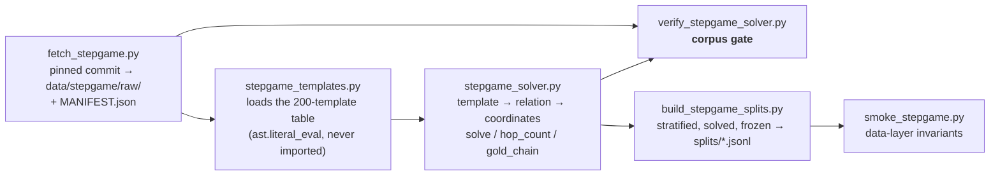

# StepGame — setup, design and plan

The second benchmark. SPaRC is an interactive grid MDP; StepGame is single-turn
text QA, so this document is as much about **generalising the harness** as about
the benchmark itself. Per the thesis proposal the agent "answers in a single turn
on StepGame and LogicGame", which means the seam built here is the one LogicGame
reuses.

Read `docs/architecture.md` first: everything below is expressed as a delta on
the baseline / Reflexion / MemP / MemoryBank design already running on SPaRC.

---

## 1. The benchmark

StepGame (Shi, Zhang & Lipani, AAAI-22) gives a **story** of *k* sentences
describing spatial relations among *k+1* entities in a chain, and asks the
relative position of two of them. The answer is one of **nine labels** —
`above below left right upper-left upper-right lower-left lower-right overlap`.
A `noise` variant adds distractor sentences (disconnected, irrelevant, supporting).

Why it is a good second benchmark here: it is spatial and multi-hop like SPaRC,
but **symbolic and single-turn**, which is exactly the "abstract text-based spatial
reasoning" transfer question the proposal poses. It also has a *train* split, so
the two cross-task methods (MemP, MemoryBank) keep the build/eval structure they
have on SPaRC.

### 1.1 We use the rectified corpus, not the original

Li, Hogg & Cohn (AAAI-24) found **14 of the 214 crowdsourced templates express a
different relation than the label they were generated under**. The corruption is
not uniform — it compounds with *k*, from 7.6% of clean *k*=1 instances to 54.3%
at *k*=10, and 74.2% of noisy *k*=10. On the original data a model is graded
against wrong answers precisely where the benchmark claims to be hardest, so any
"accuracy falls with *k*" result is partly measuring label rot.

Their `correct.py` drops every instance built from an unfixable template. Those
filtered files are what `scripts/fetch_stepgame.py` mirrors.

**Not vendored, fetched.** The upstream repository publishes no LICENSE (verified:
`raw.githubusercontent.com/.../LICENSE` → 404), so redistributing its data or its
template table inside this repo would be a licensing claim we cannot make. We
fetch from a **pinned commit** (`1114cb58`) and record a SHA-256 manifest. Bumping
the pin invalidates every embedding and bank built from the old text, exactly like
changing a key-fn — so it is bumped deliberately, not tracked.

---

## 2. The data layer (built)



| Piece | File | Role |
|---|---|---|
| fetcher | `scripts/fetch_stepgame.py` | mirrors clean+noise × train+test × k=1–10 (164 MB, 41 files) from the pinned commit; SHA-256 manifest |
| template table | `envs/stepgame_templates.py` | loads upstream's `sentence_to_relation` dict with `ast.literal_eval` — never `import`s an unsigned downloaded file; patterns anchored `^…$` so one sentence is exactly one relation |
| solver | `envs/stepgame_solver.py` | `solve` (oracle), `hop_count`, `gold_chain` (hindsight trace), `verify` |
| benchmark module | `envs/stepgame.py` | `StepGameItem`, bAbI reader, `format_item`, `parse_answer`, `is_success`, retrieval keys |
| corpus gate | `scripts/verify_stepgame_solver.py` | exhaustive; exits non-zero on any wrong or undecodable item |
| splits | `scripts/build_stepgame_splits.py` | stratified sample, solved and annotated, frozen to JSONL |
| smoke | `scripts/smoke_stepgame.py` | seconds-long invariants; no GPU, no network |

### 2.1 The solver, and why it is load-bearing

A pure-Python reimplementation of Li et al.'s `Map + ASP`: map each sentence to a
relation with the rectified template table, chain the relations' unit offsets into
coordinates, read off the **sign** of the queried pair's displacement. Their
clingo dependency is dropped — once relations are extracted this is a
breadth-first walk over a graph with ≤ 18 nodes.

It is the oracle we report as an upper bound, the check that our nine label
strings mean what the corpus means by them, and — most load-bearing — **the source
of the gold reasoning chains MemP and MemoryBank distil bank entries from when the
agent itself failed a train item**. A solver that were 99% right would seed roughly
one bank entry in a hundred with a confidently wrong derivation and nothing
downstream would flag it. Hence a gate, not a report.

> **Gate result: 454,625 items — the entire rectified corpus, train and test,
> clean and noise, k=1–10 — 100.0000% correct, 0 undecodable, 0 template misses.**

The gate also re-derives Li et al.'s Table 2 removal percentages from the item
counts on disk and matches all twenty to two decimals. That is the check that we
are reading the *rectified* corpus: the unrectified files have the same names and
parse identically, and being shorter by exactly the published amount is the cheap
way to tell them apart.

A `gold_chain` looks like this — the StepGame analogue of SPaRC's gold solution
path, quoting the sentence behind each hop so a distractor-laden story still yields
a clean trace:

```
Question: where is X relative to G?
Anchor G at (0, 0).
Hop 1: "J is to the top-right of G." => J is upper-right of G => J = (0, 0) + (1, 1) = (1, 1)
Hop 2: "X is at the 6 o'clock position relative to J." => X is below of J => X = (1, 1) + (0, -1) = (1, 0)
X is at (1, 0) and G at (0, 0); the direction of (1, 0) is right.
Answer: right
```

Note the contrast with SPaRC: MemP's SPaRC distill prompt **bans coordinates** from
a procedure (there they were overfitting to one grid). Here the coordinate frame
*is* the method, so the StepGame prompt must invert that rule.

### 2.2 `k` is not the reasoning depth

StepGame builds a chain of *k* relations and then picks the two queried entities
**at random from that chain**, so the hops actually separating them is ≤ *k*. The
original paper says so in passing; nothing downstream of it appears to act on it.
Measured over our clean test split:

| file *k* | 1 | 2 | 3 | 4 | 5 | 6 | 7 | 8 | 9 | 10 |
|---|---|---|---|---|---|---|---|---|---|---|
| mean true hops | 1.00 | 1.34 | 1.70 | 2.03 | 2.38 | 2.53 | 3.06 | 3.38 | 3.47 | 3.70 |
| share solvable in 1 hop | 100% | 66% | 49% | 40% | 34% | 32% | 26% | 24% | 25% | 23% |

Only **182 of 1000** items have `hops == k`. The *k*=10 file averages 3.7 true hops
and 23% of it is one-hop. So every published "accuracy at *k*=10" is accuracy over
a mixture of depths, not a depth — and a per-*k* difficulty breakdown, which the
proposal asks for, would inherit that.

The solver hands us the true hop count for free, so **both axes are available and
both are recorded on every item**. We keep two test splits:

| split | stratified by | n | why |
|---|---|---|---|
| `stepgame_clean_test_k1-10_n1000` | file *k*, 100 each | 1000 | the axis every published StepGame number uses; our results must be comparable to them |
| `stepgame_clean_test_byhops_k1-10_n900` | true hops, 100 each h=1–9 | 900 | the honest difficulty axis for "does memory help more as reasoning deepens?" |

`h=10` is excluded: the whole clean test corpus holds only 78 such items, which is
an underpowered bucket rather than a measurement.

### 2.3 Splits

| split | n | by *k* | by hops |
|---|---|---|---|
| `clean_train_k1-5_n500` | 500 | 100 each, k=1–5 | 288/125/55/26/6 |
| `clean_train_byhops_k1-5_n500` | 500 | 32/54/83/124/207 | 100 each, h=1–5 |
| `clean_test_k1-10_n1000` | 1000 | 100 each, k=1–10 | 406/233/125/91/61/38/23/14/5/4 |
| `clean_test_byhops_k1-10_n900` | 900 | 26…186 | 100 each, h=1–9 |

Frozen, seeded, solver-verified, committed (3 MB). Nothing downstream re-samples:
the baseline, both Reflexion arms and every MemP / MemoryBank eval must score the
**identical** items or the exact-McNemar tests are not paired at all.

Two sizing decisions:

- **Test = 1000.** Li et al. showed 30- and 100-item evaluations of the whole
  benchmark fluctuate enough to invert the ordering between hop levels, while 1000
  gives the clean monotone decay. 100 per bucket is that budget spread so every
  level is separately reportable. Same order as SPaRC's 500-puzzle split.
- **Train = 500**, exactly SPaRC's bank size, from k=1–5. The train/test asymmetry
  (built on k≤5, evaluated on k≤10) is the original StepGame generalization
  protocol and gives us something SPaRC could not: **does memory distilled from
  short chains transfer to chains longer than any it was built on?** Half the test
  set is out of the bank's range by construction.

The **hop-balanced train split exists because the k-stratified one is 58% one-hop**
items — a bank distilled from that is mostly worked examples of a task with no
chaining in it. Which of the two becomes the bank source is an ablation.

**No train/test contamination:** zero shared (story, question) pairs. Worth
checking rather than assuming — *k*=1 admits only ~10,400 distinct stories and the
original paper measured 1.09% leakage there.

---

## 3. The benchmark seam (built)

`src/memory_agents/benchmarks.py` is the seam. A `Benchmark` supplies the handful
of things that differ per task — which items exist, how to run a pass, how to
grade, the retrieval key, the exemplar and verbatim record, and every prompt that
mentions the task — and the four drivers ask it rather than importing SPaRC.

**`SparcBenchmark` forwards to the existing functions rather than reimplementing
them.** `run_sparc_suite_baseline`, `run_sparc_suite_memory_pass` and every string
in `prompts.py` are untouched; the SPaRC path is the same code it always was. That
is why the numbers in `docs/memp.md` and `docs/memorybank.md` stay citable.

| Coupling | Was | Now |
|---|---|---|
| `parse_action` imported from `envs.sparc` | module scope in `agents/base.py` | injected `parse_reply`, SPaRC default resolved lazily |
| gymnasium + `Spatial_Gym` + `datasets` | module scope in `harness/run.py` | inside the SPaRC functions — a StepGame job imports none of it |
| dataset / env / prompt | hardcoded in both suite fns | `Benchmark.run_baseline_suite` / `run_memory_pass` |
| SPaRC prompt calls | direct in 4 drivers | `Benchmark` methods |
| `Distiller` / `CaseDistiller` / `Reflector` | called `prompts.*` | take a `benchmark`; `None` keeps the SPaRC path |
| `summarize_results.py` | SPaRC-only wording | benchmark-aware labels + a `BY HOPS` section |

`summarize_results.py` needed one change after all: the arithmetic is
benchmark-agnostic but the *words* were not — printing "dead end, no legal move"
next to a StepGame format failure describes a failure mode that benchmark does not
have. It now labels the two flags per benchmark, adds a `BY HOPS` section, and
ranks "hardest solved" by hops rather than k (a k=10 item can be one hop). The
SPaRC report is unchanged: still 70/500, 227 truncated, 203 failed at exit.

`run_single_turn_suite` in `harness/run.py` is the new runner: no env pool (there
is no env), a plain semaphore, and the same `EpisodeResult`, token accounting,
format-retry loop and crash handling as the interactive path. LogicGame reuses it.

Episode shape: one `Transition`, `terminated=True` whenever an answer was
submitted, `truncated=True` only on a format failure, `difficulty` = *k*, and the
true hop count plus the gold/predicted labels on `EpisodeResult.extra` — which is
deliberately **not** read by `reflection_context()`.

### 3.1 The gate

`scripts/regress_sparc.py` compares both paths over real puzzles and requires
byte-identical output: system prompts, the reflection prompt, both MemP distill
prompts, both MemoryBank case prompts, all five injected-block granularities, the
key text, the exemplar builders, and the agent's default parser. **It passes.** So
does a real `--phase compare` over the existing gpt-oss-120b results, which
reproduces `docs/memp.md` §3.1 exactly (baseline 70/500, random 87/500).

`scripts/dryrun_stepgame.py` then runs *every phase of every arm* against a mock
model and mock embeddings — baseline, Reflexion root/memory/control/compare, MemP
build/distill/embed/upgrade/eval×3/compare, MemoryBank distill/eval×2/compare — in
about a minute, writing into a scratch directory rather than `results/`. It proves
the plumbing, not that memory helps.

### 3.2 Prompting

`stepgame_system_prompt()` is entirely constant — unlike SPaRC, which must
interpolate a per-puzzle polyshape table — so the whole prompt is a shared KV
prefix under `--enable-prefix-caching`, and only the user message varies.
Anything item-specific added to it would cost that prefix across the whole run.

**Zero-shot**, matching the SPaRC protocol, and because few-shot examples are
themselves injected memory: including them would put a hand-written memory in
*every* arm including the memoryless baseline. Stated cost: our numbers are not
directly comparable to Li et al.'s, which are 5- and 10-shot.

`parse_answer` takes the **last** `Final:` marker (a thinking model floats
candidates mid-reasoning) and accepts synonyms — a reply saying "north-west" has
reasoned correctly, and grading it wrong would measure instruction-following.

---

## 4. The three memory arms (wired)

All three run through `--benchmark stepgame` on the existing drivers, and through
`BENCHMARK=stepgame` on `serve_and_run.sbatch`.

### 4.1 Reflexion (episodic)

`run_reflexion.py`, phases unchanged. New reflection prompt and a single-turn
`reflection_context`. 10 trials as on SPaRC, for cross-benchmark comparability and
~15× cheaper here.

> **The reflector never sees the gold label.** It gets the story, the question, its
> own answer and reasoning, and a binary "incorrect" — Reflexion's own HotpotQA
> signal. A leak makes the arm trivially 100%. Enforced in three layers: the
> reflector is handed an `EpisodeResult` rebuilt from `reflection_context()`, which
> has no gold field; `smoke_stepgame.py` asserts the rendered prompt contains
> neither the worked chain nor an asserted answer; and the prompt's own docstring
> says so for whoever edits it next.

The **control arm matters more here than on SPaRC**: nine labels means a ~11%
chance floor, so resampling at temp 0.6 converts failures fast and the cumulative
curve slopes up on its own.

### 4.2 MemP (procedural)

Five phases carried over. Two deliberate divergences from SPaRC:

| | SPaRC | StepGame |
|---|---|---|
| coordinates in a procedure | **banned** (overfits one grid) | **supplied** — the coordinate frame is the method |
| `--arm fixed` | inert; measured, moved nothing | **the hypothesis** |

The prediction, written down before running it: the optimal StepGame procedure is
item-independent — "map each sentence to a relation, chain source to target, sum
the offsets, read the sign" — so `fixed` should ≈ `retrieved`. If so, procedural
memory here collapses to a single learned algorithm. That is a finding, and a
sharper version of what `docs/memp.md` §3.4 already measured on SPaRC.

`--phase upgrade` and MemoryBank's `attach_records` need no env: the verbatim
record is the question plus the solver's worked derivation, built directly.

### 4.3 Retrieval keys, and how degenerate they are

Two keys, as an ablation, because StepGame poses a retrieval question SPaRC did not:

- `stepgame-key-v1` (**structural**): `hops / sentences / unused`, the ordered
  relation chain, a sorted census. Entity letters excluded — sampled uniformly from
  26 capitals, so keying on them matches noise.
- `stepgame-key-lex-v1` (**lexical**): the story with entities anonymised, wording
  kept. Li et al. traced most residual parser error to a few oblique phrasings, so
  which *templates* an item uses is plausibly the better signal.

The dry run surfaced something worth knowing before any GPU time is spent:

| split | distinct structural keys | largest bucket | distinct lexical keys |
|---|---|---|---|
| train, k-stratified (500) | 370 | **19** | 489 |
| train, hop-stratified (500) | **465** | 6 | 499 |
| test, k-stratified (1000) | 876 | 16 | 987 |

The structural key is **degenerate**: every one-hop, one-sentence item with the
same relation renders an identical key, which is 130 of 500 items in the
k-stratified train split. Consequences, all handled:

- The embed phase's alignment check had to be relaxed from "each key is its own
  top-1 neighbour" to "nothing is *strictly* closer to a key than itself" —
  identical keys give identical vectors, and the old check would have failed a
  correctly-built `.npz`. Duplicate counts are now logged per split.
- Retrieval among a tied bucket falls to the id tie-break. That is defensible —
  structurally identical items *are* interchangeable for procedural memory — but it
  bounds how much retrieval can discriminate, which is worth stating when
  `retrieved` ≈ `random`.
- It is a third argument for the **hop-stratified train split** as the bank source
  (465/500 distinct, largest bucket 6), alongside its better hop balance.

### 4.4 MemoryBank (declarative)

Reuses MemP's build output and embeddings, as on SPaRC. `case_note` (LLM) +
verbatim record (code: question + worked chain) + compact exemplar. The
`--rules-preamble` ablation carries over, with the relation/offset table standing
in for SPaRC's rulebook.

---

## 5. Cost, and what it buys

One call per item against SPaRC's ~15 steps: a full 1000-item test pass is roughly
**20 minutes**, not two hours. The entire StepGame campaign across all three models
(Qwen3-0.6B, Qwen3-32B, gpt-oss-120b) costs less than one SPaRC arm did — which is
what pays for the ablations above.

## 6. Risks

1. **Ceiling and floor.** gpt-oss-120b may already be near-ceiling at low hop
   counts and Qwen3-0.6B at chance everywhere; memory is unmeasurable in both.
   Check at the baseline gate *before* committing GPU to all three models. The
   informative band is h ≥ 4.
2. **The chance floor is ~11%, not 0.** Unlike SPaRC, where a random path never
   solves, a lucky-wrong answer is common. Report against the floor, and lean on
   the exact-McNemar stack rather than raw deltas.
3. **Answer leakage in Reflexion** — the single biggest correctness risk.
   Closed structurally and asserted; see §4.1. Re-read that box before editing
   `stepgame_reflection_prompt`.
4. **Retrieval-key degeneracy** — measured, handled, and a live caveat on any
   `retrieved ≈ random` result. See §4.3.
5. **Clean/noise pairing.** The two variants share underlying chains, but
   `correct.py` removes different items from each, so pairing by file position is
   invalid. Pair by content or treat noise as an independent sample — **still to
   verify** before promising a paired robustness test.
6. **Pre-`retry_tokens` baselines.** The four `baseline_qwen_test_*.json` files
   predate the field and crash `--phase compare`. Pre-existing, not introduced by
   the refactor (confirmed by stashing it); the campaigns use a Reflexion root as
   the baseline, which defaults the field. Worth a one-line fix if those old files
   are ever needed.

## 7. Status

| Milestone | State |
|---|---|
| 1. corpus, solver, splits | **done** — gate passes at 454,625/454,625 |
| 2. harness seam + StepGame arms + SPaRC regression | **done** — all four gates pass |
| 3. baseline × 3 models | ready to submit |
| 4. Reflexion (+ control) | ready to submit |
| 5. MemP build/distill/embed/upgrade/eval | ready to submit |
| 6. MemoryBank distill/eval | ready to submit |
| 7. noise + generalization analysis | — |

### Setting up (once, no GPU)

```bash
python scripts/fetch_stepgame.py            # 164 MB from the pinned commit
python scripts/verify_stepgame_solver.py    # the corpus gate
python scripts/build_stepgame_splits.py     # the four frozen splits
```

### The four gates (no GPU)

```bash
python scripts/smoke_stepgame.py           # data + prompt invariants, incl. the no-leak rule   (~2 s)
python scripts/regress_sparc.py            # SPaRC prompts byte-identical to pre-refactor      (~20 s)
python scripts/dryrun_stepgame.py          # every phase of every arm, against a mock model    (~60 s)
python scripts/verify_stepgame_solver.py   # the whole 454k-item corpus                        (~5 min)
```

The first three are what you run after touching anything; the corpus gate only
needs re-running when the fetch pin or the solver changes.

### Running the campaign

`BENCHMARK=stepgame` on any driver; `serve_and_run.sbatch` carries worked submit
lines for the whole dependency chain. In order: baseline → Reflexion root → the two
Reflexion arms → MemP build → distill → embed → upgrade → the eval arms →
MemoryBank distill → its eval arms → the two `compare` phases.

Point `STEPGAME_TEST` at the `*_byhops_*` split for the difficulty analysis, and
`KEY_VARIANT=lexical` for the retrieval-key ablation — it must match between the
embed job and the evals that read its `.npz`, and the driver refuses the pair if
it does not.
